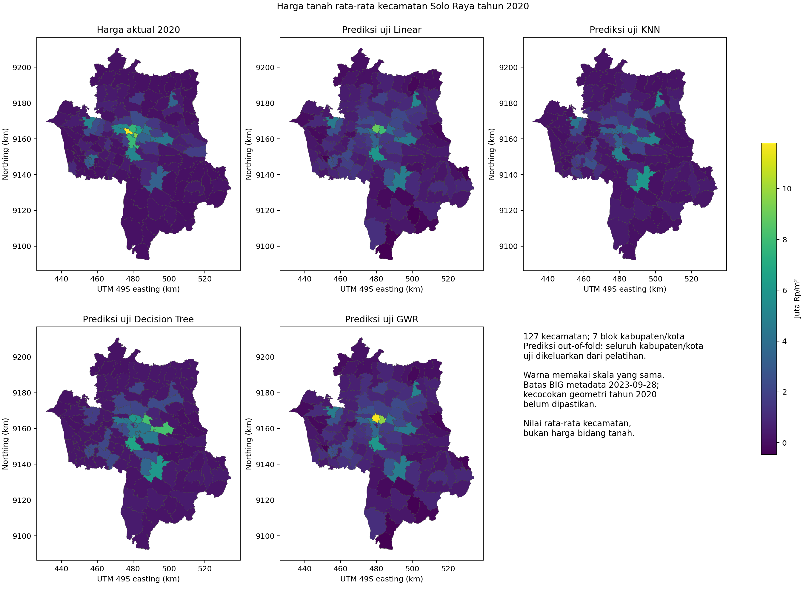
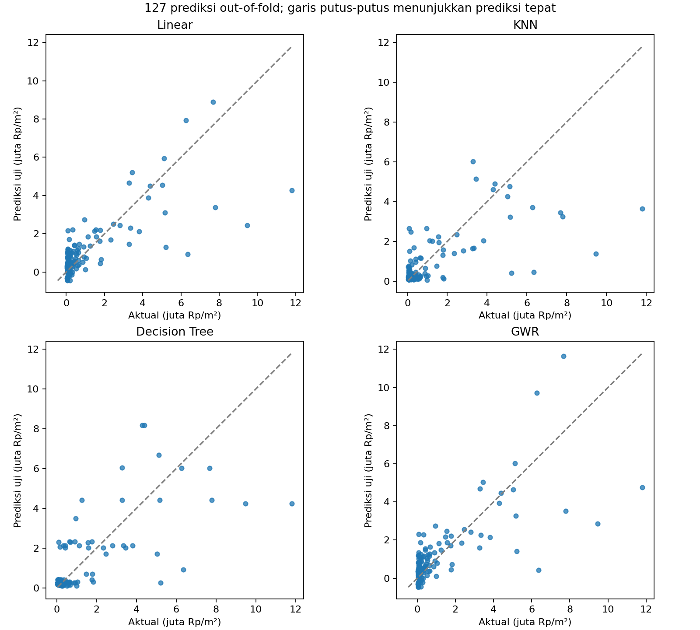

# Estimasi Harga Tanah Rata-Rata Kecamatan di Solo Raya Tahun 2020: Perbandingan Geographically Weighted Regression dan Model Nonspasial dengan Validasi Lintas Kabupaten/Kota

## Abstrak

Penelitian ini mengevaluasi manfaat pembobotan geografis untuk memperkirakan harga tanah rata-rata kecamatan pada kabupaten/kota yang tidak dilibatkan dalam pelatihan. Dataset mencakup 127 kecamatan di tujuh kabupaten/kota Solo Raya tahun 2020, dengan jumlah penduduk dan jumlah fasilitas umum regional sebagai prediktor. Geographically Weighted Regression (GWR) Gaussian dibandingkan dengan regresi linear, K-Nearest Neighbors (KNN), dan Decision Tree menggunakan tujuh lipatan luar leave-one-kabupaten/kota-out. Standardisasi dan pemilihan parameter dilakukan pada bagian latih melalui validasi internal antarkabupaten/kota. Koordinat dihitung sebagai point-on-surface dari poligon kecamatan BIG dan digunakan untuk menghitung jarak haversine. KNN menghasilkan MAE terendah sebesar Rp732.073/m², sedangkan regresi linear menghasilkan RMSE terendah sebesar Rp1.355.435/m². GWR menghasilkan MAE Rp802.227/m² dan RMSE Rp1.409.692/m². Dengan demikian, pembobotan geografis pada spesifikasi yang diuji belum memberi keunggulan konsisten. Seluruh model menghasilkan 127 prediksi uji dan hasilnya dapat direproduksi melalui pipeline modular. Interpretasi dibatasi pada rata-rata kecamatan tahun 2020, dengan ketidakpastian definisi harga sumber serta kesesuaian batas historis yang masih perlu dikonfirmasi.

Kata kunci: harga tanah; GWR; KNN; validasi spasial; Solo Raya; kecamatan.

## 1. Pendahuluan

Harga tanah memiliki variasi spasial yang dapat berkaitan dengan karakter penduduk, aksesibilitas, fasilitas, dan intensitas pembangunan wilayah. Dalam dataset penelitian, harga tanah rata-rata Kecamatan Laweyan mencapai Rp11.800.794/m², sedangkan Kecamatan Jebres Rp6.269.466/m². Perbedaan tersebut mengilustrasikan heterogenitas harga bahkan di dalam Kota Surakarta. Pertanyaan yang dikaji adalah apakah karakteristik wilayah dan kedekatan geografis dapat digunakan untuk memperkirakan harga rata-rata kecamatan di wilayah administratif yang tidak dilibatkan dalam pelatihan.

Aziz, Rahayu, dan Istanabi (2023) mengkaji struktur pusat aktivitas Surakarta Raya melalui karakteristik penggunaan lahan, harga lahan, penduduk, dan fasilitas umum. Penelitian tersebut memberi konteks regional, tetapi menggunakan analisis klaster dan bukan evaluasi prediksi lintas kabupaten/kota. Selain itu, jumlah penduduk pada eksperimen ini berbeda dari konsep kepadatan penduduk yang digunakan dalam kajian pusat aktivitas.

Saefuddin dkk. (2012) mengkaji harga tanah Tangerang Selatan melalui OLS dan GWR, dengan akses terhadap jalan dan fasilitas sebagai variabel relevan. Syahar dkk. (2020) membahas keterkaitan nilai tanah dengan pusat kegiatan, fasilitas, penggunaan lahan, dan bencana pada konteks Padang. Bukti tersebut mendukung pengujian heterogenitas spasial dan pengembangan prediktor, tetapi tidak menjamin hubungan yang sama pada rata-rata kecamatan Solo Raya. Perbedaan unit observasi harus diperhatikan ketika mengadaptasi hasil penelitian tingkat bidang atau titik menjadi model tingkat wilayah.

GWR memungkinkan koefisien hubungan prediktor dengan target berubah menurut lokasi (Brunsdon dkk., 1996). Namun, fleksibilitas lokal tidak dengan sendirinya menjamin prediksi yang lebih baik pada wilayah baru. Penelitian ini membandingkan GWR dengan regresi linear, KNN, dan Decision Tree pada prediktor serta pembagian data yang sama. Evaluasi menahan satu kabupaten/kota penuh agar tujuan pengujian sesuai dengan penggunaan model pada kelompok wilayah yang tidak dilibatkan dalam pelatihan.

Kontribusi penelitian adalah evaluasi prediksi lintas tujuh kabupaten/kota dengan pemilihan parameter di dalam data latih, audit pemadanan data harga dengan geometri kecamatan, serta penyediaan kode, prediksi uji, dan catatan parameter yang dapat direproduksi. Penelitian tidak berangkat dari asumsi bahwa GWR harus menjadi model terbaik.

## 2. Data dan Wilayah Penelitian

### 2.1. Cakupan dan sumber data

Wilayah penelitian meliputi Kota Surakarta serta Kabupaten Boyolali, Karanganyar, Klaten, Sragen, Sukoharjo, dan Wonogiri. Dataset merupakan transkripsi Lampiran A penelitian Salim Aziz di Repositori UNS. Satu baris menyatakan satu kecamatan pada tahun 2020. Kolom halaman_lampiran memungkinkan penelusuran kembali ke halaman tabel asal. Dataset yang digunakan memuat 127 pasangan unik kabupaten/kota–kecamatan.

| Kabupaten/kota | Jumlah kecamatan |
| --- | --- |
| Kabupaten Boyolali | 22 |
| Kabupaten Karanganyar | 17 |
| Kabupaten Klaten | 26 |
| Kabupaten Sragen | 20 |
| Kabupaten Sukoharjo | 12 |
| Kabupaten Wonogiri | 25 |
| Kota Surakarta | 5 |

Target diperlakukan mengikuti label sumber sebagai harga tanah rata-rata per meter persegi. Dataset belum dapat diklaim sebagai pengumpulan langsung transaksi tanah. Jenis harga, metode penghitungan rata-rata, distribusi sampel, dan sumber primer setiap kolom masih perlu dikonfirmasi terhadap dokumen sumber. Seluruh angka belum diaudit ulang satu per satu terhadap lampiran pada pengembangan program ini.

### 2.2. Variabel yang benar-benar diuji

| Komponen | Kolom | Definisi |
| --- | --- | --- |
| Target | harga_tanah_rata_rata_rp_m2 | Harga rata-rata kecamatan 2020, Rp/m² |
| Prediktor | jumlah_penduduk | Jumlah penduduk, jiwa |
| Prediktor | jumlah_fasum_regional | Jumlah fasilitas umum regional |
| Lokasi GWR | lat, lon | Titik representatif WGS84 |
| Kelompok | kab_kota | Blok validasi dan uji |

Jumlah penduduk dan fasilitas digunakan karena tersedia bersama target pada tabel sumber. Jumlah penduduk mewakili ukuran populasi, sedangkan jumlah fasilitas menggambarkan layanan regional menurut klasifikasi sumber. Penggunaan keduanya bersifat prediktif; tidak dimaksudkan mengidentifikasi dampak kausal. Kategori fasilitas perlu dipastikan sebelum replikasi dengan sumber lain. Tidak ada prediktor kepadatan penduduk, akses jalan, atau permukaan terbangun dalam hasil eksperimen yang dilaporkan pada bagian 4.

Harga target minimum 40.187, median 200.965, rata-rata 1.114.505, dan maksimum 11.800.794 Rp/m². Statistik ini bersifat deskriptif dan tidak digunakan untuk memasang standardisasi pada data uji.

### 2.3. Geometri dan penentuan koordinat

Geometri berasal dari arsip BIG KSP Satu Peta, layer Peta Wilayah Administrasi Kecamatan. Ekspor Jawa Tengah memuat 576 kecamatan. Sebanyak 127 kecamatan penelitian dipilih melalui pasangan nama kabupaten/kota dan kecamatan. Dua padanan eksplisit digunakan: Kebakkramat pada BIG dengan Kebakramat pada CSV, serta Sidoharjo pada BIG dengan Sidoarjo pada CSV. Nama CSV dipertahankan. Padanan Sidoarjo–Sidoharjo masih memerlukan konfirmasi ke lampiran harga meskipun tidak ada benturan kunci dalam pemetaan.

Poligon diproyeksikan ke UTM 49S (EPSG:32749), digabungkan per kecamatan, dan diwakili satu titik melalui ST_PointOnSurface. Titik kemudian ditransformasikan kembali ke WGS84 (EPSG:4326). Koordinat ditentukan oleh geometri, bukan oleh nilai harga. Titik ini bukan jaminan lokasi kantor kecamatan, pusat penduduk, pusat perdagangan, atau titik transaksi.

Harga merupakan atribut wilayah kecamatan. Misalnya, nilai Banjarsari Rp7.678.425/m² tidak berarti harga bidang tepat pada koordinat representatifnya memiliki nilai tersebut. Koordinat digunakan untuk mengukur kedekatan antarkecamatan dalam GWR. Titik yang berada di dalam wilayah tidak otomatis merepresentasikan distribusi sampel pembentuk harga rata-rata.

Audit menghasilkan 127 padanan berkode unik dan 127 titik di dalam poligon masing-masing; jarak minimum titik ke batas sekitar 383,02 meter. Peta audit turut tersedia. Metadata fitur arsip BIG berpenanda 20230928, sedangkan deskripsi layanan menyebut edisi 2022. Kesamaan batas dengan tahun 2020 belum dibuktikan untuk seluruh kecamatan. Status ini membatasi interpretasi hasil spasial sebagai eksperimen dengan proksi geometri administratif yang lebih baru.

## 3. Metode Penelitian

### 3.1. Protokol evaluasi dan pencegahan kebocoran data

Evaluasi menggunakan tujuh lipatan luar leave-one-kabupaten/kota-out. Satu kabupaten/kota menjadi data uji dan enam lainnya menjadi data latih. Setiap kecamatan mendapat tepat satu prediksi uji per model. Rancangan kelompok dipilih untuk menilai kemampuan generalisasi ke wilayah administratif yang belum dilatih, sejalan dengan pertimbangan evaluasi data berstruktur dalam Roberts dkk. (2017).

Pada masing-masing lipatan luar, parameter dipilih melalui enam lipatan dalam berdasarkan kabupaten/kota pada bagian latih. Dalam setiap lipatan dalam, lima wilayah menjadi data fit dan satu menjadi validasi. Kriteria pemilihan adalah MAE gabungan semua observasi validasi, bukan rata-rata sederhana MAE wilayah. Bila nilai kriteria sama, kandidat pertama pada urutan grid dipilih. Model dengan parameter terpilih dilatih kembali menggunakan seluruh enam wilayah latih untuk memprediksi wilayah uji luar.

StandardScaler dipasang hanya pada bagian latih setiap pemanggilan model, termasuk pada validasi internal. Nilai target wilayah uji luar tidak digunakan untuk memilih parameter, menghitung standardisasi, atau mengestimasi koefisien. Koordinat wilayah uji digunakan untuk menghitung jaraknya ke lokasi latih, sebagaimana lokasi tujuan prediksi diketahui.

### 3.2. Regresi linear dan Decision Tree

Regresi linear mengestimasi satu intersep dan dua koefisien global. Decision Tree menggunakan pemisahan prediktor berdasarkan ambang nilai, dengan kandidat kedalaman maksimum 2, 4, dan 6; min_samples_leaf=3; serta random_state=124. Keduanya menerima dua prediktor yang sama dengan model lain. Tidak ada pemotongan prediksi negatif setelah estimasi.

### 3.3. K-Nearest Neighbors

KNN menggunakan jarak Euclidean pada ruang dua prediktor yang distandardisasi. Kandidat jumlah tetangga adalah 3, 7, dan 15, dengan bobot invers jarak melalui weights='distance'. Kedekatan pada KNN menyatakan kemiripan atribut, bukan kedekatan geografis. Prediksi merupakan rata-rata berbobot target tetangga; implementasi menangani tetangga berjarak nol sesuai KNeighborsRegressor.

> ŷ(x) = Σᵢ∈Nₖ₍ₓ₎ wᵢyᵢ / Σᵢ∈Nₖ₍ₓ₎ wᵢ

### 3.4. Geographically Weighted Regression

GWR membentuk regresi lokal untuk lokasi uji s menggunakan seluruh observasi latih dan bobot yang menurun menurut jarak. Model menggunakan intersep serta dua prediktor terstandardisasi.

> ŷ(s) = β̂₀(s) + β̂₁(s)x₁(s) + β̂₂(s)x₂(s)

> β̂(s) = arg minᵦ Σᵢ∈T wᵢ(s)[yᵢ − b₀ − b₁xᵢ₁ − b₂xᵢ₂]²

> wᵢ(s) = exp[−dᵢ(s)² / (2h²)]

T merupakan himpunan observasi latih. Jarak d dihitung menggunakan haversine dengan radius bumi 6371,0088 km. Kandidat bandwidth Gaussian tetap adalah 5, 10, 20, dan 40 km. Penyelesaian kuadrat terkecil menggunakan akar bobot; normalisasi log-bobot menghindari underflow tanpa mengubah solusi optimum akibat pengalian semua bobot dengan konstanta positif yang sama.

Rank desain berbobot diperiksa pada setiap regresi lokal. Kandidat yang singular pada salah satu validasi internal ditolak dan dicatat. Jika semua kandidat gagal, eksperimen dihentikan. Singularitas pada prediksi uji luar juga menghentikan eksperimen. Tidak diterapkan ridge atau penggantian model secara diam-diam. Prosedur tersebut mempertahankan keterlacakan kegagalan numerik.

### 3.5. Metrik dan verifikasi

MAE, RMSE, dan R² dihitung atas prediksi out-of-fold. MAE memberi bobot yang sama untuk setiap kecamatan, sedangkan RMSE lebih peka terhadap kesalahan besar. R² gabungan menggunakan rata-rata target seluruh 127 kecamatan.

> MAE = (1/n) Σᵢ |yᵢ − ŷᵢ|

> RMSE = √[(1/n) Σᵢ (yᵢ − ŷᵢ)²]

> R² = 1 − Σᵢ (yᵢ − ŷᵢ)² / Σᵢ (yᵢ − ȳ)²

Verifikasi memeriksa kesamaan kunci dan nilai sumber, 127 prediksi finite setiap model, tujuh blok, 28 baris hasil wilayah, dan menghitung ulang MAE/RMSE gabungan serta setiap wilayah. R² gabungan juga dihitung ulang. Catatan audit memeriksa kesesuaian wilayah latih dan kunci uji. Prediksi sebelum dan setelah refaktor dibandingkan dengan toleransi numerik ketat; parameter, skor seleksi internal, dan pembagian wilayah harus tetap sama.

## 4. Hasil Eksperimen

### 4.1. Kinerja gabungan

| Model | MAE (Rp/m²) | RMSE (Rp/m²) | R² |
| --- | --- | --- | --- |
| Linear | 739.020 | 1.355.435 | 0,557 |
| KNN | 732.073 | 1.530.233 | 0,435 |
| Decision Tree | 756.462 | 1.449.369 | 0,493 |
| GWR | 802.227 | 1.409.692 | 0,521 |

KNN memberi MAE terbaik, sedangkan regresi linear memberi RMSE terbaik. MAE GWR sekitar 9,58% lebih tinggi daripada KNN, tetapi RMSE GWR sekitar 7,88% lebih rendah. Perbedaan peringkat menunjukkan bahwa model dengan galat absolut rata-rata terkecil tidak selalu paling baik dalam mengurangi kesalahan besar. GWR belum mengungguli regresi linear pada MAE maupun RMSE gabungan. Ketiga baseline cocok dengan acuan pembulatan MAE: Linear Rp739.020/m², KNN Rp732.073/m², dan Decision Tree Rp756.462/m².

### 4.2. Kinerja per kabupaten/kota

| Wilayah | n | Linear | KNN | Tree | GWR |
| --- | --- | --- | --- | --- | --- |
| Kabupaten Boyolali | 22 | 311.864 | 328.378 | 462.846 | 346.913 |
| Kabupaten Karanganyar | 17 | 638.761 | 705.239 | 1.133.978 | 633.155 |
| Kabupaten Klaten | 26 | 641.869 | 621.293 | 546.210 | 700.620 |
| Kabupaten Sragen | 20 | 574.464 | 454.792 | 427.748 | 641.662 |
| Kabupaten Sukoharjo | 12 | 975.563 | 931.183 | 1.201.583 | 966.099 |
| Kabupaten Wonogiri | 25 | 535.644 | 337.491 | 374.437 | 555.042 |
| Kota Surakarta | 5 | 4.571.968 | 5.779.800 | 4.014.822 | 5.393.705 |

Seluruh MAE pada tabel dalam Rp/m²; n adalah jumlah kecamatan uji.

GWR memiliki MAE lebih kecil daripada regresi linear pada Karanganyar dan Sukoharjo, serta lebih kecil daripada KNN pada Karanganyar dan Surakarta. Dengan demikian, peningkatan lokal tidak merata. Seluruh wilayah tetap disertakan pada hasil gabungan.

Surakarta hanya memuat lima kecamatan, tetapi memiliki MAE GWR 5.393.705 dan KNN 5.779.800 Rp/m². Lima kecamatan ini menyumbang sekitar 61.7% jumlah kuadrat galat GWR dan 64.1% jumlah kuadrat galat KNN. Besarnya galat Surakarta membantu menjelaskan perbedaan peringkat MAE dan RMSE. Ini merupakan diagnostik setelah evaluasi; wilayah tersebut tidak dikeluarkan dari perhitungan atau digunakan untuk menyetel ulang model.

### 4.3. Parameter terpilih dan perilaku prediksi

| Wilayah uji | k KNN | Kedalaman Tree | Bandwidth GWR (km) |
| --- | --- | --- | --- |
| Kabupaten Boyolali | 15 | 4 | 40 |
| Kabupaten Karanganyar | 15 | 4 | 40 |
| Kabupaten Klaten | 7 | 2 | 40 |
| Kabupaten Sragen | 7 | 2 | 40 |
| Kabupaten Sukoharjo | 15 | 2 | 40 |
| Kabupaten Wonogiri | 15 | 4 | 40 |
| Kota Surakarta | 15 | 4 | 10 |

Bandwidth 40 km terpilih pada enam lipatan, sedangkan 10 km terpilih ketika Surakarta menjadi wilayah uji. Karena enam lipatan memilih ujung atas grid, hasil ini belum membuktikan bahwa bandwidth optimal berada dalam rentang yang dicoba. Grid yang lebih luas dapat menjadi eksperimen lanjutan dengan pemilihan parameter tetap dilakukan di dalam data latih.

| Model | Jumlah prediksi negatif |
| --- | --- |
| Linear | 17 |
| KNN | 0 |
| Decision Tree | 0 |
| GWR | 15 |

Tidak ditemukan singularitas pada kandidat bandwidth dan pembagian data yang diuji. Keberhasilan numerik tersebut tidak berarti prediksi selalu layak secara ekonomi. Prediksi negatif pada Linear dan GWR merupakan konsekuensi model tanpa kendala nonnegatif. Prediksi itu tidak dipotong agar perbandingan baseline tetap dapat direproduksi. Model log-harga atau model berkendala dapat diuji secara terpisah; hasil dalam paper ini tetap dilaporkan pada spesifikasi asli.

## 5. Pembahasan

Eksperimen ini belum memberikan bukti bahwa pembobotan geografis meningkatkan prediksi secara konsisten ketika seluruh kabupaten/kota dikeluarkan dari pelatihan. Kesimpulan berlaku untuk Gaussian GWR dengan dua prediktor, representasi titik yang dipakai, dan grid bandwidth yang ditentukan. Hasil tersebut bukan penolakan terhadap seluruh pendekatan spasial.

Secara metodologis, validasi wilayah menilai tugas yang lebih spesifik daripada merekonstruksi harga pada lokasi yang ikut dilatih. Nilai kecocokan dalam sampel yang baik tidak menjamin kemampuan prediksi lintas kabupaten/kota. Perbandingan dengan studi lain perlu memperhatikan perbedaan unit observasi, variabel, rentang geografis, dan skema validasi, sehingga angka akurasi tidak dibandingkan langsung tanpa konteks.

Dua prediktor yang tersedia belum menangkap seluruh karakter pasar tanah. Jumlah penduduk tidak sama dengan kepadatan, sedangkan jumlah fasilitas tidak menunjukkan jarak, kualitas, kapasitas, atau akses jaringan. Penelitian terdahulu memberi dasar untuk memperluas informasi, tetapi seluruh prediktor tambahan harus memiliki definisi dan tahun yang sesuai. Mengulang satu nilai PDRB kabupaten pada semua kecamatan, misalnya, tidak menjadikannya ukuran ekonomi kecamatan.

Representasi satu titik untuk wilayah luas juga menyederhanakan variasi spasial internal. Titik administratif tidak ditentukan berdasarkan distribusi transaksi. Bila hasil sangat berubah ketika representasi titik diganti, ketidakpastian tersebut harus dibahas, bukan memilih titik yang semata-mata memberi skor terbaik pada uji luar.

Selisih skor yang dilaporkan bersifat deskriptif. Belum dilakukan uji signifikansi perbedaan model, interval ketidakpastian berbasis blok, atau pengujian autokorelasi residual. Penelitian berfokus pada prediksi, sehingga koefisien atau korelasi tidak ditafsirkan sebagai dampak kausal.

## 6. Keterbatasan dan Pengembangan Lanjutan

Keterbatasan utama adalah definisi harga dan pembentuk rata-ratanya belum sepenuhnya diaudit, geometri BIG lebih baru daripada tahun data, dan padanan Sidoarjo–Sidoharjo memerlukan konfirmasi sumber harga. Kesamaan nama dan keberadaan titik di dalam poligon tidak membuktikan kesamaan batas tahun 2020. Seluruh hasil tetap dibatasi pada rata-rata kecamatan tahun 2020.

Pengembangan yang direncanakan mencakup penggantian jumlah penduduk dengan kepadatan penduduk, kemudian penambahan akses pusat kegiatan, akses jalan utama, dan proporsi permukaan terbangun. Sumber calon meliputi BPS/SP2020, publikasi dalam angka dengan tahun tabel yang diperiksa, dokumen perencanaan yang berlaku, arsip jaringan jalan, serta GHSL GHS-BUILT-S epoch 2020. Produk GHSL mengukur permukaan terbangun dan tidak boleh otomatis disebut luas kawasan permukiman. Data tersebut belum menjadi bagian hasil pada bagian 4.

| Tahap | Spesifikasi | Status |
| --- | --- | --- |
| A | Jumlah penduduk + fasilitas regional | Sudah dijalankan; hasil paper ini |
| B | Kepadatan penduduk + fasilitas regional | Belum diuji |
| C | B + akses pusat kegiatan + akses jalan + proporsi terbangun | Data belum lengkap; belum diuji |
| D | Variabel C dengan alternatif titik representatif | Belum diuji |

Pusat kegiatan harus ditetapkan dari dokumen independen, bukan dari harga tanah tertinggi. Untuk menguji efek representasi lokasi saja, prediktor aksesibilitas dipertahankan saat titik pembobotan GWR diganti. Jika aksesibilitas turut dihitung ulang, perubahan tersebut dilaporkan sebagai skenario gabungan. Penambahan variabel perlu mempertimbangkan kolinearitas serta jumlah observasi efektif pada regresi lokal.

## 7. Kesimpulan

Pada 127 kecamatan Solo Raya tahun 2020, KNN menghasilkan MAE terendah sebesar Rp732.073/m², sedangkan regresi linear menghasilkan RMSE terendah sebesar Rp1.355.435/m². GWR Gaussian menghasilkan MAE Rp802.227/m² dan RMSE Rp1.409.692/m². Pembobotan geografis pada spesifikasi yang diuji belum memberikan keunggulan prediktif konsisten dalam validasi lintas kabupaten/kota.

Eksperimen menghasilkan 127 prediksi uji per model, tujuh lipatan per model, dan 28 baris evaluasi wilayah. Hasil tetap konsisten setelah kode dimodularisasi. Pengembangan berikutnya perlu mengutamakan audit sumber harga dan batas historis, penambahan prediktor yang terukur, serta pengujian sensitivitas koordinat dan bandwidth. Kesimpulan tidak digunakan untuk harga bidang tanah atau prediksi harga tahun berjalan.

## 8. Ketersediaan Kode, Data, dan Reproduksi

Repository penelitian: https://github.com/sqiftree/LandPredict. Kode disusun dalam package tanah: config untuk konfigurasi, data untuk validasi input, models untuk estimator, selection untuk validasi internal, experiment untuk orkestrasi, verification untuk pemeriksaan hasil, coordinates dan spatial_audit untuk geometri, reporting dan diagnostics untuk artefak paper, serta provenance untuk hash dan lingkungan. Skrip CLI lama tetap tersedia sebagai adapter.

Tiga keluaran utama adalah metrik.csv, per_wilayah.csv, dan prediksi_uji.csv. Catatan audit menyimpan versi pustaka, hash sumber, grid parameter, skor validasi internal, dan lipatan. Folder artifacts menyimpan hasil acuan yang dapat dibandingkan dengan eksekusi ulang. Geometri diarsipkan dalam gzip beserta hash untuk dekompresi tanpa jaringan. Tanggal pengambilan arsip mengikuti catatan sesi sebelumnya dan belum didukung log unduhan bertimestamp yang independen.

Lingkungan uji menggunakan Python 3.12 dan dependensi yang dicatat pada hasil/requirements-resolved.txt. Reproduksi dijalankan dengan python scripts/reproduce.py setelah dependensi Python dan GDAL tersedia, atau melalui container Docker sesuai README. Pipeline memulihkan geometri, menghitung ulang titik, menjalankan baseline dan GWR, memverifikasi hasil, lalu membuat peta dan diagnostik. Pipeline berhenti ketika pemeriksaan gagal.

## Referensi

Aziz, S. (t.t.). Potensi Struktur Ruang Wilayah Polisentris. Repositori UNS, Lampiran A. Tahun publikasi perlu dikonfirmasi; 2020 merupakan tahun data. https://digilib.uns.ac.id/dokumen/download/111483/NzEwODU3/Potensi-Struktur-Ruang-Wilayah-Polisentris-Lampiran_Salim-Aziz.pdf

Aziz, S., Rahayu, P., & Istanabi, T. (2023). Potensi wilayah perkotaan polisentris pada Surakarta Raya ditinjau dari perspektif pusat aktivitas. Jurnal Pengembangan Kota, 11(2), 140–154. https://doi.org/10.14710/jpk.11.2.140-154

Badan Informasi Geospasial. (t.t.). Peta Wilayah Administrasi Kecamatan, KSP Satu Peta, layer 3. Metadata diperiksa ulang 17 November 2026. https://kspservices.big.go.id/satupeta/rest/services/PUBLIK/BATAS_WILAYAH/MapServer/3

Brunsdon, C., Fotheringham, A. S., & Charlton, M. E. (1996). Geographically weighted regression: A method for exploring spatial nonstationarity. Geographical Analysis, 28(4), 281–298. https://doi.org/10.1111/j.1538-4632.1996.tb00936.x

European Commission, Joint Research Centre. GHS-BUILT-S R2023A: Built-up surface grid. Kandidat sumber variabel pengembangan; belum digunakan pada hasil baseline. https://human-settlement.emergency.copernicus.eu/ghs_buS2023.php

Pedregosa, F., Varoquaux, G., Gramfort, A., Michel, V., Thirion, B., Grisel, O., … Duchesnay, É. (2011). Scikit-learn: Machine learning in Python. Journal of Machine Learning Research, 12, 2825–2830.

Roberts, D. R., Bahn, V., Ciuti, S., Boyce, M. S., Elith, J., Guillera-Arroita, G., … Dormann, C. F. (2017). Cross-validation strategies for data with temporal, spatial, hierarchical, or phylogenetic structure. Ecography, 40(8), 913–929. https://doi.org/10.1111/ecog.02881

Saefuddin, A., Widyaningsih, Y., Ginting, A., & Mamat, M. (2012). Land price model considering spatial factors. Asian Journal of Mathematics & Statistics, 5, 132–141. https://doi.org/10.3923/ajms.2012.132.141

Syahar, F., Ramadhan, R., & Putri, S. (2020). Statistical interpretation of land value patterns in Padang, Indonesia. International Journal of GEOMATE, 19(72), 109–116. https://geomatejournal.com/geomate/article/view/1136

## Lampiran: Status dan Kontribusi Tim

Naskah ini merupakan draf empiris berdasarkan eksperimen dua prediktor yang telah dijalankan. Bagian pengembangan lanjutan adalah rencana, bukan hasil eksperimen tambahan. Identitas anggota dan kontribusi aktual perlu dilengkapi tim sebelum penyerahan.

| Anggota | Rencana kontribusi; konfirmasi aktual oleh tim |
| --- | --- |
| Yashif Victoriawan (L0124124) | Integrasi program dan reproduksi eksperimen |
| [Nama anggota 2] | Audit sumber harga dan variabel |
| [Nama anggota 3] | Audit geometri dan data tambahan |
| [Nama anggota 4] | Analisis galat dan penulisan pembahasan |
