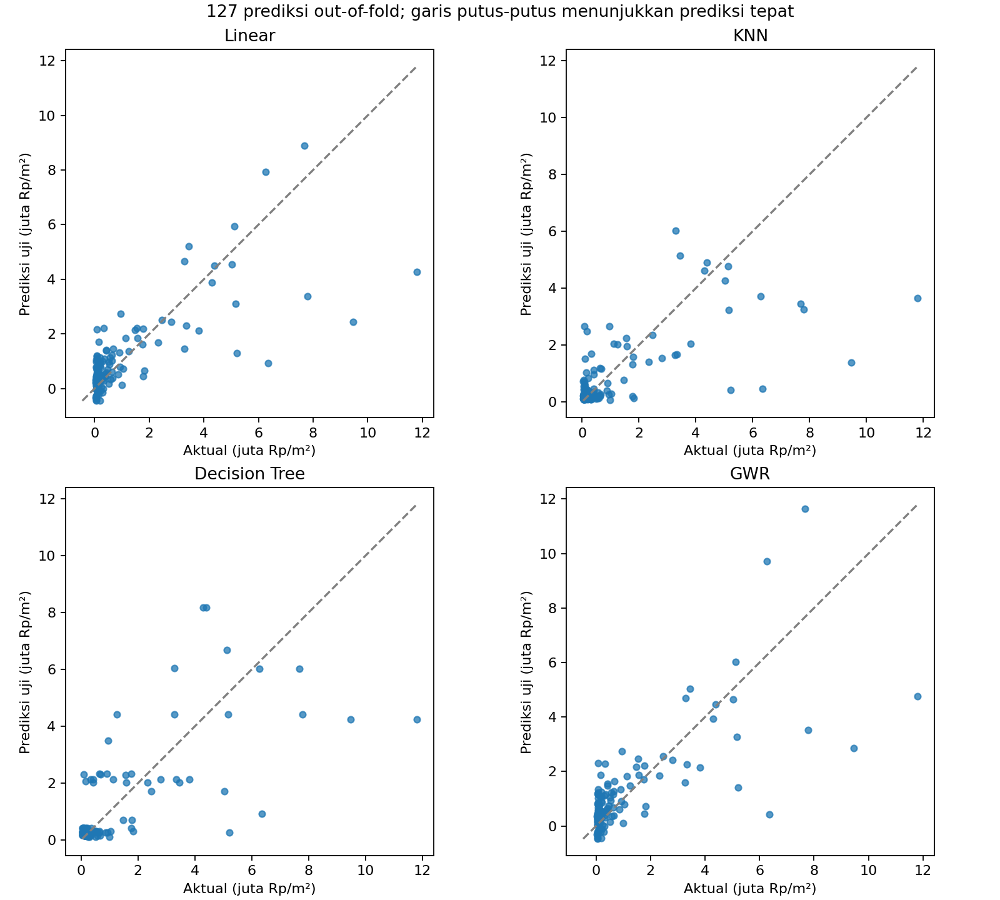
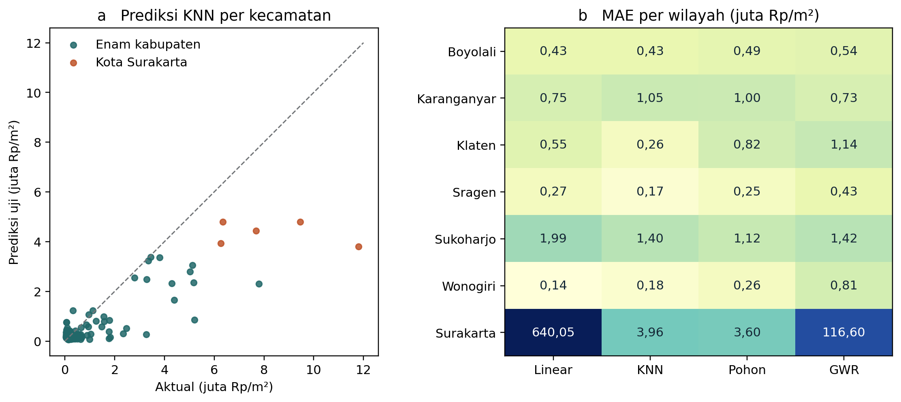

# Estimasi Harga Tanah Rata-Rata Kecamatan di Solo Raya Tahun 2020: Perbandingan Geographically Weighted Regression dan Model Nonspasial dengan Validasi Lintas Kabupaten/Kota

## Abstrak

Penelitian ini mengevaluasi manfaat pembobotan geografis untuk memperkirakan harga tanah rata-rata kecamatan pada kabupaten/kota yang tidak dilibatkan dalam pelatihan. Dataset mencakup 127 kecamatan di tujuh kabupaten/kota Solo Raya tahun 2020, dengan jumlah penduduk dan jumlah fasilitas umum regional sebagai prediktor. Geographically Weighted Regression (GWR) Gaussian dibandingkan dengan regresi linear, K-Nearest Neighbors (KNN), dan Decision Tree menggunakan tujuh lipatan luar leave-one-kabupaten/kota-out. Standardisasi dan pemilihan parameter dilakukan pada bagian latih melalui validasi internal antarkabupaten/kota. Koordinat dihitung sebagai point-on-surface dari poligon kecamatan BIG setelah proyeksi ke UTM 49S dan digunakan untuk menghitung jarak haversine. Pada eksperimen dua prediktor, KNN menghasilkan MAE terendah sebesar Rp732.073/m², sedangkan regresi linear menghasilkan RMSE terendah sebesar Rp1.355.435/m². GWR menghasilkan MAE Rp802.227/m² dan RMSE Rp1.409.692/m². Eksperimen tujuh prediktor menambahkan kepadatan dan tutupan lahan serta memodelkan log-harga. KNN berbobot menghasilkan MAE Rp619.531/m² dan RMSE Rp1.309.859/m². Dengan demikian, pembobotan geografis pada spesifikasi yang diuji belum memberi keunggulan konsisten. Seluruh model menghasilkan 127 prediksi uji dan hasilnya dapat direproduksi melalui pipeline modular. Interpretasi dibatasi pada rata-rata kecamatan tahun 2020, dengan ketidakpastian definisi harga, perbedaan fasum dan penduduk antarsumber, serta kesesuaian batas historis yang masih perlu dikonfirmasi.

Kata kunci: harga tanah; GWR; KNN; validasi spasial; Solo Raya; kecamatan.

## 1. Pendahuluan

Harga tanah memiliki variasi spasial yang dapat berkaitan dengan karakter penduduk, aksesibilitas, fasilitas, dan intensitas pembangunan wilayah. Dalam dataset penelitian, harga tanah rata-rata Kecamatan Laweyan mencapai Rp11.800.794/m², sedangkan Kecamatan Jebres Rp6.269.466/m². Perbedaan tersebut mengilustrasikan heterogenitas harga bahkan di dalam Kota Surakarta. Pertanyaan yang dikaji adalah apakah karakteristik wilayah dan kedekatan geografis dapat digunakan untuk memperkirakan harga rata-rata kecamatan di wilayah administratif yang tidak dilibatkan dalam pelatihan.

Aziz, Rahayu, dan Istanabi (2023) mengkaji struktur pusat aktivitas Surakarta Raya melalui karakteristik penggunaan lahan, harga lahan, penduduk, dan fasilitas umum. Penelitian tersebut memberi konteks regional, tetapi menggunakan analisis klaster dan bukan evaluasi prediksi lintas kabupaten/kota. Selain itu, jumlah penduduk pada eksperimen ini berbeda dari konsep kepadatan penduduk yang digunakan dalam kajian pusat aktivitas.

Berbagai kajian empiris nilai tanah di Indonesia menguatkan peran aksesibilitas, fasilitas pelayanan, dan lingkungan dalam membentuk variasi spasial harga tanah. Saefuddin dkk. (2012) mengkaji harga tanah Tangerang Selatan melalui OLS dan GWR, dengan akses terhadap jalan arteri, gerbang tol, dan fasilitas umum sebagai variabel relevan. Syahar dkk. (2020) membahas keterkaitan nilai tanah dengan pusat kegiatan, fasilitas pelayanan, perubahan penggunaan lahan, dan bencana pada konteks Padang. Pada konteks Jawa Tengah, Arumingtyas, Subiyanto, dan Firdaus (2019) menganalisis pengaruh aksesibilitas serta keberadaan fasilitas umum dan fasilitas sosial terhadap harga bidang tanah di Kelurahan Tlogosari Kulon, Semarang, serta membedakan harga pasar dan Nilai Jual Objek Pajak (NJOP). Sementara itu, Janssen, Mulder, dan Yudhistira (2022) mengkaji pemilahan spasial kelompok pendapatan di Jakarta. Kajian tersebut menjadi konteks struktur perkotaan, bukan bukti langsung bahwa tiap kandidat prediktor meningkatkan akurasi harga tanah Solo Raya. Bukti-bukti tersebut mendukung pengujian heterogenitas spasial dan pengembangan prediktor, tetapi tidak menjamin hubungan yang sama berlaku pada rata-rata kecamatan Solo Raya. Perbedaan unit observasi harus diperhatikan ketika mengadaptasi hasil penelitian tingkat bidang atau titik menjadi model tingkat wilayah.

GWR memungkinkan koefisien hubungan prediktor dengan target berubah menurut lokasi (Brunsdon dkk., 1996). Namun, fleksibilitas lokal tidak dengan sendirinya menjamin prediksi yang lebih baik pada wilayah baru. Penelitian ini membandingkan GWR dengan regresi linear, KNN, dan Decision Tree pada prediktor serta pembagian data yang sama. Evaluasi menahan satu kabupaten/kota penuh agar tujuan pengujian sesuai dengan penggunaan model pada kelompok wilayah yang tidak dilibatkan dalam pelatihan.

Kontribusi penelitian adalah evaluasi prediksi lintas tujuh kabupaten/kota dengan pemilihan parameter di dalam data latih, audit pemadanan data harga dengan geometri kecamatan beserta landasan penentuan titik representatifnya, serta penyediaan kode, prediksi uji, dan catatan parameter yang dapat direproduksi. Penelitian tidak berangkat dari asumsi bahwa GWR harus menjadi model terbaik.

## 2. Data dan Wilayah Penelitian

### 2.1. Cakupan dan sumber data

Wilayah penelitian meliputi Kota Surakarta serta Kabupaten Boyolali, Karanganyar, Klaten, Sragen, Sukoharjo, dan Wonogiri. Dataset merupakan transkripsi Lampiran A penelitian Salim Aziz di Repositori UNS. Satu baris menyatakan satu kecamatan pada tahun 2020. Lokasi sumber telah diperiksa pada halaman PDF 1–4, dengan nomor cetak A-1, A-2, A-3, dan B-1. Label A-4 pada 21 baris CSV lama berbeda dari nomor cetak; tabel perbandingan_halaman.csv dan dataset_2020_rujukan_terverifikasi.csv menyediakan rujukan yang diperbaiki tanpa mengubah angka eksperimen. Dataset yang digunakan memuat 127 pasangan unik kabupaten/kota–kecamatan dengan distribusi wilayah, rata-rata harga tanah, rentang harga, total penduduk, total fasilitas regional, dan total luas poligon sebagai berikut.

| Kabupaten/kota | n | Rata-rata harga (Rp/m²) | Rentang harga (Rp/m²) | Total penduduk | Total fasum | Total luas (km²) |
| --- | --- | --- | --- | --- | --- | --- |
| Kabupaten Boyolali | 22 | 749.194 | 105.400–5.025.000 | 1.062.713 | 9 | 1.095,76 |
| Kabupaten Karanganyar | 17 | 1.509.848 | 145.000–5.214.285 | 938.808 | 13 | 802,38 |
| Kabupaten Klaten | 26 | 631.602 | 45.299–3.811.000 | 1.260.506 | 17 | 700,98 |
| Kabupaten Sragen | 20 | 383.456 | 50.112–3.442.857 | 976.951 | 10 | 993,78 |
| Kabupaten Sukoharjo | 12 | 2.266.921 | 121.534–7.789.431 | 911.966 | 14 | 493,14 |
| Kabupaten Wonogiri | 25 | 261.464 | 40.187–3.285.714 | 1.043.177 | 9 | 1.904,26 |
| Kota Surakarta | 5 | 8.312.399 | 6.269.466–11.800.794 | 522.364 | 26 | 46,68 |

Target diperlakukan mengikuti label sumber sebagai harga tanah rata-rata per meter persegi. Dataset belum dapat diklaim sebagai pengumpulan langsung transaksi tanah. Jenis harga, metode penghitungan rata-rata, distribusi sampel, dan sumber primer setiap kolom masih perlu dikonfirmasi terhadap dokumen sumber. Audit 17 November 2026 mencocokkan 127 kunci dan seluruh 381 nilai pada tiga kolom numerik dengan ekstraksi langsung PDF Lampiran A yang diberikan pengguna. Keempat halaman tabel diperiksa secara visual; hash berkas dan lokasi setiap baris dicatat. Hasil ini memverifikasi transkripsi terhadap dokumen sumber, tetapi belum memvalidasi pengukuran primer. Artikel Aziz dkk. (2023), Gambar 4–5 hlm.147, mengatribusikan harga ke Bhumi ATR-BPN 2020. Dokumentasi resmi BHUMI menyebut Zona Nilai Tanah (ZNT) sebagai salah satu dataset. Namun, audit belum memperoleh arsip layer 2020, atribut layanan historis, atau metode yang menghubungkan zona dengan 127 nilai kecamatan. Karena itu, asal angka tersebut dari agregasi poligon ZNT belum dapat dipastikan. Status ketersediaan unduhan historis juga belum terverifikasi. Penelusuran dokumentasi BHUMI dan katalog ATLAS pada 18 November 2026 mengidentifikasi calon sumber pendukung penggunaan lahan, akses kesehatan, dan bahaya gunung api. Tahun, cakupan Solo Raya, dan data numeriknya belum terverifikasi; temuan katalog ini belum digunakan sebagai prediktor eksperimen. Rincian bukti dan syarat penggunaan disimpan pada data/SUMBER_BHUMI.md dan data/inventaris_bhumi.csv.

Total fasilitas pada lampiran berbeda dari penjumlahan kategori Tabel 3 artikel Aziz dkk. (2023), hlm.149, pada seluruh tujuh wilayah. Artikel menyebut observasi peneliti 2023 dengan data 2020. Perbedaan belum dapat ditentukan sebagai salah ketik, beda versi, atau beda cakupan. CSV acuan dipertahankan agar hasil eksperimen dapat ditelusuri.

| Wilayah | Fasum CSV/lampiran | Fasum artikel | Selisih CSV − artikel |
| --- | --- | --- | --- |
| Kota Surakarta | 26 | 25 | 1 |
| Kabupaten Boyolali | 9 | 11 | -2 |
| Kabupaten Sukoharjo | 14 | 11 | 3 |
| Kabupaten Karanganyar | 13 | 12 | 1 |
| Kabupaten Wonogiri | 9 | 8 | 1 |
| Kabupaten Sragen | 10 | 11 | -1 |
| Kabupaten Klaten | 17 | 15 | 2 |

Jumlah penduduk CSV juga berbeda dari total urban dan rural Tabel 1 artikel pada Surakarta (522.364 dibanding 576.412), Sukoharjo (911.966 dibanding 907.587), dan Karanganyar (938.808 dibanding 931.963). Empat wilayah lainnya cocok. Lima angka kecamatan Surakarta cocok dengan Gambar 1.10 laporan Pemerintah Kota Surakarta, hlm.i-20, yang mengutip BPS 2021 untuk tahun data 2020. Pemeriksaan ini tidak menggantikan verifikasi seluruh kecamatan ke BPS. Rincian bukti, URL, dan kebutuhan rekonsiliasi tersedia di data/SUMBER_DATASET.md; perbandingan dapat diulang dengan scripts/audit_dataset.py.

### 2.2. Variabel yang benar-benar diuji

| Komponen | Kolom | Definisi |
| --- | --- | --- |
| Target | harga_tanah_rata_rata_rp_m2 | Harga rata-rata kecamatan 2020, Rp/m² |
| Prediktor | jumlah_penduduk | Jumlah penduduk, jiwa |
| Prediktor | jumlah_fasum_regional | Jumlah fasilitas umum regional |
| Lokasi GWR | lat, lon | Titik representatif WGS84 |
| Kelompok | kab_kota | Blok validasi dan uji |

Jumlah penduduk dan fasilitas digunakan karena tersedia bersama target pada tabel sumber. Jumlah penduduk mewakili ukuran populasi, sedangkan jumlah fasilitas menggambarkan layanan regional menurut klasifikasi sumber. Penggunaan keduanya bersifat prediktif; tidak dimaksudkan mengidentifikasi dampak kausal. Kategori fasilitas perlu dipastikan sebelum replikasi dengan sumber lain. Tidak ada prediktor kepadatan penduduk, akses jalan, atau permukaan terbangun dalam hasil eksperimen yang dilaporkan pada bagian 4.

| Variabel / Atribut | Minimum | Median | Rata-rata | Maksimum | Simpangan baku |
| --- | --- | --- | --- | --- | --- |
| Harga tanah rata-rata (Rp/m²) | 40.187 | 200.965 | 1.114.504,86 | 11.800.794 | 2.044.263,94 |
| Jumlah penduduk (jiwa) | 17.760 | 47.773 | 52.885,71 | 168.770 | 23.188,90 |
| Jumlah fasum regional (unit) | 0 | 0 | 0,77 | 9 | 1,83 |
| Luas poligon kecamatan (km²) | 3,06 | 46,33 | 47,54 | 144,40 | 24,21 |
| Jarak titik ke batas (m) | 383,02 | 1.650,59 | 1.755,75 | 4.572,15 | 815,64 |

Kuartil harga tanah rata-rata pada 127 kecamatan adalah Q1 Rp89.345/m², median Rp200.965/m², dan Q3 Rp943.656/m². Lima kecamatan dengan nilai tertinggi adalah Laweyan (Kota Surakarta: Rp11.800.794/m², penduduk 88.524, fasum 5); Pasar Kliwon (Kota Surakarta: Rp9.463.310/m², penduduk 78.517, fasum 2); Grogol (Kabupaten Sukoharjo: Rp7.789.431/m², penduduk 121.414, fasum 2); Banjarsari (Kota Surakarta: Rp7.678.425/m², penduduk 168.770, fasum 9); Serengan (Kota Surakarta: Rp6.350.000/m², penduduk 47.778, fasum 1). Tiga kecamatan dengan nilai terendah adalah Kismantoro (Kabupaten Wonogiri: Rp40.187/m², penduduk 40.200, fasum 0); Puhpelem (Kabupaten Wonogiri: Rp43.011/m², penduduk 21.144, fasum 0); Kalikotes (Kabupaten Klaten: Rp45.299/m², penduduk 37.051, fasum 0). Seluruh statistik ini bersifat deskriptif dan tidak digunakan untuk memasang standardisasi pada data uji.

### 2.3. Geometri dan Landasan Penentuan Titik Koordinat GWR

Geometri berasal dari arsip BIG KSP Satu Peta, layer Peta Wilayah Administrasi Kecamatan. Ekspor Jawa Tengah memuat 576 kecamatan. Sebanyak 127 kecamatan penelitian dipilih melalui pasangan nama kabupaten/kota dan kecamatan. Dua padanan eksplisit digunakan: Kebakkramat pada BIG dengan Kebakramat pada CSV, serta Sidoharjo pada BIG dengan Sidoarjo pada CSV. Nama CSV dipertahankan. PDF lampiran halaman 2 memang menulis Sidoarjo; identitas administratif padanannya dengan Sidoharjo tetap memerlukan konfirmasi meskipun tidak ada benturan kunci dalam pemetaan.

Penetapan koordinat titik untuk pembobotan GWR didasarkan pada empat landasan metodologis dan teknis berikut.

Pertama, landasan representasi unit areal (areal unit point representation). Dalam implementasi GWR yang diuji, setiap observasi direpresentasikan dengan koordinat titik untuk menghitung jarak geografis antarunit dalam kernel Gaussian. Karena dataset menyajikan harga tanah sebagai atribut agregat tingkat kecamatan (poligon areal) dan bukan lokasi persil transaksi tunggal, penelitian ini memilih satu titik representatif untuk setiap kecamatan. Pilihan ini merupakan penyederhanaan implementasi, bukan satu-satunya representasi wilayah yang mungkin.

Kedua, landasan geometris dan GIS melalui algoritma ST_PointOnSurface dibandingkan centroid biasa. Poligon kecamatan yang berbentuk cekung (concave), memanjang, atau terdiri atas beberapa bagian dapat menyebabkan pusat massa geometris biasa (centroid) jatuh di luar batas kecamatan tersebut. Sebaliknya, algoritma ST_PointOnSurface(ST_Union(geom)) secara matematis memilih titik interior yang dijamin berada di dalam gabungan poligon kecamatan masing-masing.

Ketiga, landasan geodetik melalui proyeksi metrik planar UTM Zona 49S (EPSG:32749). Sebelum penggabungan poligon dan penghitungan ST_PointOnSurface, geometri WGS84 diproyeksikan ke UTM 49S agar operasi spasial berlangsung pada bidang datar bersatuan meter sesuai posisi geografis Solo Raya. Titik kemudian ditransformasikan kembali ke WGS84 (EPSG:4326) untuk menghitung jarak lingkaran besar haversine dengan radius bumi 6.371,0088 km.

Keempat, konstruksi koordinat tidak menggunakan target harga. Koordinat titik ditentukan semata-mata oleh geometri batas administratif BIG tanpa membaca nilai harga tanah aktual. Dengan demikian, harga pada baris Banjarsari sebesar Rp7.678.425/m² tidak berarti harga bidang tepat pada koordinat point-on-surface Banjarsari bernilai demikian, melainkan nilai rata-rata kecamatan yang dilekatkan pada simpul koordinat wilayahnya. Titik ini bukan jaminan lokasi kantor kecamatan, pusat penduduk, pusat perdagangan, atau titik transaksi, dan satu titik menyederhanakan variasi internal wilayah yang rata-rata seluas 47,54 km².

Audit spasial pada 127 kecamatan menunjukkan seluruh 127 titik (100%) berada di dalam poligon padanannya (`di_dalam_poligon = True`), dengan jarak titik ke batas berkisar antara 383,02 m hingga 4.572,15 m (median 1.650,59 m; rata-rata 1.755,75 m) dan selisih numerik maksimum point-on-surface terhadap Shapely sekitar 3.26e-09 m.

| Kasus ekstrem jarak ke batas | Kabupaten/kota | Kecamatan | Jarak ke batas (m) | Luas kecamatan (km²) |
| --- | --- | --- | --- | --- |
| Terdekat ke batas | Kota Surakarta | Serengan | 383,02 | 3,06 |
| Terjauh dari batas | Kabupaten Wonogiri | Pracimantoro | 4.572,15 | 144,40 |

Metadata fitur arsip BIG berpenanda 20230928, sedangkan deskripsi layanan menyebut edisi 2022. Kesamaan batas dengan tahun 2020 belum dibuktikan untuk seluruh kecamatan. Status ini membatasi interpretasi hasil spasial sebagai eksperimen dengan proksi geometri administratif yang lebih baru.

## 3. Metode Penelitian

### 3.1. Protokol evaluasi dan pencegahan kebocoran data

Evaluasi menggunakan tujuh lipatan luar leave-one-kabupaten/kota-out. Satu kabupaten/kota menjadi data uji dan enam lainnya menjadi data latih. Setiap kecamatan mendapat tepat satu prediksi uji per model. Rancangan kelompok dipilih untuk menilai kemampuan generalisasi ke wilayah administratif yang belum dilatih, sejalan dengan pertimbangan evaluasi data berstruktur dalam Roberts dkk. (2017).

Pada masing-masing lipatan luar, parameter dipilih melalui enam lipatan dalam berdasarkan kabupaten/kota pada bagian latih. Dalam setiap lipatan dalam, lima wilayah menjadi data fit dan satu menjadi validasi. Kriteria pemilihan adalah MAE gabungan semua observasi validasi, bukan rata-rata sederhana MAE wilayah. Bila nilai kriteria sama, kandidat pertama pada urutan grid dipilih. Model dengan parameter terpilih dilatih kembali menggunakan seluruh enam wilayah latih untuk memprediksi wilayah uji luar.

StandardScaler dipasang hanya pada bagian latih setiap pemanggilan model, termasuk pada validasi internal. Nilai target wilayah uji luar tidak digunakan untuk memilih parameter, menghitung standardisasi, atau mengestimasi koefisien. Koordinat wilayah uji digunakan untuk menghitung jaraknya ke lokasi latih, sebagaimana lokasi tujuan prediksi diketahui.

### 3.2. Regresi linear dan Decision Tree

Regresi linear mengestimasi satu intersep dan dua koefisien global. Decision Tree menggunakan pemisahan prediktor berdasarkan ambang nilai, dengan kandidat kedalaman maksimum 2, 4, dan 6; min_samples_leaf=3; serta random_state=124. Keduanya menerima dua prediktor yang sama dengan model lain. Tidak ada pemotongan prediksi negatif setelah estimasi.

### 3.3. K-Nearest Neighbors

KNN menggunakan jarak Euclidean pada ruang dua prediktor yang distandardisasi. Kandidat jumlah tetangga adalah 3, 7, dan 15, dengan bobot invers jarak melalui weights='distance'. Kedekatan pada KNN menyatakan kemiripan atribut, bukan kedekatan geografis. Prediksi merupakan rata-rata berbobot target tetangga; implementasi menangani tetangga berjarak nol sesuai KNeighborsRegressor.

> ŷ(x) = Σᵢ∈Nₖ₍ₓ₎ wᵢyᵢ / Σᵢ∈Nₖ₍ₓ₎ wᵢ

### 3.4. Geographically Weighted Regression

GWR membentuk regresi lokal untuk lokasi uji s menggunakan seluruh observasi latih dan bobot yang menurun menurut jarak. Model menggunakan intersep serta dua prediktor terstandardisasi.

> ŷ(s) = β̂₀(s) + β̂₁(s)x₁(s) + β̂₂(s)x₂(s)

> β̂(s) = arg minᵦ Σᵢ∈T wᵢ(s)[yᵢ − b₀ − b₁xᵢ₁ − b₂xᵢ₂]²

> wᵢ(s) = exp[−dᵢ(s)² / (2h²)]

T merupakan himpunan observasi latih. Jarak d dihitung menggunakan haversine dengan radius bumi 6371,0088 km. Kandidat bandwidth Gaussian tetap adalah 5, 10, 20, dan 40 km. Penyelesaian kuadrat terkecil menggunakan akar bobot; normalisasi log-bobot menghindari underflow tanpa mengubah solusi optimum akibat pengalian semua bobot dengan konstanta positif yang sama.

Rank desain berbobot diperiksa pada setiap regresi lokal. Kandidat yang singular pada salah satu validasi internal ditolak dan dicatat. Jika semua kandidat gagal, eksperimen dihentikan. Singularitas pada prediksi uji luar juga menghentikan eksperimen. Tidak diterapkan ridge atau penggantian model secara diam-diam. Prosedur tersebut mempertahankan keterlacakan kegagalan numerik.

### 3.5. Metrik dan verifikasi

MAE, RMSE, dan R² dihitung atas prediksi out-of-fold. MAE memberi bobot yang sama untuk setiap kecamatan, sedangkan RMSE lebih peka terhadap kesalahan besar. R² gabungan menggunakan rata-rata target seluruh 127 kecamatan.

> MAE = (1/n) Σᵢ |yᵢ − ŷᵢ|

> RMSE = √[(1/n) Σᵢ (yᵢ − ŷᵢ)²]

> R² = 1 − Σᵢ (yᵢ − ŷᵢ)² / Σᵢ (yᵢ − ȳ)²

Verifikasi memeriksa kesamaan kunci dan nilai sumber, 127 prediksi finite setiap model, tujuh blok, 28 baris hasil wilayah, dan menghitung ulang MAE/RMSE gabungan serta setiap wilayah. R² gabungan juga dihitung ulang. Catatan audit memeriksa kesesuaian wilayah latih dan kunci uji. Prediksi sebelum dan setelah refaktor dibandingkan dengan toleransi numerik ketat; parameter, skor seleksi internal, dan pembagian wilayah harus tetap sama.

## 4. Hasil Eksperimen

### 4.1. Kinerja gabungan

| Model | MAE (Rp/m²) | RMSE (Rp/m²) | R² |
| --- | --- | --- | --- |
| Linear | 739.020 | 1.355.435 | 0,557 |
| KNN | 732.073 | 1.530.233 | 0,435 |
| Decision Tree | 756.462 | 1.449.369 | 0,493 |
| GWR | 802.227 | 1.409.692 | 0,521 |

KNN memberi MAE terbaik, sedangkan regresi linear memberi RMSE terbaik. MAE GWR sekitar 9,58% lebih tinggi daripada KNN, tetapi RMSE GWR sekitar 7,88% lebih rendah. Perbedaan peringkat menunjukkan bahwa model dengan galat absolut rata-rata terkecil tidak selalu paling baik dalam mengurangi kesalahan besar. GWR belum mengungguli regresi linear pada MAE maupun RMSE gabungan. Ketiga baseline cocok dengan acuan pembulatan MAE: Linear Rp739.020/m², KNN Rp732.073/m², dan Decision Tree Rp756.462/m².

### 4.2. Kinerja per kabupaten/kota

| Wilayah | n | Linear | KNN | Tree | GWR |
| --- | --- | --- | --- | --- | --- |
| Kabupaten Boyolali | 22 | 311.864 | 328.378 | 462.846 | 346.913 |
| Kabupaten Karanganyar | 17 | 638.761 | 705.239 | 1.133.978 | 633.155 |
| Kabupaten Klaten | 26 | 641.869 | 621.293 | 546.210 | 700.620 |
| Kabupaten Sragen | 20 | 574.464 | 454.792 | 427.748 | 641.662 |
| Kabupaten Sukoharjo | 12 | 975.563 | 931.183 | 1.201.583 | 966.099 |
| Kabupaten Wonogiri | 25 | 535.644 | 337.491 | 374.437 | 555.042 |
| Kota Surakarta | 5 | 4.571.968 | 5.779.800 | 4.014.822 | 5.393.705 |

Seluruh MAE pada tabel dalam Rp/m²; n adalah jumlah kecamatan uji.

| Wilayah | n | Linear | KNN | Tree | GWR |
| --- | --- | --- | --- | --- | --- |
| Kabupaten Boyolali | 22 | 439.799 | 521.109 | 898.205 | 485.127 |
| Kabupaten Karanganyar | 17 | 1.084.197 | 1.300.834 | 1.867.771 | 1.060.699 |
| Kabupaten Klaten | 26 | 808.729 | 882.024 | 807.489 | 870.106 |
| Kabupaten Sragen | 20 | 786.345 | 759.633 | 716.957 | 844.890 |
| Kabupaten Sukoharjo | 12 | 1.550.099 | 1.542.724 | 1.608.852 | 1.491.076 |
| Kabupaten Wonogiri | 25 | 668.108 | 680.649 | 776.887 | 683.980 |
| Kota Surakarta | 5 | 5.286.238 | 6.176.307 | 4.823.843 | 5.581.001 |

Seluruh RMSE pada tabel dalam Rp/m²; n adalah jumlah kecamatan uji.

GWR memiliki MAE lebih kecil daripada regresi linear pada Karanganyar dan Sukoharjo, serta lebih kecil daripada KNN pada Karanganyar dan Surakarta. GWR juga mengungguli Decision Tree dalam MAE pada Boyolali, Karanganyar, dan Sukoharjo. Dengan demikian, peningkatan lokal tidak merata. Seluruh wilayah tetap disertakan pada hasil gabungan.

Surakarta hanya memuat lima kecamatan, tetapi memiliki MAE GWR 5.393.705 dan KNN 5.779.800 Rp/m². Lima kecamatan ini menyumbang sekitar 61.7% jumlah kuadrat galat GWR dan 64.1% jumlah kuadrat galat KNN. Besarnya galat Surakarta membantu menjelaskan perbedaan peringkat MAE dan RMSE. Ini merupakan diagnostik setelah evaluasi; wilayah tersebut tidak dikeluarkan dari perhitungan atau digunakan untuk menyetel ulang model.

### 4.3. Parameter terpilih dan perilaku prediksi

| Wilayah uji | k KNN | Kedalaman Tree | Bandwidth GWR (km) |
| --- | --- | --- | --- |
| Kabupaten Boyolali | 15 | 4 | 40 |
| Kabupaten Karanganyar | 15 | 4 | 40 |
| Kabupaten Klaten | 7 | 2 | 40 |
| Kabupaten Sragen | 7 | 2 | 40 |
| Kabupaten Sukoharjo | 15 | 2 | 40 |
| Kabupaten Wonogiri | 15 | 4 | 40 |
| Kota Surakarta | 15 | 4 | 10 |

Bandwidth 40 km terpilih pada enam lipatan, sedangkan 10 km terpilih ketika Surakarta menjadi wilayah uji. Karena enam lipatan memilih ujung atas grid, hasil ini belum membuktikan bahwa bandwidth optimal berada dalam rentang yang dicoba. Grid yang lebih luas dapat menjadi eksperimen lanjutan dengan pemilihan parameter tetap dilakukan di dalam data latih.

| Model | Jumlah prediksi negatif |
| --- | --- |
| Linear | 17 |
| KNN | 0 |
| Decision Tree | 0 |
| GWR | 15 |

Tidak ditemukan singularitas pada kandidat bandwidth dan pembagian data yang diuji. Keberhasilan numerik tersebut tidak berarti prediksi selalu layak secara ekonomi. Prediksi negatif pada Linear dan GWR merupakan konsekuensi model tanpa kendala nonnegatif. Prediksi itu tidak dipotong agar perbandingan baseline tetap dapat direproduksi. Model log-harga atau model berkendala dapat diuji secara terpisah; hasil dalam paper ini tetap dilaporkan pada spesifikasi asli.

## 5. Pembahasan

Eksperimen ini belum memberikan bukti bahwa pembobotan geografis meningkatkan prediksi secara konsisten ketika seluruh kabupaten/kota dikeluarkan dari pelatihan. Kesimpulan berlaku untuk Gaussian GWR dengan dua prediktor, representasi titik yang dipakai, dan grid bandwidth yang ditentukan. Hasil tersebut bukan penolakan terhadap seluruh pendekatan spasial.

Secara metodologis, validasi wilayah menilai tugas yang lebih spesifik daripada merekonstruksi harga pada lokasi yang ikut dilatih. Nilai kecocokan dalam sampel yang baik tidak menjamin kemampuan prediksi lintas kabupaten/kota. Perbandingan dengan studi lain perlu memperhatikan perbedaan unit observasi, variabel, rentang geografis, dan skema validasi, sehingga angka akurasi tidak dibandingkan langsung tanpa konteks.

Dua prediktor yang tersedia belum menangkap seluruh karakter pasar tanah. Jumlah penduduk tidak sama dengan kepadatan, sedangkan jumlah fasilitas tidak menunjukkan jarak, kualitas, kapasitas, atau akses jaringan. Penelitian terdahulu memberi dasar untuk memperluas informasi, tetapi seluruh prediktor tambahan harus memiliki definisi dan tahun yang sesuai. Mengulang satu nilai PDRB kabupaten pada semua kecamatan, misalnya, tidak menjadikannya ukuran ekonomi kecamatan.

Representasi satu titik untuk wilayah luas juga menyederhanakan variasi spasial internal. Titik administratif tidak ditentukan berdasarkan distribusi transaksi. Bila hasil sangat berubah ketika representasi titik diganti, ketidakpastian tersebut harus dibahas, bukan memilih titik yang semata-mata memberi skor terbaik pada uji luar.

Selisih skor yang dilaporkan bersifat deskriptif. Belum dilakukan uji signifikansi perbedaan model, interval ketidakpastian berbasis blok, atau pengujian autokorelasi residual. Penelitian berfokus pada prediksi, sehingga koefisien atau korelasi tidak ditafsirkan sebagai dampak kausal.

## 6. Keterbatasan, Status Audit, dan Pengembangan Lanjutan

Keterbatasan utama adalah definisi harga dan pembentuk rata-ratanya belum sepenuhnya diaudit, geometri BIG lebih baru daripada tahun data, dan identitas administratif padanan Sidoarjo–Sidoharjo masih memerlukan konfirmasi. Ejaan Sidoarjo telah cocok dengan PDF lampiran halaman 2, tetapi hal itu belum membuktikan kesesuaian batas historis. Kesamaan nama dan keberadaan titik di dalam poligon tidak membuktikan kesamaan batas tahun 2020. Seluruh hasil tetap dibatasi pada rata-rata kecamatan tahun 2020. Rangkuman status audit seluruh komponen penelitian disajikan pada tabel berikut.

| Komponen | Status saat ini | Bukti di repositori / tindakan audit lanjutan |
| --- | --- | --- |
| Konsistensi komputasional 4 model & 7 lipatan | Terverifikasi | 127 prediksi uji, 7 blok, 28 baris per_wilayah; metrik dihitung ulang oleh verifier sebelum naskah dibuat. Hasil tes terpisah dicatat pada laporan audit. |
| Ketercakupan interior titik GWR (ST_PointOnSurface) | Terverifikasi secara geometris | 127/127 titik di dalam poligon BIG; jarak ke batas 383,02–4.572,15 m (padanan_dan_titik.csv). |
| Padanan nama wilayah (padanan_nama.csv) | 125 otomatis + 2 eksplisit; identitas historis perlu konfirmasi | Kebakkramat–Kebakramat dan Sidoharjo–Sidoarjo unik tanpa benturan kunci; ejaan Sidoarjo cocok dengan PDF lampiran halaman 2; konfirmasi identitas administratif masih diperlukan. |
| Kesesuaian garis batas historis tahun 2020 | Belum terverifikasi historis | Arsip BIG memiliki penanda fitur 20230928 (layanan edisi 2022); perlu audit batas khususnya pemekaran Boyolali 2018–2019 (Gladagsari, Tamansari, Wonosamodro). |
| Definisi & angka primer harga tanah 2020 | 381/381 nilai cocok dengan PDF; pengukuran primer belum tervalidasi | Perlu konfirmasi jenis harga (transaksi, penawaran, NJOP, atau ZNT), dan cara perataan. Dokumentasi BHUMI menyebut ZNT, tetapi arsip layer 2020, metode agregasi, dan hubungan langsungnya dengan angka Lampiran A belum terverifikasi. Ketersediaan unduhan historis belum dapat dipastikan. Empat halaman tabel PDF sudah diperiksa; 21 label halaman lama dikoreksi dalam dataset rujukan terverifikasi. Perbedaan fasum pada 7 wilayah dan penduduk pada 3 wilayah belum terselesaikan. |

Pengembangan yang direncanakan mencakup penggantian jumlah penduduk dengan kepadatan penduduk, kemudian penambahan akses pusat kegiatan, akses jalan utama, dan proporsi permukaan terbangun. Kandidat sumber resmi dan kebutuhan verifikasinya dirangkum berikut ini; seluruh data tersebut belum menjadi bagian hasil pada bagian 4.

| Variabel pengembangan | Kandidat sumber resmi | Catatan verifikasi & tahun data |
| --- | --- | --- |
| Kepadatan penduduk (jiwa/km²) | BPS (SP2020 / Publikasi Dalam Angka) dan luas poligon UTM 49S (luas_km2) | Periksa tahun tabel penduduk agar mewakili 2020 dan cocok untuk 22 kecamatan Boyolali. |
| Fasilitas umum regional | Lampiran Aziz (tahun data 2020; tahun publikasi belum dipastikan), BPS/Podes, dan instansi penyedia | Definisikan kategori fasum secara konsisten; Podes 2021 bukan data 2020 sehingga hanya dipakai jika dinyatakan sebagai pendekatan. |
| Akses pusat kegiatan (km) | Dokumen RTRW Provinsi Jawa Tengah / RTRW Kabupaten/Kota | Tetapkan pusat kegiatan secara independen tanpa memakai nilai harga tanah tertinggi pada dataset. |
| Akses jalan utama (km) | BIG / Peta Rupabumi Indonesia (RBI) dan dinas terkait | Periksa klasifikasi jalan arteri/kolektor dan tahun data jaringan jalan. |
| Proporsi permukaan terbangun (%) | European Commission JRC — GHSL GHS-BUILT-S R2023A epoch 2020 (100 m) | Mengukur permukaan terbangun agregat per poligon kecamatan; tidak disamakan langsung dengan luas kawasan permukiman RTRW. |

### 6.1. Perluasan kandidat berbasis literatur

Sebanyak 25 kandidat dirumuskan, termasuk dua prediktor baseline; sebagian merupakan alternatif operasionalisasi konsep yang sama. Daftar ini merupakan agenda pengumpulan dan pengujian, bukan dataset tambahan yang telah lengkap. Berawi dkk. (2018) mendukung pengujian akses stasiun, Huang dan Hewings (2021) mendukung pengujian kemiringan lereng, serta Zhang dkk. (2021) mendukung penggunaan POI dan cahaya malam untuk pemodelan harga tanah. Arafah dkk. (2026) menguji 14 prediktor pada NJOP 2025 di Banda Aceh dan tidak menemukan signifikansi pada seluruh kandidat; konteks tersebut tidak disamakan dengan target Solo Raya 2020.

| No. | Kandidat variabel | Landasan konsep | Prioritas pengumpulan |
| --- | --- | --- | --- |
| 1 | Jumlah penduduk | R1 | baseline |
| 2 | Kepadatan penduduk | R1 | utama |
| 3 | Jumlah fasum regional | R1 | baseline |
| 4 | Kepadatan fasum | R1 | alternatif |
| 5 | Jarak ke pusat kegiatan utama Solo | R3 | utama |
| 6 | Jarak ke subpusat kegiatan terdekat | R1;R3 | alternatif |
| 7 | Jarak ke jalan arteri/kolektor | R2;R3 | utama |
| 8 | Jarak ke gerbang tol | R2 | lanjutan |
| 9 | Kepadatan jaringan jalan | R2 | alternatif |
| 10 | Jarak ke pasar | R4 | utama |
| 11 | Jarak ke rumah sakit | R2;R8 | utama |
| 12 | Jarak ke sekolah menengah | R2;R7 | lanjutan |
| 13 | Jarak ke perguruan tinggi | R1;R7 | lanjutan |
| 14 | Jarak ke stasiun penumpang | R5 | utama |
| 15 | Jarak ke terminal bus | R1;R5 | lanjutan |
| 16 | Proporsi permukaan terbangun | R1;R7 | utama |
| 17 | Proporsi tutupan pertanian | R1;R3 | lanjutan |
| 18 | Proporsi tutupan pohon | R7 | lanjutan |
| 19 | Intensitas cahaya malam | R7 | utama |
| 20 | Kemiringan lereng rata-rata | R6 | utama |
| 21 | Proporsi lahan berlereng curam | R6 | alternatif |
| 22 | Elevasi rata-rata | R6 | lanjutan |
| 23 | Proporsi wilayah rawan banjir | R3;R8 | lanjutan |
| 24 | Jarak ke taman publik | R7 | lanjutan |
| 25 | Proporsi kawasan industri | R1;R3 | lanjutan |

Kode sumber: R1 Aziz dkk. (2023); R2 Saefuddin dkk. (2012); R3 Syahar dkk. (2020); R4 Arumingtyas dkk. (2019); R5 Berawi dkk. (2018); R6 Huang dan Hewings (2021); R7 Zhang dkk. (2021); R8 Arafah dkk. (2026). Kode menunjukkan landasan konsep; definisi tingkat kecamatan dan sejumlah variabel turunan merupakan adaptasi penelitian ini, bukan variabel yang semuanya telah terbukti signifikan. Rincian dukungan langsung/adaptasi, satuan, tahun dan status data tersedia dalam data/kandidat_variabel.csv dan docs/PENGEMBANGAN_VARIABEL.md.

### 6.2. Rencana pemeriksaan korelasi dan seleksi

Spearman direncanakan sebagai layar eksplorasi utama dan Pearson sebagai pemeriksaan sensitivitas; arah, besar koefisien, jumlah observasi, outlier dan kestabilan antarwilayah dilaporkan. Apabila p-value eksploratif dihitung, seluruh keluarga uji yang ditetapkan dilaporkan beserta koreksi Benjamini–Hochberg (1995). Koreksi pengujian berganda tidak memperbaiki asumsi independensi yang dilanggar oleh ketergantungan spasial. P-value standar diperlakukan sebagai nominal/eksploratif sampai prosedur inferensi spasial yang sesuai ditetapkan. Korelasi bukan pengaruh kausal, dan p-value terkecil bukan ukuran manfaat prediksi terbaik.

Untuk pengembangan model, imputasi, penyaringan korelasi dan seleksi fitur hanya memakai bagian fit setiap lipatan dalam; pilihan fitur serta parameter dinilai pada validasi dalam, kemudian prosedur dipasang kembali pada seluruh data latih luar. Matriks antarprediktor, VIF dan rank desain lokal diperiksa. Jumlah penduduk dan kepadatan, jumlah fasilitas dan kepadatan fasilitas, serta beberapa ukuran urbanisasi diperlakukan sebagai kandidat yang berpotensi redundan. Semua 25 kandidat tidak dimasukkan sekaligus ke GWR. Korelasi eksploratif seluruh sampel dilaporkan pada bagian 6.3; evaluasi tujuh prediktor disajikan pada bagian 6.4. Hasil eksplorasi ini tidak dipakai untuk memilih fitur lalu mengklaim evaluasi independen pada data yang sama.

| Tahap | Spesifikasi | Status |
| --- | --- | --- |
| A | Jumlah penduduk + fasilitas regional | Sudah dijalankan; hasil paper ini |
| B | Kepadatan penduduk + fasilitas regional | Belum diuji |
| C | B + akses pusat kegiatan + akses jalan + proporsi terbangun | Data belum lengkap; belum diuji |
| D | Variabel C dengan alternatif titik representatif | Belum diuji |

Pusat kegiatan harus ditetapkan dari dokumen independen, bukan dari harga tanah tertinggi. Untuk menguji efek representasi lokasi saja, prediktor aksesibilitas dipertahankan saat titik pembobotan GWR diganti. Jika aksesibilitas turut dihitung ulang, perubahan tersebut dilaporkan sebagai skenario gabungan. Penambahan variabel perlu mempertimbangkan kolinearitas serta jumlah observasi efektif pada regresi lokal.

### 6.3. Pengolahan variabel pendukung dan eksplorasi awal

Pengolahan tambahan menghasilkan lima variabel untuk seluruh 127 kecamatan: proporsi terbangun, cropland dan tutupan pohon dari ESA WorldCover 2020 v100 (Zanaga dkk., 2021, DOI 10.5281/zenodo.5571936), serta kepadatan penduduk dan fasilitas menggunakan luas arsip BIG. Dua tile S09E108 dan S09E111 dibaca pada resolusi asli; piksel dimasukkan berdasarkan pusatnya di dalam poligon, kemudian luas piksel elipsoid digunakan sebagai bobot. Proporsi kelas dihitung terhadap luas piksel valid. Seluruh piksel terpilih berkelas valid; hal ini bukan ukuran akurasi klasifikasi. Batas poligon pada tepi piksel merupakan pendekatan dan geometri historis 2020 masih belum terverifikasi. Kedua kepadatan disebut proksi, bukan statistik resmi kepadatan 2020.

Cropland tidak identik dengan sawah; tree cover tidak identik dengan taman; built-up bukan luas tapak bangunan. Proporsi kelas utama tidak mencakup seluruh kelas; tabel keluaran juga menyimpan semua 11 kelas untuk pemeriksaan jumlah 100%. Data ini berasal dari ESA, bukan ekstraksi layer BHUMI. Katalog ATLAS tentang sawah, akses kesehatan, dan bahaya gunung api belum diolah karena metadata dan data numeriknya belum diperoleh.

| Variabel | Pearson | Spearman |
| --- | ---: | ---: |
| jumlah_penduduk | 0.670 | 0.596 |
| jumlah_fasum_regional | 0.716 | 0.633 |
| kepadatan_penduduk_proksi | 0.812 | 0.634 |
| kepadatan_fasum_proksi | 0.812 | 0.637 |
| built_pct | 0.893 | 0.676 |
| cropland_pct | -0.180 | 0.050 |
| tree_pct | -0.520 | -0.485 |

Koefisien dihitung pada 127 observasi terhadap harga rata-rata kecamatan, dengan average ranks untuk ties pada Spearman. Seluruh hasil bersifat eksploratif; belum ada uji signifikansi, koreksi ketergantungan spasial, atau penilaian kestabilan per wilayah. Hubungan terbangun dengan harga adalah asosiasi, bukan bukti kausal atau peningkatan akurasi GWR. Hasil model pada bagian 4 tetap eksperimen dua prediktor. Prosedur pemilihan fitur dan evaluasi model tambahan harus dilakukan tersendiri dengan validasi bersarang.

Peta interaktif menampilkan poligon yang disederhanakan 40 meter untuk visualisasi, sedangkan statistik dihitung dari geometri penuh. Dataset, manifest sumber/hash dan tabel korelasi tersedia pada data/processed; cara reproduksi dan keterbatasan dicatat dalam docs/PENGOLAHAN_VARIABEL_2020.md.

### 6.4 Eksperimen tujuh prediktor dan sensitivitas koordinat

Kelima variabel pada bagian 6.3 ditambahkan pada jumlah penduduk dan fasilitas. Empat estimator NumPy dari notebook menggunakan tujuh lipatan luar yang sama dengan bagian 4. Rerata dan simpangan baku setiap fitur dihitung pada bagian latih. Model dilatih pada ln(harga) dan prediksinya dikembalikan ke Rp/m² dengan eksponensial tanpa koreksi retransformasi. Dengan cara ini, galat positif besar pada skala log dapat membesar pada skala rupiah.

KNN menggunakan lima tetangga dengan bobot kebalikan jarak dalam ruang prediktor. Pohon CART memiliki kedalaman maksimum empat, minimal enam observasi untuk membelah simpul dan tiga per daun. Parameter keduanya ditetapkan mengikuti notebook. Regresi linear global menggunakan penalti numerik 10⁻⁸ dan GWR Gaussian memakai penalti 10⁻³, termasuk pada intersep. Bandwidth dipilih dari 5, 10, 15, 25, 40, 60 dan 80 km berdasarkan RMSE gabungan pada enam lipatan validasi internal. Standardisasi dipasang kembali pada setiap bagian latih internal. Koordinat hanya digunakan oleh GWR. Tabel melaporkan skor gabungan dari 127 prediksi uji per model dengan titik BIG.

| Model | MAE (Rp/m²) | RMSE (Rp/m²) | MAPE (%) | R² |
| --- | --- | --- | --- | --- |
| KNN | 619.531 | 1.309.859 | 127,72 | 0,586 |
| Decision Tree | 724.774 | 1.328.450 | 231,83 | 0,574 |
| GWR | 5.377.444 | 36.519.930 | 263,26 | -320,676 |
| Linear | 25.741.669 | 218.841.334 | 447,02 | -11.549,956 |

Untuk mengukur kontribusi lima fitur secara bersama, KNN dilatih ulang dengan dua prediktor awal. Target log, bobot, k, standardisasi dan lipatan dipertahankan. Penambahan fitur menurunkan MAE dari Rp733.681 menjadi Rp619.531/m² (15,6%) dan RMSE dari Rp1.585.546 menjadi Rp1.309.859/m². Pada lipatan Surakarta, MAE KNN tujuh fitur masih mencapai Rp3.958.006/m². Laweyan memiliki harga aktual Rp11.800.794/m² dan prediksi sekitar Rp3,80 juta/m².

Replikasi dengan koordinat kiriman menghasilkan MAE GWR Rp4.633.597/m² dan RMSE Rp30.928.350/m². Pada arsip BIG, titik kiriman Ampel dan Wonosegoro berada di luar poligon padanannya. Pengulangan dengan 127 titik interior BIG menghasilkan angka pada tabel. Pada eksperimen tujuh prediktor, GWR memperoleh MAE lebih rendah daripada regresi linear global, tetapi lebih tinggi daripada KNN dan pohon. Perbandingan dengan model linear juga melibatkan perbedaan penalti. Lima kecamatan Surakarta menyumbang 99,66% jumlah kuadrat galat GWR dengan titik BIG. Semua regresi lokal menghasilkan prediksi finite. Pada protokol awal, matriks desain lokal yang kehilangan rank menggugurkan kandidat bandwidth dan dicatat di audit. Tidak terjadi kegagalan singular pada run awal ini. Pada protokol notebook, penalti ridge menstabilkan penyelesaian sistem lokal. Besarnya galat di Surakarta terjadi meskipun sistem dapat diselesaikan.

VIF deskriptif pada seluruh sampel mencapai 36,65 untuk proporsi terbangun dan 24,27 untuk tutupan pohon. Nilai ini menunjukkan redundansi linear antarprediktor dan membatasi interpretasi koefisien individual. Seluruh tujuh fitur tetap digunakan di setiap lipatan. Perbandingan model dilaporkan secara deskriptif karena kecamatan dalam satu blok berbagi wilayah uji dan lipatan menggunakan data latih yang tumpang tindih. Klaim signifikansi Wilcoxon per kecamatan dari notebook memerlukan penanganan ketergantungan tersebut.

## 7. Kesimpulan

Pada spesifikasi awal dua prediktor untuk 127 kecamatan Solo Raya tahun 2020, KNN menghasilkan MAE terendah sebesar Rp732.073/m², sedangkan regresi linear menghasilkan RMSE terendah sebesar Rp1.355.435/m². GWR Gaussian menghasilkan MAE Rp802.227/m² dan RMSE Rp1.409.692/m². Pembobotan geografis pada spesifikasi yang diuji belum memberikan keunggulan prediktif konsisten dalam validasi lintas kabupaten/kota.

Eksperimen menghasilkan 127 prediksi uji per model, tujuh lipatan per model, dan 28 baris evaluasi wilayah. Dalam eksperimen tujuh prediktor, KNN berbobot mencatat MAE dan RMSE gabungan terendah. Hasil pembanding KNN menunjukkan bahwa kepadatan dan tutupan lahan secara bersama membantu prediksi lintas wilayah pada data ini. Pengembangan berikutnya perlu mengutamakan audit sumber harga dan batas historis, penambahan prediktor yang terukur, serta pengujian sensitivitas koordinat dan bandwidth. Kesimpulan tidak digunakan untuk harga bidang tanah atau prediksi harga tahun berjalan.

## 8. Ketersediaan Kode, Data, dan Reproduksi

Repository penelitian: https://github.com/sqiftree/LandPredict. Kode disusun dalam package tanah: config untuk konfigurasi, data untuk validasi input, models untuk estimator, selection untuk validasi internal, experiment untuk orkestrasi, verification untuk pemeriksaan hasil, coordinates dan spatial_audit untuk geometri, reporting dan diagnostics untuk artefak paper, serta provenance untuk hash dan lingkungan. Skrip CLI lama tetap tersedia sebagai adapter.

Tiga keluaran utama adalah metrik.csv, per_wilayah.csv, dan prediksi_uji.csv. Catatan audit menyimpan versi pustaka, hash sumber, grid parameter, skor validasi internal, dan lipatan. Folder artifacts menyimpan hasil acuan yang dapat dibandingkan dengan eksekusi ulang. Geometri diarsipkan dalam gzip beserta hash untuk dekompresi tanpa jaringan. Tanggal pengambilan arsip mengikuti catatan sesi sebelumnya dan belum didukung log unduhan bertimestamp yang independen.

Lingkungan uji menggunakan Python 3.12 dan dependensi yang dicatat pada hasil/requirements-resolved.txt. Reproduksi dijalankan dengan python scripts/reproduce.py setelah dependensi Python dan GDAL tersedia, atau melalui container Docker sesuai README. Pipeline memulihkan geometri, menghitung ulang titik, menjalankan baseline dan GWR, memverifikasi hasil, lalu membuat peta dan diagnostik. Pipeline berhenti ketika pemeriksaan gagal.

## Referensi

Arafah, Y., Hanifah, W., Sabila, F., Asra, H., & Djamaluddin, M. (2026). Land Price Variation in the Urban Fringe of Banda Aceh: A Hedonic Analysis of Syiah Kuala District. The Journal of Indonesia Sustainable Development Planning, 7(2), 290–304. https://doi.org/10.46456/jisdep.v7i2.971

Benjamini, Y., & Hochberg, Y. (1995). Controlling the False Discovery Rate: A Practical and Powerful Approach to Multiple Testing. Journal of the Royal Statistical Society: Series B, 57(1), 289–300. https://doi.org/10.1111/j.2517-6161.1995.tb02031.x

Berawi, M. A., Suwartha, N., Kurnia, K., Gunawan, Miraj, P., & Berawi, A. R. B. (2018). Forecasting the Land Value around Commuter Rail Stations using Hedonic Price Modeling. International Journal of Technology, 9(7), 1329–1337. https://doi.org/10.14716/ijtech.v9i7.2589

Huang, Y., & Hewings, G. (2021). More Reliable Land Price Index: Is There a Slope Effect? Land, 10(3), 261. https://doi.org/10.3390/land10030261

Zhang, P., Hu, S., Li, W., Zhang, C., Yang, S., & Qu, S. (2021). Modeling fine-scale residential land price distribution: An experimental study using open data and machine learning. Applied Geography, article 102442. https://doi.org/10.1016/j.apgeog.2021.102442

Arumingtyas, O., Subiyanto, S., & Firdaus, H. (2019). Analisis faktor aksesibilitas, fasum dan fasos terhadap harga bidang tanah serta visualisasi berbasis WebGIS (Studi kasus: Kelurahan Tlogosari Kulon, Kecamatan Pedurungan, Kota Semarang). Jurnal Geodesi Undip, 8(4), 165–174. https://doi.org/10.14710/jgundip.2019.25155

Aziz, S. (t.t.). Potensi Struktur Ruang Wilayah Polisentris. Repositori UNS, Lampiran A. Tahun publikasi perlu dikonfirmasi; 2020 merupakan tahun data. https://digilib.uns.ac.id/dokumen/download/111483/NzEwODU3/Potensi-Struktur-Ruang-Wilayah-Polisentris-Lampiran_Salim-Aziz.pdf

Aziz, S., Rahayu, P., & Istanabi, T. (2023). Potensi wilayah perkotaan polisentris pada Surakarta Raya ditinjau dari perspektif pusat aktivitas. Jurnal Pengembangan Kota, 11(2), 140–154. https://doi.org/10.14710/jpk.11.2.140-154

Badan Informasi Geospasial. (t.t.). Peta Wilayah Administrasi Kecamatan, KSP Satu Peta, layer 3. Metadata diperiksa ulang 17 November 2026. https://kspservices.big.go.id/satupeta/rest/services/PUBLIK/BATAS_WILAYAH/MapServer/3

Brunsdon, C., Fotheringham, A. S., & Charlton, M. E. (1996). Geographically weighted regression: A method for exploring spatial nonstationarity. Geographical Analysis, 28(4), 281–298. https://doi.org/10.1111/j.1538-4632.1996.tb00936.x

European Commission, Joint Research Centre. GHS-BUILT-S R2023A: Built-up surface grid. Kandidat sumber variabel pengembangan; belum digunakan pada hasil baseline. https://human-settlement.emergency.copernicus.eu/ghs_buS2023.php

Janssen, K. M. J., Mulder, P., & Yudhistira, M. H. (2022). Spatial sorting of rich versus poor people in Jakarta. Bulletin of Indonesian Economic Studies, 58(2), 167–194. https://doi.org/10.1080/00074918.2021.1876209

Pedregosa, F., Varoquaux, G., Gramfort, A., Michel, V., Thirion, B., Grisel, O., … Duchesnay, É. (2011). Scikit-learn: Machine learning in Python. Journal of Machine Learning Research, 12, 2825–2830.

Pemerintah Kota Surakarta. Laporan pada portal Dinas Lingkungan Hidup, Gambar 1.10, hlm. i-20: penduduk per kecamatan tahun 2020, sumber BPS Kota Surakarta 2021. Diakses 17 November 2026. https://dlh.surakarta.go.id/web/file/20220714104304.pdf

Roberts, D. R., Bahn, V., Ciuti, S., Boyce, M. S., Elith, J., Guillera-Arroita, G., … Dormann, C. F. (2017). Cross-validation strategies for data with temporal, spatial, hierarchical, or phylogenetic structure. Ecography, 40(8), 913–929. https://doi.org/10.1111/ecog.02881

Saefuddin, A., Widyaningsih, Y., Ginting, A., & Mamat, M. (2012). Land price model considering spatial factors. Asian Journal of Mathematics & Statistics, 5, 132–141. https://doi.org/10.3923/ajms.2012.132.141

Syahar, F., Ramadhan, R., & Putri, S. (2020). Statistical interpretation of land value patterns in Padang, Indonesia. International Journal of GEOMATE, 19(72), 109–116. https://geomatejournal.com/geomate/article/view/1136

## Lampiran: Status dan Kontribusi Tim

Naskah ini merupakan draf empiris berdasarkan eksperimen dua dan tujuh prediktor. Bagian 6.3 dan 6.4 melaporkan pengolahan data, eksperimen tujuh prediktor, dan uji sensitivitas koordinat. Identitas anggota dan kontribusi aktual perlu dilengkapi tim sebelum penyerahan.

| Anggota | Rencana kontribusi; konfirmasi aktual oleh tim |
| --- | --- |
| Yashif Victoriawan | Integrasi program dan reproduksi eksperimen |
| [Nama anggota 2] | Audit sumber harga dan variabel |
| [Nama anggota 3] | Audit geometri dan data tambahan |
| [Nama anggota 4] | Analisis galat dan penulisan pembahasan |
