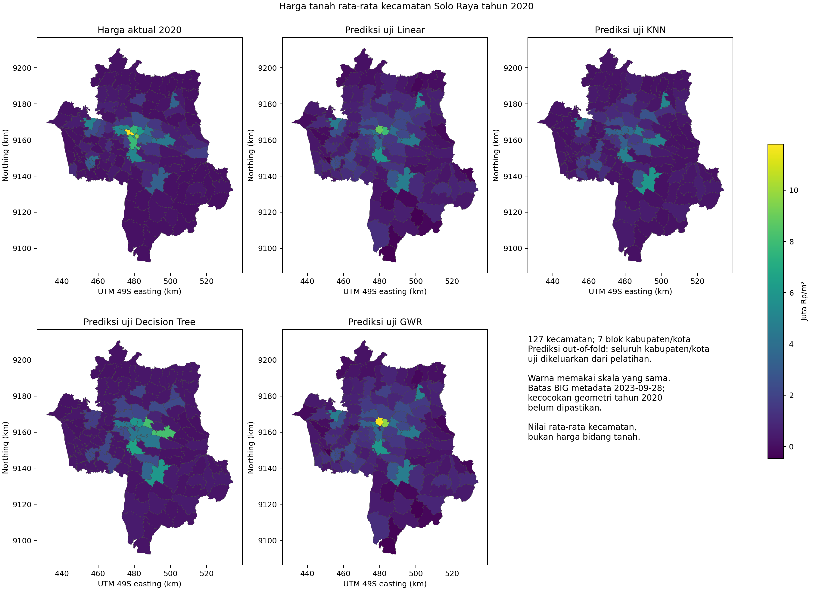
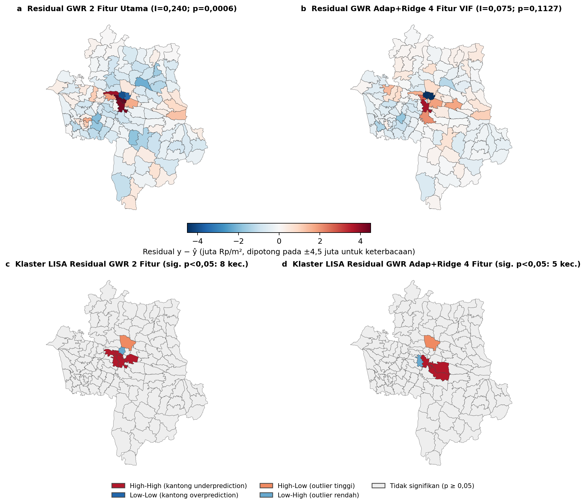
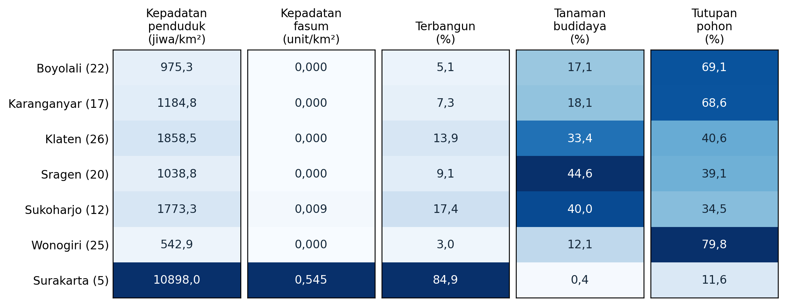
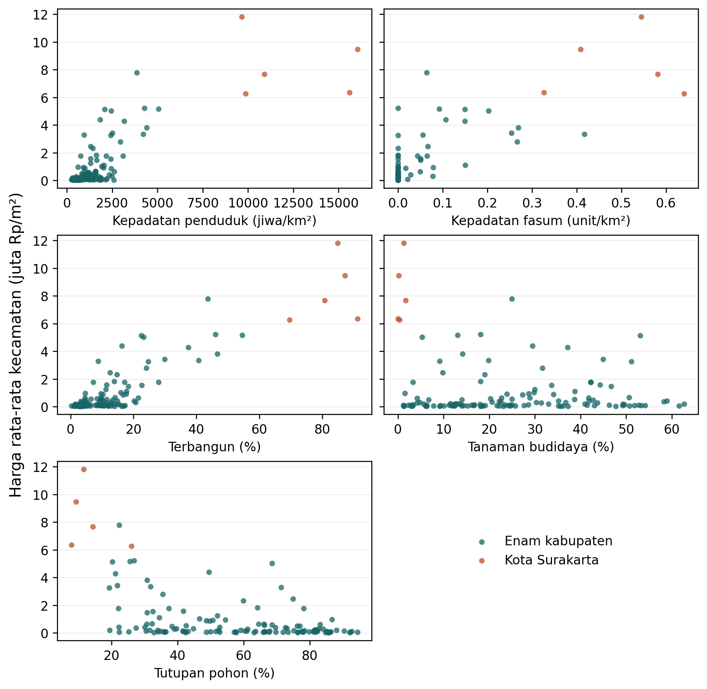
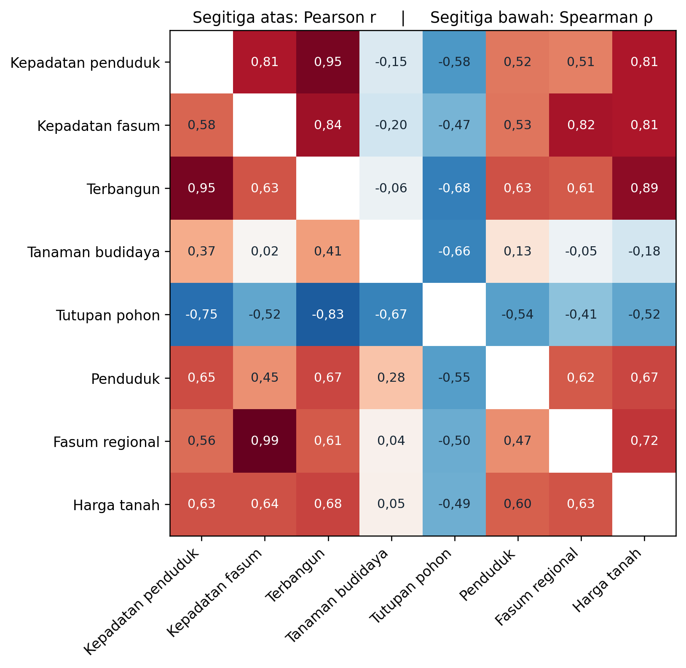
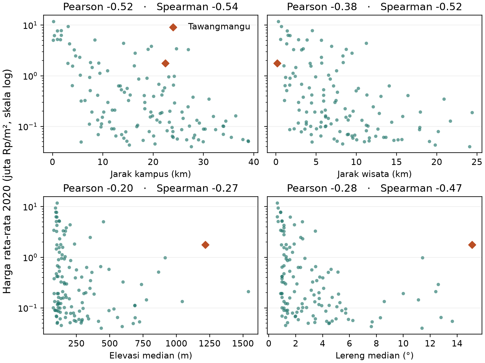

# Estimasi Harga Tanah Rata-Rata Kecamatan di Solo Raya Tahun 2020: Perbandingan Geographically Weighted Regression dan Model Nonspasial dengan Validasi Lintas Kabupaten/Kota

## Abstrak

Penelitian ini menguji apakah pembobotan geografis membantu memperkirakan harga tanah rata-rata tingkat kecamatan ketika seluruh kabupaten/kota tujuan dikeluarkan dari data latih. Dataset mencakup 127 kecamatan di tujuh kabupaten/kota Solo Raya tahun 2020 dari kompilasi sekunder Lampiran A penelitian Salim Aziz. Protokol konfirmatori utama membandingkan Geographically Weighted Regression (GWR) Gaussian klasik dengan regresi linear, K-Nearest Neighbors (KNN), dan Decision Tree pada dua prediktor sumber (jumlah penduduk dan jumlah fasilitas umum regional), skala target Rp/m², serta tujuh lipatan luar *leave-one-kabupaten/kota-out* (LOKO) dengan standardisasi dan penyetelan parameter di dalam bagian latih. Pada protokol terkunci 127 kecamatan, KNN menghasilkan MAE terendah Rp732.073/m² dan regresi linear menghasilkan RMSE terendah Rp1.355.435/m² (R² 0,557), sedangkan GWR menghasilkan MAE Rp802.227/m² (selisih +Rp63.207/m² terhadap regresi linear; interval kepercayaan bootstrap blok 95%: +Rp16.219 hingga +Rp163.778/m²). Pada enam kabupaten non-Surakarta (122 kecamatan), KNN tetap terendah dalam MAE (Rp525.199/m²), sementara lima kecamatan Kota Surakarta memicu *domain shift* perkotaan ekstrem yang berada di luar *Area of Applicability* (AoA) ruang fitur pelatihan. Analisis sensitivitas eksploratif menunjukkan bahwa penambahan tutupan lahan ESA WorldCover 2020 dengan penyaringan multikolinearitas (VIF ≤ 2,05) dan kendala nonnegatif menurunkan MAE Ridge global setara hingga Rp496.144/m² (R² 0,822), sedangkan GWR berperan lebih kuat dalam meredam autokorelasi spasial residual (Moran's I turun menjadi 0,073; p = 0,120) daripada melampaui akurasi prediksi lintas kabupaten. Karena definisi pengukuran primer harga dan ukuran sampel pembentuk rata-rata kecamatan belum tervalidasi ke ATR/BPN, seluruh temuan dibatasi untuk evaluasi metodologis rata-rata kecamatan tahun 2020 dan tidak ditujukan bagi penilaian persil, penetapan pajak, atau kebijakan praktis.

Kata kunci: harga tanah; GWR; validasi spasial lintas wilayah; domain shift; Area of Applicability; Solo Raya.

## 1. Pendahuluan

Harga tanah bervariasi secara spasial mengikuti aglomerasi penduduk, ketersediaan fasilitas, aksesibilitas, dan intensitas terbangun wilayah. Dalam dataset penelitian ini, rata-rata harga tanah Kecamatan Laweyan tercatat Rp11.800.794/m², sedangkan Kecamatan Jebres di kota yang sama tercatat Rp6.269.466/m² dan sejumlah kecamatan pedesaan di Wonogiri berada di bawah Rp60.000/m². Rentang yang lebar tersebut menimbulkan pertanyaan metodologis yang spesifik: ketika model dilatih pada enam kabupaten/kota di Solo Raya, apakah pembobotan kedekatan geografis membantu memperkirakan rata-rata harga tanah kecamatan pada satu kabupaten/kota yang sama sekali tidak dilibatkan dalam pelatihan?

Aziz, Rahayu, dan Istanabi (2023) meneliti struktur polisentris Surakarta Raya melalui karakteristik penggunaan lahan, harga lahan, penduduk, dan fasilitas umum. Studi tersebut memberikan konteks kewilayahan, tetapi menggunakan pengelompokan klaster alih-alih evaluasi prediksi lintas batas administratif. Kajian nilai tanah di berbagai kota Indonesia juga mendokumentasikan kaitan aksesibilitas dan fasilitas terhadap harga lahan. Saefuddin dkk. (2012) membandingkan OLS dan GWR di Tangerang Selatan dengan prediktor jalan arteri, gerbang tol, dan fasilitas umum. Syahar dkk. (2020) menelaah hubungan pusat kegiatan, perubahan penggunaan lahan, dan risiko bencana terhadap nilai tanah di Padang. Di Jawa Tengah, Arumingtyas, Subiyanto, dan Firdaus (2019) membedakan harga pasar bidang tanah dan Nilai Jual Objek Pajak (NJOP) di Kelurahan Tlogosari Kulon, Semarang, sedangkan Janssen, Mulder, dan Yudhistira (2022) memberi konteks pemilahan spasial kelompok pendapatan di Jakarta. Temuan pada tingkat bidang atau kelurahan tersebut menjadi pijakan konseptual, tetapi tidak menjamin daya prediksi yang sama ketika data diagregasikan ke unit kecamatan dan diuji lintas kabupaten/kota.

Geographically Weighted Regression (GWR) mengizinkan koefisien regresi berubah menurut koordinat lokasi melalui pembobotan jarak (Brunsdon dkk., 1996). Meski fleksibel menangkap heterogenitas lokal di dalam sampel latih, GWR menghadapi tiga tantangan serius saat memprediksi wilayah administratif baru: kerentanan terhadap multikolinearitas lokal (Wheeler, 2007), penyempitan sampel efektif ketika memprediksi ke seberang batas kabupaten/kota, serta pergeseran distribusi fitur (*domain shift*) apabila wilayah uji memiliki intensitas perkotaan yang melampaui cakupan data latih (Meyer & Pebesma, 2021).

Penelitian ini merancang evaluasi yang memisahkan secara tegas pengujian hipotesis konfirmatori dari eksplorasi pasca-evaluasi. Kontribusi utamanya mencakup: (1) evaluasi konfirmatori terkunci empat keluarga model pada tujuh lipatan luar *leave-one-kabupaten/kota-out* (LOKO) yang dilengkapi interval kepercayaan bootstrap blok kabupaten/kota, metrik terpisah dengan dan tanpa Kota Surakarta, analisis *Area of Applicability* (AoA), serta pengujian autokorelasi spasial residual (Global dan Local Moran's I); (2) audit transparan atas keterbatasan validitas data target sekunder, ketidakselarasan waktu antarsumber, serta perilaku prediksi negatif; dan (3) diagnostik metodologis terkendali untuk memisahkan pengaruh multikolinearitas lokal, bias retransformasi logaritmik (koreksi Duan smearing dan model *log-link* Quasi-Poisson), sensitivitas titik representatif kecamatan, serta keadilan penyetelan antarmode. Penelitian tidak mengasumsikan GWR harus unggul sebagai model prediksi utama.

## 2. Data dan Wilayah Penelitian

### 2.1. Cakupan, validitas target, dan keselarasan temporal sumber

Wilayah penelitian meliputi seluruh 127 kecamatan di tujuh kabupaten/kota Solo Raya: Kota Surakarta serta Kabupaten Boyolali, Karanganyar, Klaten, Sragen, Sukoharjo, dan Wonogiri. Tabel utama berasal dari transkripsi Lampiran A penelitian Salim Aziz di Repositori Universitas Sebelas Maret (UNS) untuk tahun acuan 2020. Keempat halaman tabel pada berkas PDF sumber (nomor cetak A-1, A-2, A-3, dan B-1) telah diperiksa secara visual dan komputasional; label urutan lama A-4 pada 21 kecamatan Kabupaten Klaten telah dipetakan ulang pada berkas `dataset_2020_rujukan_terverifikasi.csv` tanpa mengubah nilai numerik eksperimen. Ringkasan distribusi kecamatan, rata-rata dan rentang harga, jumlah penduduk, jumlah fasilitas regional, serta luas poligon tiap wilayah disajikan berikut ini.

| Kabupaten/kota | n | Rata-rata harga (Rp/m²) | Rentang harga (Rp/m²) | Total penduduk | Total fasum | Total luas (km²) |
| --- | --- | --- | --- | --- | --- | --- |
| Kabupaten Boyolali | 22 | 749.194 | 105.400–5.025.000 | 1.062.713 | 9 | 1.095,76 |
| Kabupaten Karanganyar | 17 | 1.509.848 | 145.000–5.214.285 | 938.808 | 13 | 802,38 |
| Kabupaten Klaten | 26 | 631.602 | 45.299–3.811.000 | 1.260.506 | 17 | 700,98 |
| Kabupaten Sragen | 20 | 383.456 | 50.112–3.442.857 | 976.951 | 10 | 993,78 |
| Kabupaten Sukoharjo | 12 | 2.266.921 | 121.534–7.789.431 | 911.966 | 14 | 493,14 |
| Kabupaten Wonogiri | 25 | 261.464 | 40.187–3.285.714 | 1.043.177 | 9 | 1.904,26 |
| Kota Surakarta | 5 | 8.312.399 | 6.269.466–11.800.794 | 522.364 | 26 | 46,68 |

Kelemahan pengukuran paling mendasar pada dataset ini terletak pada belum tervalidasinya definisi operasional variabel target di tingkat sumber primer. Audit tanggal 17 November 2026 memastikan 127 kunci wilayah dan seluruh 381 sel numerik pada CSV cocok 100% dengan PDF Lampiran A. Namun, kecocokan salinan hanya membuktikan ketepatan transkripsi sekunder. Artikel Aziz dkk. (2023, Gambar 4–5 hlm. 147) mengatribusikan peta harga lahan ke portal Bhumi ATR/BPN tahun 2020. Meskipun dokumentasi resmi Bhumi dan standar atribut Permen ATR/BPN No. 1 Tahun 2025 mengenal layer Zona Nilai Tanah (ZNT), arsip digital ZNT tahun 2020, metode perataan dari poligon zona ke satu angka kecamatan, maupun jumlah sampel pembentuk di tiap kecamatan belum tersedia untuk diaudit. Tabel berikut merangkum status bukti validitas target beserta batasan klaim yang diterapkan di seluruh naskah.

| Dimensi validitas target | Status bukti pada repositori | Implikasi metodologis & batas klaim |
| --- | --- | --- |
| Definisi konseptual label harga | Dilabeli harga tanah rata-rata (Rp/m²) di Lampiran A Salim Aziz; artikel Aziz dkk. (2023) hlm. 147 menyebut Bhumi ATR-BPN 2020 | Belum dipastikan apakah angka mewakili nilai zona ZNT, harga penawaran, transaksi riil, atau NJOP; tidak boleh diklaim sebagai harga pasar transaksi |
| Metode agregasi ke kecamatan | Rumus perataan poligon/bidang ke 127 angka kecamatan tidak tercantum pada lampiran maupun artikel sumber | Potensi bias agregasi (rata-rata sederhana vs tertimbang luas) tidak teramati; evaluasi diperlakukan sebagai prediksi indeks sekunder tingkat kecamatan |
| Ukuran sampel / poligon per kecamatan | Jumlah zona atau titik sampel pembentuk rata-rata per kecamatan (nᵢ) tidak tersedia di arsip publik | Presisi label antar-kecamatan mungkin tidak seragam (heteroskedastisitas galat pengukuran label) |
| Tahun efektif pengukuran | Judul tabel lampiran menyatakan tahun 2020; arsip historis layer Bhumi 2020 dan tanggal pemutakhiran zona belum diperoleh | Kemungkinan jeda pembaruan antarzona di portal asal membatasi penafsiran lintas waktu |
| Integritas transkripsi sekunder | 127/127 pasangan wilayah dan 381/381 nilai numerik cocok 100% dengan PDF Lampiran A (SHA-256 terverifikasi) | Bebas salah salin dari sumber sekunder, tetapi kecocokan salinan tidak menggantikan validasi pengukuran primer |

Selain ketidakpastian definisi primer harga, pemeriksaan silang antara Lampiran A dan tabel ringkas dalam artikel Aziz dkk. (2023) menunjukkan perbedaan angka agregat yang perlu dicatat terbuka.

Total fasilitas pada lampiran berbeda dari penjumlahan kategori Tabel 3 artikel Aziz dkk. (2023), hlm. 149, pada seluruh tujuh wilayah. Artikel menyebut observasi peneliti 2023 dengan data 2020. Perbedaan belum dapat ditentukan sebagai salah ketik, beda versi, atau beda cakupan. CSV acuan dipertahankan agar hasil eksperimen dapat ditelusuri.

| Wilayah | Fasum CSV/lampiran | Fasum artikel | Selisih CSV − artikel |
| --- | --- | --- | --- |
| Kota Surakarta | 26 | 25 | 1 |
| Kabupaten Boyolali | 9 | 11 | -2 |
| Kabupaten Sukoharjo | 14 | 11 | 3 |
| Kabupaten Karanganyar | 13 | 12 | 1 |
| Kabupaten Wonogiri | 9 | 8 | 1 |
| Kabupaten Sragen | 10 | 11 | -1 |
| Kabupaten Klaten | 17 | 15 | 2 |

Jumlah penduduk CSV juga berbeda dari total urban dan rural Tabel 1 artikel pada Surakarta (522.364 dibanding 576.412), Sukoharjo (911.966 dibanding 907.587), dan Karanganyar (938.808 dibanding 931.963). Empat wilayah lainnya cocok. Lima angka kecamatan Surakarta cocok dengan Gambar 1.10 laporan Pemerintah Kota Surakarta, hlm. i-20, yang mengutip BPS 2021 untuk tahun data 2020. Pemeriksaan ini tidak menggantikan verifikasi seluruh kecamatan ke BPS. Rincian bukti, URL, dan kebutuhan rekonsiliasi tersedia di data/SUMBER_DATASET.md; perbandingan dapat diulang dengan scripts/audit_dataset.py.

Karena analisis sensitivitas pada Bagian 6 turut menggabungkan geometri batas administratif, tutupan lahan satelit, objek lokasi OpenStreetMap, dan model elevasi digital, keselarasan waktu antar-sumber juga harus diperiksa agar proksi pasca-2020 tidak ditafsirkan seolah-olah pengukuran serentak tahun 2020.

| Sumber data | Variabel yang diturunkan | Tahun acuan amatan | Versi / tahun arsip | Risiko ketidakselarasan & galat proksi |
| --- | --- | --- | --- | --- |
| Lampiran A Salim Aziz (UNS) | Harga rata-rata (target), penduduk, fasum regional | 2020 |  Publikasi artikel 2023 | Metode agregasi harga Bhumi 2020 belum terverifikasi; terdapat selisih total fasum/penduduk terhadap tabel ringkas artikel |
| BIG KSP Satu Peta (Layer 3) | Batas poligon, luas proksi, titik ST_PointOnSurface | Batas efektif pasca-2019 | Metadata 20230928 (edisi 2022) | Seluruh 127 kecamatan sudah terbentuk sebelum 2020, tetapi kesamaan garis batas mikro 2020 vs 2023 belum terverifikasi |
| ESA WorldCover 10 m | Persentase terbangun, tanaman budidaya, tutupan pohon | 2020 | v100 (Zanaga dkk., 2021) | Selaras tahun 2020; ketidakpastian berasal dari salah klasifikasi piksel 10 m dan irisan piksel tepi batas |
| OpenStreetMap (Geofabrik) | Jarak garis lurus wisata/kampus & hitungan radius 5 km | 1 Januari 2021 | Ekstrak 210101 | Selisih 1 hari pasca-2020; bias kelengkapan pemetaan sukarela, duplikasi objek institusi, dan bukan jarak jaringan jalan raya |
| SRTM Digital Elevation | Median elevasi dan kemiringan lereng kecamatan | Februari 2000 | CIAT v4.1 (~90 m) | Topografi makro relatif stabil dalam dua dekade, tetapi meratakan variasi lereng mikro permukiman |

### 2.2. Variabel pada eksperimen konfirmatori utama

Untuk menjaga kemurnian evaluasi konfirmatori, eksperimen utama pada Bagian 4 dikunci hanya pada variabel yang tersedia langsung di tabel sumber tahun 2020 tanpa penambahan fitur pasca-eksplorasi. **Metrik keputusan utama** ditetapkan pada skala asli Rp/m² (MAE dan RMSE gabungan) karena tujuan tugas adalah menaksir besaran rata-rata harga wilayah dalam satuan moneter, bukan sekadar mengurutkan peringkat logaritmik.

| Komponen | Kolom | Definisi |
| --- | --- | --- |
| Target | harga_tanah_rata_rata_rp_m2 | Harga rata-rata kecamatan 2020, Rp/m² (metrik keputusan utama) |
| Prediktor konfirmatori 1 | jumlah_penduduk | Jumlah penduduk kecamatan pada tabel sumber, jiwa |
| Prediktor konfirmatori 2 | jumlah_fasum_regional | Jumlah fasilitas umum regional pada tabel sumber, unit |
| Lokasi GWR | lat, lon | Titik interior ST_PointOnSurface WGS84 dari proyeksi UTM 49S |
| Kelompok validasi | kab_kota | Tujuh blok administratif untuk LOKO luar dan validasi dalam |

Jumlah penduduk mewakili skala demografis kecamatan dan jumlah fasilitas umum regional mewakili ketersediaan layanan berskala wilayah menurut klasifikasi sumber. Keduanya dipakai murni sebagai prediktor statistik tanpa klaim hubungan kausal. Sebanyak 99 dari 127 kecamatan memiliki nilai fasilitas umum regional nol pada tabel sumber sehingga sebaran variabel tersebut sangat miring ke kanan.

| Variabel / Atribut | Minimum | Median | Rata-rata | Maksimum | Simpangan baku |
| --- | --- | --- | --- | --- | --- |
| Harga tanah rata-rata (Rp/m²) | 40.187 | 200.965 | 1.114.504,86 | 11.800.794 | 2.044.263,94 |
| Jumlah penduduk (jiwa) | 17.760 | 47.773 | 52.885,71 | 168.770 | 23.188,90 |
| Jumlah fasum regional (unit) | 0 | 0 | 0,77 | 9 | 1,83 |
| Luas poligon kecamatan (km²) | 3,06 | 46,33 | 47,54 | 144,40 | 24,21 |
| Jarak titik ke batas (m) | 383,02 | 1.650,59 | 1.755,75 | 4.572,15 | 815,64 |

Kuartil harga tanah rata-rata pada 127 kecamatan adalah Q1 Rp89.345/m², median Rp200.965/m², dan Q3 Rp943.656/m². Lima kecamatan dengan nilai tertinggi adalah Laweyan (Kota Surakarta: Rp11.800.794/m², penduduk 88.524, fasum 5); Pasar Kliwon (Kota Surakarta: Rp9.463.310/m², penduduk 78.517, fasum 2); Grogol (Kabupaten Sukoharjo: Rp7.789.431/m², penduduk 121.414, fasum 2); Banjarsari (Kota Surakarta: Rp7.678.425/m², penduduk 168.770, fasum 9); Serengan (Kota Surakarta: Rp6.350.000/m², penduduk 47.778, fasum 1). Tiga kecamatan dengan nilai terendah adalah Kismantoro (Kabupaten Wonogiri: Rp40.187/m², penduduk 40.200, fasum 0); Puhpelem (Kabupaten Wonogiri: Rp43.011/m², penduduk 21.144, fasum 0); Kalikotes (Kabupaten Klaten: Rp45.299/m², penduduk 37.051, fasum 0). Seluruh statistik ini bersifat deskriptif dan tidak digunakan untuk memasang standardisasi pada data uji.

### 2.3. Geometri batas dan representasi koordinat titik kecamatan

Poligon batas kecamatan diambil dari arsip Badan Informasi Geospasial (BIG) KSP Satu Peta, layer Peta Wilayah Administrasi Kecamatan (576 fitur Jawa Tengah, disaring menjadi 127 pasangan unik kabupaten/kota dan kecamatan Solo Raya). Seluruh 127 kecamatan cocok dengan kode wilayah resmi Kemendagri. Dua perbedaan penulisan ejaan dipetakan secara eksplisit melalui `data/padanan_nama.csv`: `Kebakkramat` (BIG/BPS) dengan `Kebakramat` (CSV), serta `Sidoharjo` (BIG/BPS) dengan `Sidoarjo` (tercetak `Sidoarjo` pada halaman A-2 PDF lampiran).

Dalam GWR berbasis titik, setiap unit areal kecamatan seluas rata-rata 47,54 km² harus diwakili oleh sepasang koordinat untuk menghitung matriks jarak kernel. Representasi acuan proyek menggunakan `ST_PointOnSurface(ST_Union(geom))` setelah memproyeksikan poligon WGS84 ke bidang metrik UTM Zona 49S (`EPSG:32749`), kemudian mengembalikan titik ke WGS84 (`EPSG:4326`) untuk perhitungan jarak lingkaran besar Haversine (radius bumi 6.371,0088 km). Berbeda dari pusat massa geometris biasa (*centroid*) yang dapat jatuh di luar poligon cekung atau terpisah waduk, `ST_PointOnSurface` menjamin titik berada di dalam poligon kecamatan masing-masing dan dibentuk murni dari geometri tanpa membaca target harga.

Audit spasial pada 127 kecamatan menunjukkan seluruh 127 titik (100%) berada di dalam poligon padanannya (`di_dalam_poligon = True`), dengan jarak titik ke batas berkisar antara 383,02 m hingga 4.572,15 m (median 1.650,59 m; rata-rata 1.755,75 m) dan selisih numerik maksimum point-on-surface terhadap Shapely sekitar 3,26e-09 m.

| Kasus ekstrem jarak ke batas | Kabupaten/kota | Kecamatan | Jarak ke batas (m) | Luas kecamatan (km²) |
| --- | --- | --- | --- | --- |
| Terdekat ke batas | Kota Surakarta | Serengan | 383,02 | 3,06 |
| Terjauh dari batas | Kabupaten Wonogiri | Pracimantoro | 4.572,15 | 144,40 |

Penyederhanaan satu kecamatan menjadi satu titik mengabaikan variasi intra-kecamatan (*Modifiable Areal Unit Problem* / MAUP) dan belum tentu berimpit dengan pusat permukiman atau koridor niaga. Untuk menguji seberapa peka hasil GWR terhadap penyederhanaan ini, Bagian 6.8 menguji empat alternatif titik representatif secara langsung. Selain itu, meskipun seluruh 127 kecamatan telah berdiri sebelum tahun 2020 (termasuk pemekaran Boyolali tahun 2018–2019), metadata fitur arsip BIG bertanggal `20230928` (edisi layanan 2022) sehingga kesamaan garis batas mikro dengan kondisi tepat tahun 2020 tetap dicatat sebagai asumsi proksi.

## 3. Metode Penelitian

### 3.1. Pemisahan protokol konfirmatori, eksplorasi, dan pencegahan kebocoran data

Banyak studi pemodelan spasial menjadi bias ketika peneliti menguji puluhan kombinasi fitur dan transformasi pada lipatan uji yang sama lalu melaporkan spesifikasi dengan galat terendah seolah-olah hasil konfirmatori. Untuk mencegah hal tersebut, seluruh rangkaian eksperimen dalam penelitian ini dibagi ke dalam empat tingkat inferensi yang terpisah tegas.

| Kelompok eksperimen | Bagian | Status inferensi | Fitur & skala target | Tujuan metodologis |
| --- | --- | --- | --- | --- |
| Eksperimen utama terkunci | Bagian 4 | Konfirmatori utama | 2 fitur sumber; target linear Rp/m² | Menguji hipotesis manfaat pembobotan geografis lintas kabupaten tanpa rekayasa fitur pasca-uji |
| Replikasi & perluasan tutupan lahan | Bagian 6.3–6.4 | Eksploratif terjadwal | 7 fitur (WorldCover + kepadatan); target ln(harga) | Menguji kontribusi tutupan lahan 2020 dan mereplikasi protokol notebook secara terkendali |
| Uji hipotesis akses & topografi | Bagian 6.5–6.6 | Eksploratif pasca-galat | 8–11 fitur (OSM + SRTM); ln(harga) & Rp/m² potong nol | Memeriksa apakah galat lokal (mis. Tawangmangu) berkaitan dengan wisata, kampus, dan lereng |
| Diagnostik sensitivitas & keadilan protokol | Bagian 6.7–6.8 | Diagnostik metodologis | Saringan VIF, Duan smearing, Poisson QMLE, 4 titik lokasi | Mengisolasi efek kolinearitas lokal, bias retransformasi log, prediksi negatif, domain shift, dan keadilan tuning |

Evaluasi utama menggunakan skema tujuh lipatan luar *leave-one-kabupaten/kota-out* (LOKO) mengikuti prinsip validasi berkelompok untuk data berstruktur spasial (Roberts dkk., 2017). Pada setiap lipatan luar, satu kabupaten/kota ditahan sepenuhnya sebagai data uji dan enam kabupaten/kota lainnya menjadi data latih, sehingga terkumpul tepat 127 prediksi uji *out-of-fold* per model. Di dalam setiap bagian latih luar, penyetelan parameter dilakukan melalui enam lipatan validasi dalam antarkabupaten/kota (lima wilayah *fit*, satu wilayah validasi). Parameter dipilih berdasarkan MAE gabungan seluruh observasi validasi dalam; jika terjadi nilai seri, kandidat pertama pada urutan grid dipilih secara deterministik.

Pencegahan kebocoran data diterapkan ketat: rata-rata dan simpangan baku standardisasi prediktor dihitung ulang hanya pada bagian *fit* di setiap lipatan dalam dan pada enam wilayah latih di setiap lipatan luar. Target wilayah uji tidak pernah diakses saat penyaringan fitur, standardisasi, pemilihan parameter, maupun perhitungan koreksi retransformasi. Koordinat lokasi uji hanya dipakai untuk menghitung jarak geografis ke titik-titik latih sebagaimana lazimnya prediksi spasial pada lokasi tujuan yang diketahui. Matriks perbandingan ruang penyetelan dan perlakuan setiap model dirangkum pada tabel berikut.

| Model | Ruang parameter (eksperimen utama) | Ruang parameter (benchmark setara §6.8) | Pra-pemrosesan dalam-lipatan | Penalti & kendala dasar |
| --- | --- | --- | --- | --- |
| Linear / Ridge Global | Tanpa parameter (OLS murni) | λ ∈ {0; 0,01; 0,1; 1; 10} tanpa penalti intersep | Standardisasi z-score data latih | Tanpa penalti di §4; Ridge L2 di §6.8 |
| KNN | k ∈ {3, 7, 15}, bobot invers jarak Euclidean | k ∈ {3, 5, 7, 15}, bobot invers jarak Euclidean | Standardisasi z-score data latih | Nonparametrik; otomatis positif karena kombinasi konveks y latih |
| Decision Tree (CART) | max_depth ∈ {2, 4, 6}, min_samples_leaf=3 | max_depth ∈ {2, 4, 6}, min_samples_leaf=3 | Standardisasi z-score data latih (invarian urutan) | Otomatis positif karena rerata daun data latih |
| Classic GWR | Fixed Gaussian h ∈ {5, 10, 20, 40} km | Fixed h ∈ {5..80} km atau Adaptive k ∈ {15..80} + λ ∈ {0..10} | Standardisasi z-score latih + jarak Haversine WGS84 | Tanpa ridge (tolak singular) di §4; Ridge lokal bebas intersep di §6.7–6.8 |

### 3.2. Regresi linear dan Decision Tree

Pada eksperimen konfirmatori utama, regresi linear mengestimasi satu intersep dan dua koefisien global dengan kuadrat terkecil biasa tanpa pemotongan nilai negatif pasca-estimasi, sehingga perilaku ekstrapolasi linear terlihat apa adanya. Pada benchmark protokol setara di Bagian 6.8, model global diperluas menjadi regresi Ridge dengan kandidat penalti L2 yang disetel setara dengan GWR tanpa mempenalti intersep. Decision Tree menggunakan algoritma CART (`min_samples_leaf=3`, `random_state=124`, Pedregosa dkk., 2011) dengan kandidat kedalaman maksimum 2, 4, dan 6. Karena prediksi setiap daun merupakan rata-rata harga data latih di daun tersebut, pohon keputusan secara alami selalu menghasilkan prediksi positif.

### 3.3. K-Nearest Neighbors

KNN mengukur jarak Euclidean di dalam ruang prediktor yang telah distandardisasi pada data latih, bukan jarak geografis di permukaan bumi. Kandidat jumlah tetangga pada eksperimen utama adalah `k ∈ {3, 7, 15}` dengan bobot kebalikan jarak (`weights='distance'`). Karena prediksi dibentuk sebagai rata-rata tertimbang konveks dari harga kecamatan latih terdekat di ruang atribut, prediksi KNN terjamin positif tetapi tidak mampu melakukan ekstrapolasi melampaui rentang harga maksimum yang pernah muncul di data latih.

> ŷ(x) = Σᵢ∈Nₖ₍ₓ₎ wᵢyᵢ / Σᵢ∈Nₖ₍ₓ₎ wᵢ

### 3.4. Geographically Weighted Regression

Model spasial yang dievaluasi adalah **GWR klasik** (*Locally Weighted Least Squares*, Brunsdon dkk., 1996). Pada eksperimen utama Bagian 4, digunakan kernel **Fixed Gaussian** dengan kandidat *bandwidth* jarak tetap `h ∈ {5, 10, 20, 40}` km yang berlaku seragam bagi intersep dan prediktor terstandardisasi. Untuk setiap kecamatan uji `s`, koefisien lokal diestimasi hanya dari himpunan kecamatan latih `T` dengan bobot eksponensial jarak Haversine `dᵢ(s)`.

> ŷ(s) = β̂₀(s) + β̂₁(s)x₁(s) + β̂₂(s)x₂(s)

> β̂(s) = arg minᵦ Σᵢ∈T wᵢ(s)[yᵢ − b₀ − b₁xᵢ₁ − b₂xᵢ₂]²

> wᵢ(s) = exp[−dᵢ(s)² / (2h²)]

Pada protokol konfirmatori awal, sistem lokal diselesaikan tanpa penalti Ridge; setiap kehilangan *rank* matriks desain berbobot pada validasi dalam langsung menggugurkan kandidat *bandwidth* dan dicatat di berkas audit. Pada diagnostik sensitivitas Bagian 6.7–6.8, GWR diperluas mencakup kernel *Adaptive Gaussian* dan *Adaptive Bisquare* (berdasarkan jarak ke tetangga latih ke-`k`) serta penalti Ridge lokal pada koefisien lereng tanpa mempenalti intersep untuk mengendalikan kolinearitas lokal (Wheeler, 2007).

### 3.5. Metrik evaluasi, ketidakpastian bootstrap blok, AoA, dan autokorelasi residual

Kinerja diukur dari 127 prediksi *out-of-fold* menggunakan MAE, RMSE, dan koefisien determinasi gabungan R² dalam satuan Rp/m². Mengingat adanya pergeseran domain perkotaan ekstrem di Kota Surakarta, hasil utama dilaporkan secara berdampingan untuk **seluruh 127 kecamatan** dan **enam kabupaten non-Surakarta (122 kecamatan)**, sementara kelima kecamatan Surakarta juga dianalisis terpisah sebagai uji tekan perkotaan (*urban stress test*).

> MAE = (1/n) Σᵢ |yᵢ − ŷᵢ|

> RMSE = √[(1/n) Σᵢ (yᵢ − ŷᵢ)²]

> R² = 1 − Σᵢ (yᵢ − ŷᵢ)² / Σᵢ (yᵢ − ȳ)²

Untuk mengukur ketidakpastian statistik tanpa melanggar ketergantungan spasial maupun kesamaan model di dalam lipatan uji yang sama, dihitung **interval kepercayaan 95% berbasis bootstrap blok kabupaten/kota** (*cluster block bootstrap*, `B = 10.000` replikasi berseed tetap `124`). Setiap replikasi menarik tujuh blok kabupaten/kota dengan pengembalian (atau enam blok untuk metrik 122 kecamatan), lalu menghitung distribusi empiris MAE, RMSE, dan selisih berpasangan `ΔMAE` terhadap model acuan.

Dua diagnostik spasial tambahan diterapkan secara baku pada hasil utama. Pertama, **Area of Applicability (AoA)** dan *Dissimilarity Index* (`DI`) dihitung murni *out-of-fold* mengikuti Meyer dan Pebesma (2021): jarak Euclidean terdekat tiap kecamatan uji ke data latih terstandardisasi dinormalisasi oleh rata-rata jarak berpasangan data latih, lalu dibandingkan terhadap ambang pencilan `Q₃ + 1,5 × IQR` yang diperoleh dari validasi silang internal data latih. Kedua, struktur spasial residual `eᵢ = yᵢ − ŷᵢ` diuji menggunakan **Global Moran's I** (uji permutasi dua sisi `9.999` pengacakan) dan **Local Indicators of Spatial Association (LISA / Local Moran's I)** (Anselin, 1995; `999` permutasi bersyarat) di atas matriks kontiguitas *Queen* terstandardisasi baris dari poligon penuh BIG.

## 4. Hasil Eksperimen Konfirmatori Utama (Protokol Terkunci Dua Prediktor)

### 4.1. Kinerja gabungan, pemisahan Kota Surakarta, dan ketidakpastian blok

Tabel berikut menyajikan hasil konfirmatori utama keempat model pada protokol terkunci dua prediktor, lengkap dengan interval kepercayaan bootstrap blok 95% serta perbandingan langsung antara evaluasi penuh 127 kecamatan dan evaluasi enam kabupaten non-Surakarta (122 kecamatan).

| Model | MAE 127 kec. [95% CI blok] | RMSE 127 kec. [95% CI blok] | R² (127) | ΔMAE vs Linear [95% CI blok] | Enam kab. 122 kec. MAE [95% CI] (R²) |
| --- | --- | --- | --- | --- | --- |
| Linear | 739.020 [495.697–1.276.474] | 1.355.435 [714.651–2.326.947] | 0,557 | Acuan (0) | 581.932 [454.358–723.057] (0,602) |
| KNN | 732.073 [428.220–1.441.402] | 1.530.233 [763.281–2.699.909] | 0,435 | −6.947 [−112.571; +175.407] | 525.199 [399.858–688.230] (0,546) |
| Decision Tree | 756.462 [484.759–1.296.393] | 1.449.369 [869.221–2.278.092] | 0,493 | +17.442 [−141.763; +221.442] | 622.923 [436.347–870.874] (0,360) |
| GWR | 802.227 [529.751–1.438.694] | 1.409.692 [745.440–2.434.921] | 0,521 | +63.207 [+16.219; +163.778] | 614.052 [490.687–744.524] (0,589) |

Tiga temuan pokok muncul dari tabel utama. Pertama, pada gabungan 127 kecamatan, KNN memberikan MAE titik terendah (Rp732.073/m²) dan regresi linear memberikan RMSE terendah (Rp1.355.435/m²; R² 0,557). Namun, selisih berpasangan KNN terhadap regresi linear hanya −Rp6.947/m² dengan interval kepercayaan bootstrap blok 95% yang sangat lebar melintasi nol (−Rp112.571 hingga +Rp175.407/m²), sehingga keunggulan tipis KNN atas regresi linear tidak bermakna secara statistik. Kedua, GWR Gaussian mencatat MAE Rp802.227/m²; selisih +Rp63.207/m² di atas regresi linear memiliki interval kepercayaan bootstrap blok 95% yang seluruhnya positif (+Rp16.219 hingga +Rp163.778/m²). Artinya, pada dua prediktor dasar, pembobotan geografis secara konsisten menghasilkan galat absolut sedikit lebih besar daripada regresi global. Ketiga, ketika lima kecamatan Kota Surakarta dipisahkan (kolom 122 kecamatan), rentang ketidakpastian menyempit tajam dan memperjelas peringkat di wilayah kabupaten: KNN mencapai MAE Rp525.199/m², regresi linear mencapai RMSE terendah Rp875.922/m² (R² 0,602), sedangkan GWR tetap tertinggal +Rp32.120/m² dari regresi linear (95% CI blok: +Rp8.491 hingga +Rp51.807/m²).

### 4.2. Variasi kinerja per kabupaten/kota dan analisis Area of Applicability

Rincian MAE dan RMSE setiap kabupaten/kota memperlihatkan ketimpangan skala galat antara enam kabupaten dan Kota Surakarta.

| Wilayah | n | Linear | KNN | Tree | GWR |
| --- | --- | --- | --- | --- | --- |
| Kabupaten Boyolali | 22 | 311.864 | 328.378 | 462.846 | 346.913 |
| Kabupaten Karanganyar | 17 | 638.761 | 705.239 | 1.133.978 | 633.155 |
| Kabupaten Klaten | 26 | 641.869 | 621.293 | 546.210 | 700.620 |
| Kabupaten Sragen | 20 | 574.464 | 454.792 | 427.748 | 641.662 |
| Kabupaten Sukoharjo | 12 | 975.563 | 931.183 | 1.201.583 | 966.099 |
| Kabupaten Wonogiri | 25 | 535.644 | 337.491 | 374.437 | 555.042 |
| Kota Surakarta | 5 | 4.571.968 | 5.779.800 | 4.014.822 | 5.393.705 |

Seluruh MAE pada tabel dalam Rp/m²; n adalah jumlah kecamatan uji.

| Wilayah | n | Linear | KNN | Tree | GWR |
| --- | --- | --- | --- | --- | --- |
| Kabupaten Boyolali | 22 | 439.799 | 521.109 | 898.205 | 485.127 |
| Kabupaten Karanganyar | 17 | 1.084.197 | 1.300.834 | 1.867.771 | 1.060.699 |
| Kabupaten Klaten | 26 | 808.729 | 882.024 | 807.489 | 870.106 |
| Kabupaten Sragen | 20 | 786.345 | 759.633 | 716.957 | 844.890 |
| Kabupaten Sukoharjo | 12 | 1.550.099 | 1.542.724 | 1.608.852 | 1.491.076 |
| Kabupaten Wonogiri | 25 | 668.108 | 680.649 | 776.887 | 683.980 |
| Kota Surakarta | 5 | 5.286.238 | 6.176.307 | 4.823.843 | 5.581.001 |

Seluruh RMSE pada tabel dalam Rp/m²; n adalah jumlah kecamatan uji.

Pada tingkat wilayah individual, GWR menghasilkan MAE lebih rendah daripada regresi linear hanya di Karanganyar dan Sukoharjo, serta mengungguli KNN di Karanganyar dan Surakarta. Keunggulan lokal di sebagian wilayah pinggiran Surakarta tersebut tidak cukup menutup kenaikan galat di lima wilayah lainnya.

Sebagai uji tekan perkotaan (*urban stress test*), Kota Surakarta hanya memuat lima kecamatan, tetapi menghasilkan MAE GWR Rp5.393.705/m² dan KNN Rp5.779.800/m² (Linear Rp4.571.968/m²; Decision Tree Rp4.014.822/m²). Lima kecamatan ini menyumbang sekitar 61,7% jumlah kuadrat galat GWR dan 64,1% jumlah kuadrat galat KNN. Ketika lima kecamatan Surakarta dipisahkan dari ringkasan (122 kecamatan pada enam kabupaten), KNN mencatat MAE terendah Rp525.199/m² dan regresi linear mencatat RMSE terendah Rp875.922/m² (R² 0,602), sedangkan GWR tetap berada di belakang regresi linear (MAE Rp614.052/m²; ΔMAE +Rp32.120/m², 95% CI blok [+Rp8.491; +Rp51.807]/m²). Dominasi galat di Surakarta terjadi karena premi aglomerasi kota inti tidak terwakili oleh profil keenam kabupaten latih.

Untuk menguji secara objektif apakah kegagalan di Kota Surakarta disebabkan oleh ketiadaan padanan ruang fitur pada data latih, tabel berikut merangkum hasil pengujian *Area of Applicability* (AoA) lintas ruang prediktor.

| Ruang prediktor | Luar AoA total (%) | Surakarta luar AoA | 6 kab. luar AoA | Median DI Solo vs 6 kab. (ambang) | MAE GWR dalam vs luar AoA (Rp/m²) |
| --- | --- | --- | --- | --- | --- |
| 2 fitur utama | 19/127 (15,0%) | 4/5 | 15/122 | 0,41 vs 0,01 (0,14) | 591.448 vs 2.000.340 |
| 4 fitur VIF | 13/127 (10,2%) | 5/5 | 8/122 | 1,92 vs 0,12 (0,58) | 358.705 vs 1.936.984 |
| 7 fitur pendukung | 18/127 (14,2%) | 5/5 | 13/122 | 3,61 vs 0,14 (0,50) | 343.153 vs 1.592.752 |

Hasil AoA mengonfirmasi mekanisme *domain shift* tersebut tanpa memakai informasi harga uji. Pada ruang dua prediktor utama, 19 dari 127 kecamatan (15,0%) berada di luar AoA pelatihan, termasuk 4 dari 5 kecamatan Kota Surakarta, dengan median *Dissimilarity Index* Surakarta hampir 37 kali lipat median kabupaten lainnya (0,41 dibanding 0,01). Di luar AoA, MAE GWR melonjak lebih dari tiga kali lipat dari Rp591.448/m² menjadi Rp2.000.340/m² (dan KNN melonjak dari Rp485.239/m² menjadi Rp2.135.131/m²). Ketika ruang fitur diperluas mencakup proporsi terbangun pada Bagian 6 (empat fitur VIF maupun tujuh fitur), kelima kecamatan Kota Surakarta (5/5) seluruhnya jatuh jauh di luar ambang AoA data latih.

### 4.3. Parameter terpilih dan audit prediksi negatif

Parameter yang dipilih validasi internal pada tiap lipatan luar tercantum pada tabel berikut.

| Wilayah uji | k KNN | Kedalaman Tree | Bandwidth GWR (km) |
| --- | --- | --- | --- |
| Kabupaten Boyolali | 15 | 4 | 40 |
| Kabupaten Karanganyar | 15 | 4 | 40 |
| Kabupaten Klaten | 7 | 2 | 40 |
| Kabupaten Sragen | 7 | 2 | 40 |
| Kabupaten Sukoharjo | 15 | 2 | 40 |
| Kabupaten Wonogiri | 15 | 4 | 40 |
| Kota Surakarta | 15 | 4 | 10 |

Enam lipatan kabupaten memilih batas atas *bandwidth* kandidat GWR (40 km), sedangkan lipatan Kota Surakarta memilih *bandwidth* sempit (10 km) untuk menangkap gradien harga kecamatan penyangga terdekat seperti Kartasura, Colomadu, Grogol, dan Baki. Tidak terjadi kegagalan matriks singular pada eksperimen utama, tetapi ketiadaan kendala nonnegatif pada model berbasis regresi linear memunculkan prediksi harga negatif di kecamatan pedesaan berpenduduk kecil dan tanpa fasilitas regional.

| Model | Jumlah (%) | Prediksi terendah (Rp/m²) | Median negatif (Rp/m²) | Sebaran kabupaten & contoh ekstrem |
| --- | --- | --- | --- | --- |
| Linear | 17/127 (13,4%) | −450.353 | −152.894 | Wonogiri (7); Boyolali (5); Sragen (3); Klaten (1); Karanganyar (1); contoh: Paranggupito (−Rp450.353); Batuwarno (−Rp445.958); Kebonarum (−Rp432.086) |
| KNN | 0/127 (0,0%) | 69.481 (positif) | Tidak ada | Seluruh prediksi positif |
| Decision Tree | 0/127 (0,0%) | 100.416 (positif) | Tidak ada | Seluruh prediksi positif |
| GWR | 15/127 (11,8%) | −469.120 | −210.834 | Wonogiri (7); Boyolali (5); Klaten (1); Sragen (1); Karanganyar (1); contoh: Paranggupito (−Rp469.120); Kebonarum (−Rp449.455); Batuwarno (−Rp446.772) |

Sebanyak 17 kecamatan (13,4%) pada regresi linear dan 15 kecamatan (11,8%) pada GWR memperoleh prediksi negatif, dengan nilai paling ekstrem mencapai −Rp450.353/m² (Linear) dan −Rp469.120/m² (GWR) di Kecamatan Paranggupito, Kabupaten Wonogiri. Kecamatan terdampak terkonsentrasi di Wonogiri dan Boyolali dengan rata-rata harga aktual sekitar Rp120–129 ribu/m². Prediksi negatif tidak layak secara domain ekonomi dan menandai salah spesifikasi bentuk fungsional ekor bawah; nilai asli tetap dipertahankan pada tabel konfirmatori Bagian 4 agar tolok ukur baseline transparan, sedangkan model berkendala nonnegatif dievaluasi secara sistematis pada Bagian 6.8.

### 4.4. Diagnostik autokorelasi spasial residual (Moran's I dan LISA)

Agar evaluasi tidak berhenti pada besaran agregat MAE dan RMSE, residual *out-of-fold* keempat model diperiksa terhadap matriks kontiguitas *Queen* 127 poligon kecamatan. Tabel berikut merangkum nilai Global Moran's I beserta jumlah klaster lokal signifikan (LISA, `p < 0,05`) baik untuk eksperimen konfirmatori dua fitur maupun pembanding empat fitur non-kolinear dari Bagian 6.7.

| Skenario | Model / Variabel | Global Moran's I | z-score (p permutasi) | Klaster LISA sig. (p<0,05) | Rincian (HH / LL / HL / LH) |
| --- | --- | --- | --- | --- | --- |
| Target harga aktual (2020) | Aktual | 0,592 | 11,28 (0,0001) | 15/127 | 14 / 0 / 0 / 1 |
| 2 fitur utama | Linear | 0,364 | 7,25 (0,0001) | 11/127 | 8 / 0 / 1 / 2 |
| 2 fitur utama | KNN | 0,545 | 10,57 (0,0001) | 11/127 | 10 / 0 / 0 / 1 |
| 2 fitur utama | Decision Tree | 0,343 | 6,66 (0,0001) | 11/127 | 7 / 0 / 3 / 1 |
| 2 fitur utama | GWR | 0,240 | 4,74 (0,0006) | 8/127 | 6 / 0 / 1 / 1 |
| 4 fitur VIF linear | OLS | 0,109 | 2,22 (0,0284) | 9/127 | 3 / 2 / 2 / 2 |
| 4 fitur VIF linear | KNN (k=5) | 0,418 | 8,19 (0,0001) | 13/127 | 10 / 0 / 0 / 3 |
| 4 fitur VIF linear | Decision Tree (d=4) | 0,151 | 3,02 (0,0043) | 9/127 | 5 / 0 / 1 / 3 |
| 4 fitur VIF linear | GWR Fixed Gauss + Ridge | 0,073 | 1,55 (0,1195) | 5/127 | 3 / 0 / 1 / 1 |
| 4 fitur VIF linear | GWR Adap Gauss + Ridge | 0,075 | 1,60 (0,1127) | 5/127 | 3 / 0 / 1 / 1 |

Variabel target harga aktual memiliki autokorelasi spasial positif yang sangat kuat (Moran's I = 0,592; `z = 11,28`; `p = 0,0001`) dengan 14 kecamatan klaster *High-High* di koridor inti Surakarta dan kecamatan penyangga Sukoharjo–Karanganyar. Pada eksperimen dua prediktor, seluruh model masih menyisakan autokorelasi residual yang signifikan (`p ≤ 0,0006`) karena dua variabel demografi-fasilitas belum mampu menjelaskan struktur aglomerasi ruang. Meskipun demikian, terlihat perbedaan perilaku spasial yang jelas: KNN menyisakan pengelompokan galat tertinggi (Moran's I = 0,545; 10 klaster *High-High*), diikuti regresi linear (I = 0,364; 8 *High-High*), sedangkan GWR meredam autokorelasi residual paling kuat di antara model baseline (I = 0,240; 6 *High-High*). Ketika fitur tutupan terbangun non-kolinear disertakan pada model empat fitur VIF linear, GWR Fixed + Ridge (I = 0,073; `p = 0,1195`) dan GWR Adaptive + Ridge (I = 0,075; `p = 0,1127`) berhasil menekan autokorelasi residual hingga tidak lagi berbeda signifikan dari sebaran acak, sedangkan residual KNN masih mengelompok kuat (I = 0,418; `p = 0,0001`).

## 5. Pembahasan Hasil Utama

Hasil konfirmatori pada Bagian 4 menjawab pertanyaan penelitian utama secara lugas: ketika satu kabupaten/kota dikeluarkan penuh dari pelatihan dan model hanya dibekali jumlah penduduk serta fasilitas umum regional, pembobotan geografis GWR belum meningkatkan akurasi prediksi dibandingkan regresi linear maupun KNN. Sebaliknya, GWR justru menunjukkan fungsi diagnostik yang berguna karena kemampuannya menyerap sebagian dependensi spasial residual di perbatasan antarkabupaten, sebagaimana tercermin dari penurunan Global Moran's I dan penyusutan kantong *underprediction* LISA.

Terdapat tiga penjelasan struktural atas hasil tersebut. Pertama, validasi lintas kabupaten/kota memutus informasi harga lokal tepat di sekitar pusat wilayah uji. Untuk kecamatan di bagian tengah kabupaten uji yang berjarak puluhan kilometer dari kabupaten tetangga, tetangga latih terdekat berada di wilayah administratif lain sehingga regresi lokal dengan *bandwidth* sempit kekurangan sampel efektif, sedangkan *bandwidth* lebar menyusutkan GWR mendekati OLS global. Kedua, ketimpangan struktur ruang antara Kota Surakarta dan enam kabupaten penyangganya menciptakan *domain shift* yang tajam. Baik model lokal maupun global tidak memiliki titik rujukan di data latih dengan kepadatan dan aglomerasi komersial setara Surakarta, sehingga galat pada lima kecamatan kota mendominasi lebih dari separuh jumlah kuadrat galat gabungan. Ketiga, dengan hanya tujuh klaster kabupaten/kota, variabilitas antarklaster cukup besar sehingga selisih kecil MAE antarmode nonspasial (seperti Rp6.947/m² antara KNN dan regresi linear) berada sepenuhnya di dalam rentang derau pengambilan sampel blok.

Temuan ini membawa implikasi praktis yang tegas. Model tingkat kecamatan yang dilatih dari dua variabel agregat sekunder tidak memadai untuk penaksiran nilai bidang tanah, penyusunan NJOP/ZNT operasional, ataupun pengambilan keputusan fiskal daerah. Selain galat absolut rata-rata masih berkisar Rp525–623 ribu/m² di luar Surakarta dan melampaui Rp4 juta/m² di Surakarta, regresi tanpa kendala nonnegatif juga menghasilkan taksiran negatif di wilayah pedesaan berharga rendah. Oleh sebab itu, seluruh eksperimen pengembangan pada Bagian 6 diposisikan untuk menguji apakah perbaikan fitur tutupan lahan, pengendalian kolinearitas, dan kendala nonnegatif dapat mengatasi kelemahan spesifikasi tersebut tanpa diklaim mengesampingkan keterbatasan data target.

## 6. Keterbatasan, Audit Sumber, dan Analisis Sensitivitas Eksploratif

Ringkasan status verifikasi komponen data, geometri, dan komputasi penelitian disajikan pada tabel berikut sebagai pijakan kehati-hatian sebelum membaca rangkaian eksperimen eksploratif.

| Komponen | Status saat ini | Bukti di repositori / tindakan audit lanjutan |
| --- | --- | --- |
| Konsistensi komputasional & ketidakpastian blok | Terverifikasi | 127 prediksi uji, 7 blok, 28 baris per_wilayah, serta 10 berkas diagnostik lanjut (bootstrap blok, AoA, Moran/LISA, Duan, Poisson QMLE) diverifikasi otomatis sebelum naskah dibuat. |
| Ketercakupan interior & sensitivitas titik GWR | Terverifikasi pada 4 representasi titik | 127/127 titik BIG ST_PointOnSurface berada di dalam poligon (jarak ke batas 383,02–4.572,15 m); uji sensitivitas terhadap centroid BIG, titik BPS/HDX, dan titik GADM menunjukkan peringkat model tidak berubah. |
| Padanan nama wilayah (padanan_nama.csv) | 125 otomatis + 2 eksplisit; cocok kode Kemendagri | Kebakkramat–Kebakramat dan Sidoharjo–Sidoarjo cocok kode resmi Kemendagri/BPS tanpa benturan kunci; konfirmasi batas mikro historis tetap diperlukan. |
| Kesesuaian garis batas historis tahun 2020 | Belum terverifikasi garis mikro | Seluruh 127 kecamatan telah terbentuk sebelum 2020 (pemekaran Boyolali efektif 2019), namun arsip poligon BIG berpenanda fitur 20230928 (edisi 2022). |
| Definisi & angka primer harga tanah 2020 | 381/381 nilai cocok dengan PDF; pengukuran primer belum tervalidasi | Perlu konfirmasi ke ATR/BPN atau penulis sumber mengenai jenis harga (ZNT/penawaran/transaksi/NJOP), jumlah poligon/sampel per kecamatan, dan rumus agregasi. Klaim praktis dibatasi ketat. |

Rencana pengembangan prediktor beserta kandidat sumber resmi dan syarat verifikasinya dirangkum pada tabel di bawah ini.

| Variabel pengembangan | Kandidat sumber resmi | Catatan verifikasi & tahun data |
| --- | --- | --- |
| Kepadatan penduduk (jiwa/km²) | BPS (SP2020 / Publikasi Dalam Angka) dan luas poligon UTM 49S (luas_km2) | Periksa tahun tabel penduduk agar mewakili 2020 dan cocok untuk 22 kecamatan Boyolali. |
| Fasilitas umum regional | Lampiran Aziz (tahun data 2020; tahun publikasi belum dipastikan), BPS/Podes, dan instansi penyedia | Definisikan kategori fasum secara konsisten; Podes 2021 bukan data 2020 sehingga hanya dipakai jika dinyatakan sebagai pendekatan. |
| Akses pusat kegiatan (km) | Dokumen RTRW Provinsi Jawa Tengah / RTRW Kabupaten/Kota | Tetapkan pusat kegiatan secara independen tanpa memakai nilai harga tanah tertinggi pada dataset. |
| Akses jalan utama & waktu tempuh | BIG / Peta Rupabumi Indonesia (RBI), jaringan jalan OSRM, dan dinas terkait | Ganti jarak garis lurus dengan jarak/waktu tempuh jaringan jalan sesuai klasifikasi arteri/kolektor tahun 2020. |
| Proporsi permukaan terbangun (%) | ESA WorldCover 2020 v100 (diolah) dan GHSL GHS-BUILT-S R2023A epoch 2020 (alternatif) | ESA WorldCover 2020 v100 sudah diolah dan diuji secara eksploratif pada bagian 6.3–6.8; GHSL tetap menjadi alternatif pembanding. |

### 6.1. Kerangka kandidat variabel berbasis literatur

Sebanyak 25 kandidat variabel diinventarisasi dari delapan rujukan empiris untuk memetakan dimensi demografi, fasilitas, aksesibilitas transportasi, tutupan lahan, dan fisik medan (Berawi dkk., 2018; Huang & Hewings, 2021; Zhang dkk., 2021; Arafah dkk., 2026). Daftar ini berfungsi sebagai kerangka konseptual terstruktur, bukan kumpulan fitur yang dimasukkan serentak ke dalam regresi lokal berobservasi 127 kecamatan.

| No. | Kandidat variabel | Landasan konsep | Prioritas pengumpulan |
| --- | --- | --- | --- |
| 1 | Jumlah penduduk | R1 | baseline |
| 2 | Kepadatan penduduk | R1 | utama |
| 3 | Jumlah fasum regional | R1 | baseline |
| 4 | Kepadatan fasum | R1 | alternatif |
| 5 | Jarak ke pusat kegiatan utama Solo | R3 | utama |
| 6 | Jarak ke subpusat kegiatan terdekat | R1;R3 | alternatif |
| 7 | Jarak ke jalan arteri/kolektor | R2;R3 | utama |
| 8 | Jarak ke gerbang tol | R2 | lanjutan |
| 9 | Kepadatan jaringan jalan | R2 | alternatif |
| 10 | Jarak ke pasar | R4 | utama |
| 11 | Jarak ke rumah sakit | R2;R8 | utama |
| 12 | Jarak ke sekolah menengah | R2;R7 | lanjutan |
| 13 | Jarak ke perguruan tinggi | R1;R7 | lanjutan |
| 14 | Jarak ke stasiun penumpang | R5 | utama |
| 15 | Jarak ke terminal bus | R1;R5 | lanjutan |
| 16 | Proporsi permukaan terbangun | R1;R7 | utama |
| 17 | Proporsi tutupan pertanian | R1;R3 | lanjutan |
| 18 | Proporsi tutupan pohon | R7 | lanjutan |
| 19 | Intensitas cahaya malam | R7 | utama |
| 20 | Kemiringan lereng rata-rata | R6 | utama |
| 21 | Proporsi lahan berlereng curam | R6 | alternatif |
| 22 | Elevasi rata-rata | R6 | lanjutan |
| 23 | Proporsi wilayah rawan banjir | R3;R8 | lanjutan |
| 24 | Jarak ke taman publik | R7 | lanjutan |
| 25 | Proporsi kawasan industri | R1;R3 | lanjutan |

Kode rujukan pada tabel mengacu pada: R1 Aziz dkk. (2023); R2 Saefuddin dkk. (2012); R3 Syahar dkk. (2020); R4 Arumingtyas dkk. (2019); R5 Berawi dkk. (2018); R6 Huang dan Hewings (2021); R7 Zhang dkk. (2021); serta R8 Arafah dkk. (2026). Rincian satuan dan status ketersediaan dicatat pada `data/kandidat_variabel.csv` dan `docs/PENGEMBANGAN_VARIABEL.md`.

### 6.2. Aturan penyaringan eksploratif dan tahapan uji

Korelasi peringkat Spearman digunakan sebagai ukuran asosiasi eksploratif utama karena sebaran harga dan fasilitas sangat miring, didampingi korelasi linear Pearson sebagai pembanding sensitivitas terhadap nilai ekstrem. Nilai `p` korelasi maupun koreksi pengujian berganda Benjamini dan Hochberg (1995) diperlakukan semata-mata sebagai indikator deskriptif karena ketergantungan spasial antar-kecamatan melanggar asumsi pengamatan bebas. Dalam pemodelan prediktif, pemilihan fitur dan parameter wajib diisolasi di dalam bagian latih setiap lipatan agar tidak mencemari evaluasi uji luar.

| Tahap | Spesifikasi | Status |
| --- | --- | --- |
| A | Jumlah penduduk + fasilitas regional (protokol terkunci) | Selesai; acuan konfirmatori utama pada Bagian 4 |
| B | Kepadatan penduduk + fasilitas regional + tutupan lahan | Diuji eksploratif pada Bagian 6.4 dan disaring via VIF pada Bagian 6.7–6.8 |
| C | B + akses pusat kegiatan + jaringan jalan + fasilitas | Sebagian diuji pasca-galat pada Bagian 6.5–6.6 (OSM garis lurus & SRTM); perlu validasi data independen |
| D | Sensitivitas titik representatif kecamatan | Selesai diuji pada 4 alternatif titik di Bagian 6.8; titik berbobot populasi persil belum tersedia |

### 6.3. Eksplorasi lima variabel tambahan tutupan lahan dan kepadatan (Eksploratif)

Tahap pengolahan geospasial mengekstrak tiga proporsi tutupan lahan tahun 2020 dari raster ESA WorldCover 10 m v100 (Zanaga dkk., 2021; tile `S09E108` dan `S09E111` dengan pembobotan luas piksel elipsoid di dalam poligon) serta dua ukuran kepadatan proksi dari pembagian jumlah penduduk dan fasilitas terhadap luas poligon BIG dalam proyeksi UTM 49S. Kelas `cropland` mencakup lahan tanaman semusim secara umum (bukan khusus sawah irigasi), `tree cover` mencakup tajuk pepohonan secara umum, dan `built-up` mewakili permukaan terbangun pada resolusi 10 meter.

| Sumber data | Kolom yang digunakan | Cara memperoleh nilai kecamatan |
| --- | --- | --- |
| Lampiran A Salim Aziz | Penduduk, jumlah fasilitas umum regional, harga rata-rata (Rp/m²) | Angka per kecamatan ditranskripsi dan dicocokkan dengan lampiran PDF. Harga menjadi variabel target. |
| Poligon BIG dan jumlah dari Lampiran A | Kepadatan penduduk proksi (jiwa/km²), kepadatan fasilitas proksi (unit/km²) | Masing-masing jumlah dibagi luas poligon kecamatan dalam proyeksi UTM 49S. |
| ESA WorldCover 2020 v100 dan poligon BIG | Persentase terbangun, tanaman budidaya (*cropland*), tutupan pohon | Luas piksel valid kelas terkait dibagi total luas piksel valid kecamatan lalu dikalikan 100. |

Sebagai ilustrasi perhitungan pada satu baris, Kecamatan Banjarsari di Kota Surakarta memiliki luas poligon arsip 15,4864 km², penduduk 168.770 jiwa, dan 9 fasilitas regional sehingga diperoleh kepadatan proksi 10.897,95 jiwa/km² serta 0,581 unit/km², dengan tutupan WorldCover 80,79% terbangun, 1,67% tanaman budidaya, 14,33% tutupan pohon, dan harga rata-rata Rp7.678.425/m². Ringkasan kuartil seluruh variabel disajikan pada tabel berikut.

| Variabel (satuan) | Median | Q1–Q3 | Min. | Maks. |
| --- | --- | --- | --- | --- |
| Kepadatan penduduk (jiwa/km²) | 1.129 | 678–1.851 | 263 | 16.038 |
| Kepadatan fasum (unit/km²) | 0,000 | 0,000–0,000 | 0,000 | 0,640 |
| Terbangun (%) | 9,23 | 3,96–15,28 | 0,33 | 91,19 |
| Tanaman budidaya (%) | 22,49 | 11,63–37,21 | 0,04 | 62,65 |
| Tutupan pohon (%) | 57,64 | 35,29–76,71 | 7,89 | 94,42 |
| Penduduk (jiwa) | 47.773 | 38.750–61.107 | 17.760 | 168.770 |
| Fasum regional (unit) | 0 | 0–0 | 0 | 9 |
| Harga tanah (Rp/m²) | 200.965 | 89.345–943.656 | 40.187 | 11.800.794 |

Perbedaan profil fisik antara Kota Surakarta dan kabupaten sekitarnya sangat mencolok: median proporsi terbangun Surakarta mencapai 84,95% dengan kepadatan 10.898 jiwa/km², berbanding 2,99% dan 543 jiwa/km² pada 25 kecamatan di Kabupaten Wonogiri.

Korelasi bivariat ketujuh prediktor terhadap harga pada 127 kecamatan dirangkum di bawah ini.

| Prediktor terhadap harga 2020 | Pearson r | Spearman ρ |
| --- | --- | --- |
| Kepadatan penduduk | 0,812 | 0,634 |
| Kepadatan fasum | 0,812 | 0,637 |
| Terbangun | 0,893 | 0,676 |
| Tanaman budidaya | -0,180 | 0,050 |
| Tutupan pohon | -0,520 | -0,485 |
| Penduduk | 0,670 | 0,596 |
| Fasum regional | 0,716 | 0,633 |

Proporsi lahan terbangun menunjukkan asosiasi terkuat terhadap harga (`r = 0,893`; `ρ = 0,676`), tetapi sekaligus berkorelasi sangat tinggi dengan kepadatan penduduk proksi (`r = 0,952`; `ρ = 0,950`) serta membentuk konstrain komposisional dengan tutupan pohon dan tanaman budidaya. Tumpang tindih linear inilah yang memicu pembengkakan varians apabila ketujuh variabel dimasukkan serentak ke model regresi tanpa penyaringan.

### 6.4. Replikasi tujuh prediktor skala logaritmik dan sensitivitas titik notebook (Eksploratif)

Subbagian ini mendokumentasikan replikasi eksak protokol notebook pendamping (`tanah/colab.py`) yang menggabungkan ketujuh prediktor di atas dan melatih empat model *from scratch* pada skala target `ln(harga)`, kemudian mengembalikan prediksi ke skala Rp/m² melalui transformasi balik naif `exp(ẑ)` tanpa koreksi *smearing*. Pada protokol notebook tersebut, KNN memakai `k = 5` tetap, pohon keputusan memakai kedalaman `4` tetap, OLS memakai penalti numerik `10⁻⁸`, dan GWR Fixed Gaussian menyetel *bandwidth* dari `{5, 10, 15, 25, 40, 60, 80}` km melalui RMSE internal dengan penalti `10⁻³` yang ikut dikenakan pada intersep. Tabel berikut menyajikan metrik gabungan pada skala keputusan Rp/m² menggunakan 127 titik interior BIG.

| Model | MAE (Rp/m²) | RMSE (Rp/m²) | MAPE (%) | R² |
| --- | --- | --- | --- | --- |
| KNN | 619.531 | 1.309.859 | 127,72 | 0,586 |
| Decision Tree | 724.774 | 1.328.450 | 231,83 | 0,574 |
| GWR | 5.377.444 | 36.519.930 | 263,26 | -320,676 |
| Linear | 25.741.669 | 218.841.334 | 447,02 | -11.549,956 |

Pada KNN berbobot, penambahan lima fitur WorldCover/BIG menurunkan MAE dari Rp733.681/m² (ablasi dua fitur bertarget log) menjadi Rp619.531/m² dan RMSE menjadi Rp1.309.859/m², kendati MAE di Kota Surakarta masih tinggi (Rp3.958.006/m² karena prediksi dibatasi rata-rata tetangga latih non-Surakarta). Sebaliknya, OLS dan GWR mengalami ledakan galat ekstrem (MAE Rp25,74 juta/m² dan Rp5,38 juta/m²; lima kecamatan Surakarta menyumbang 99,66% SSE GWR). Audit menunjukkan dua akar masalah pada protokol notebook ini: (1) multikolinearitas berat antarprediktor (VIF `built_pct` mencapai 36,65 dan `tree_pct` 24,27) dan (2) pemetaan eksponensial `exp(ẑ)` yang menggandakan kelebihan taksiran linear di wilayah berkepadatan tinggi menjadi ratusan juta rupiah per meter persegi. Sebagai catatan audit geometri, penggunaan berkas koordinat kiriman awal notebook menghasilkan MAE GWR Rp4.633.597/m², tetapi dua titik di Kabupaten Boyolali (`Ampel` dan `Wonosegoro`) terbukti jatuh di luar poligon BIG pasca-pemekaran karena masih memakai centroid GADM v4.1 pra-pemekaran.

### 6.5. Eksplorasi pasca-galat: proksi akses wisata, kampus, dan topografi (Eksploratif)

Setelah meninjau galat lokal di kawasan lereng wisata Tawangmangu, dilakukan uji eksploratif dengan menambahkan empat fitur fisik-aksesibilitas: jarak Haversine terdekat dari titik interior kecamatan ke objek wisata (`attraction`, `museum`, `theme_park`) dan perguruan tinggi (`university`, `college`) pada ekstrak OpenStreetMap 1 Januari 2021, serta median elevasi dan kemiringan lereng dari raster SRTM v4.1 CIAT (Jarvis dkk., 2008). Pemilihan fitur ini merujuk pada kajian wisata Tawangmangu (Riswandha & Wahyono, 2017), kedekatan kampus (Wang, 2023), dan kemiringan lahan (Huang & Hewings, 2021), namun harus diperlakukan dengan sangat hati-hati karena dua keterbatasan: (a) jarak garis lurus dari ekstrak OSM awal 2021 merupakan proksi kasar yang tidak mengukur waktu tempuh jaringan jalan raya, kapasitas pengunjung, maupun ketimpangan kelengkapan pemetaan sukarela, dan (b) spesifikasi diuji ulang pada tujuh blok LOKO yang sama setelah peneliti melihat pola galat sebelumnya (*post-error specification search*).

Delapan kombinasi prediktor diuji pada target `ln(harga)` dengan penyetelan parameter internal berbasis MAE gabungan (`KNN k ∈ {3, 5, 7, 15}`; `Pohon d ∈ {2, 4, 6}`; `Ridge global` dan `GWR ridge` dengan intersep bebas penalti serta kandidat *bandwidth* tetap maupun adaptif).

| Prediktor | KNN | Pohon | Ridge global | GWR ridge |
| --- | --- | --- | --- | --- |
| dasar | 633.139 | 739.308 | 10.167.319 | 11.557.860 |
| medan | 637.414 | 722.068 | 10.099.502 | 11.808.369 |
| wisata | 645.170 | 737.481 | 9.077.754 | 10.929.409 |
| kampus | 610.868 | 752.247 | 7.934.276 | 9.039.580 |
| akses | 643.041 | 730.496 | 7.453.904 | 8.776.937 |
| gabungan | 647.987 | 703.366 | 7.591.916 | 9.039.300 |
| dasar_log1p | 646.049 | 739.308 | 1.826.352 | 3.558.693 |
| gabungan_log1p | 615.717 | 698.011 | 3.499.224 | 3.801.444 |

Penambahan jarak kampus menurunkan MAE KNN dari Rp633.139/m² (spesifikasi dasar pada grid penyetelan yang sama) menjadi Rp610.868/m² (RMSE Rp1.263.634/m²), terutama berkat perbaikan prediksi di kecamatan penyangga kampus seperti Kartasura dan Grogol, sedangkan galat di Tawangmangu sendiri tidak membaik (Rp1.666.854/m²). Pada sebelas prediktor skala asli dengan target log, GWR ridge tetap mengalami ledakan ekstrapolasi di Surakarta (RMSE Rp58,96 juta/m²), dan transformasi prediktor `ln(1+x)` masih menempatkan GWR di belakang Ridge global. Karena fitur-fitur ini lahir dari inspeksi galat pada sampel yang sama, penurunan MAE KNN sebesar ~3,5% tersebut tidak boleh diklaim sebagai bukti generalisasi konfirmatori sebelum diuji pada periode atau wilayah baru dengan matriks jarak jaringan jalan yang terverifikasi.

### 6.6. Eksplorasi konsentrasi wisata dalam blok dan seleksi spesifikasi internal (Eksploratif)

Sebagai pemeriksaan lanjutan atas hubungan peringkat di dalam kabupaten yang sama, dihitung korelasi peringkat terpusat blok beserta uji acak 9.999 permutasi dalam-kabupaten terkoreksi Bonferroni, lalu diuji model skala asli Rp/m² dengan pemotongan batas bawah nol (`max(0, ŷ)`) dan seleksi gabungan spesifikasi-model-parameter berdasarkan RMSE validasi dalam.

| Variabel | Pearson | Spearman | Dalam blok | p terkoreksi |
| --- | --- | --- | --- | --- |
| kepadatan_penduduk_proksi | 0,8117 | 0,6339 | 0,6306 | 0,0007 |
| built_pct | 0,8927 | 0,6756 | 0,6754 | 0,0007 |
| objek_wisata_5km | 0,7126 | 0,4638 | 0,3182 | 0,0049 |
| elevasi_median_m | -0,1965 | -0,2657 | -0,2712 | 0,0161 |
| lereng_median_derajat | -0,2786 | -0,4699 | -0,5363 | 0,0007 |
| jarak_wisata_km | -0,3807 | -0,5164 | -0,3709 | 0,0007 |
| jarak_kampus_km | -0,5222 | -0,5414 | -0,2881 | 0,0056 |

| Model | Spesifikasi | MAE (Rp/m²) | RMSE (Rp/m²) | Prediksi nol |
| --- | --- | --- | --- | --- |
| Ridge | kota_wisata_medan | 660.964 | 1.065.252 | 19/127 |
| GWR ridge | kota_wisata_medan | 734.631 | 1.320.632 | 20/127 |
| Seleksi RMSE | validasi internal | 844.988 | 1.489.458 | 15/127 |

Berbeda dari eksperimen konfirmatori dua prediktor pada Bagian 4 yang mempertahankan nilai negatif tanpa pemotongan, eksperimen eksploratif pada bagian ini menetapkan batas bawah Rp0/m². Pemotongan terjadi pada 19/127 kecamatan untuk Ridge lima variabel, 20/127 untuk GWR ridge lima variabel, dan 15/127 untuk Seleksi RMSE (total 139 dari 1.270 prediksi uji pada seluruh kombinasi model dan spesifikasi).

Di dalam kabupaten yang sama, kepadatan penduduk dan persentase lahan terbangun tetap berkorelasi positif kuat terhadap peringkat harga (`p = 0,0007`), sedangkan jarak wisata garis lurus dan hitungan objek wisata radius 5 km tidak menunjukkan hubungan monotonik umum setelah dikendalikan menurut kabupaten. Prosedur seleksi internal berbasis RMSE menghasilkan MAE gabungan Rp820.533/m², lebih buruk daripada spesifikasi tetap Ridge lima variabel (MAE Rp660.964/m²), karena pemilihan model antar-enam kabupaten pedesaan gagal mengantisipasi lonjakan skala perkotaan saat lipatan Surakarta diuji.

### 6.7. Diagnostik terkendali GWR: multikolinearitas, skala target, bandwidth adaptif, dan domain shift

Untuk mengisolasi penyebab kegagalan GWR pada Bagian 6.4 secara sistematis, dijalankan eksperimen faktorial terkendali (`tanah/sensitivity.py`) yang memisahkan efek tiga faktor: (1) reduksi multikolinearitas dari tujuh fitur (VIF maksimum 36,65) menjadi empat fitur non-redundan (`built_pct`, `cropland_pct`, `jumlah_penduduk`, `jumlah_fasum_regional`; VIF masing-masing 1,96; 1,06; 2,05; dan 1,88); (2) skala target `ln(harga)` lawan skala linear `Rp/m²`; serta (3) pilihan kernel *Fixed Gaussian*, *Adaptive Gaussian*, dan *Adaptive Bisquare* dengan penalti Ridge lokal `λ ∈ {0; 0,01; 0,1; 1; 10}` tanpa mempenalti intersep.

| Spesifikasi & Model | MAE 127 (Rp/m²) | RMSE 127 (Rp/m²) | R² 127 (Neg.) | MAE 122 / Solo (Rp/m²) |
| --- | --- | --- | --- | --- |
| 7 fitur (log): OLS | 25.741.669 | 218.841.334 | -11.549,956 (0) | 565.277 / 640.045.638 |
| 7 fitur (log): KNN (k=5) | 619.531 | 1.309.859 | 0,586 (0) | 482.708 / 3.958.006 |
| 7 fitur (log): Decision Tree (d=4) | 724.774 | 1.328.450 | 0,574 (0) | 606.862 / 3.601.846 |
| 7 fitur (log): GWR Fixed (notebook) | 5.377.444 | 36.519.930 | -320,676 (0) | 819.063 / 116.601.940 |
| 7 fitur (log): GWR Adap Gauss + Ridge | 25.902.625 | 192.829.675 | -8.967,235 (0) | 568.977 / 644.043.632 |
| 7 fitur (log): GWR Adap Bisq + Ridge | 1.549.986 | 5.133.638 | -5,356 (0) | 641.278 / 23.722.459 |
| 7 fitur (linear): OLS | 555.382 | 1.034.282 | 0,742 (25) | 439.426 / 3.384.703 |
| 7 fitur (linear): KNN (k=5) | 574.918 | 1.182.342 | 0,663 (0) | 442.782 / 3.799.041 |
| 7 fitur (linear): GWR Fixed + Ridge | 565.799 | 1.090.022 | 0,713 (11) | 443.928 / 3.539.449 |
| 7 fitur (linear): GWR Adap Gauss + Ridge | 581.486 | 1.212.604 | 0,645 (12) | 445.421 / 3.901.476 |
| 4 fitur VIF (linear): OLS | 512.702 | 880.000 | 0,813 (17) | 425.248 / 2.646.569 |
| 4 fitur VIF (linear): KNN (k=5) | 539.872 | 1.078.519 | 0,719 (0) | 428.884 / 3.247.967 |
| 4 fitur VIF (linear): Decision Tree (d=4) | 669.970 | 1.201.739 | 0,652 (0) | 570.756 / 3.090.795 |
| 4 fitur VIF (linear): GWR Fixed + Ridge | 519.091 | 937.260 | 0,788 (10) | 421.179 / 2.908.146 |
| 4 fitur VIF (linear): GWR Adap Gauss + Ridge | 520.261 | 923.902 | 0,794 (9) | 424.890 / 2.847.320 |
| 4 fitur VIF (linear): GWR Adap Bisq + Ridge | 600.401 | 999.850 | 0,759 (2) | 503.251 / 2.970.856 |

Tabel di atas membongkar tiga mekanisme penting. Pertama, mengganti *bandwidth* tetap menjadi adaptif saja pada tujuh fitur bertarget log sama sekali tidak mengatasi ledakan galat (MAE GWR Adaptive Gaussian + Ridge mencapai Rp25,90 juta/m²). Kedua, berpindah ke skala target linear `Rp/m²` langsung menghentikan amplifikasi eksponensial di Surakarta sehingga MAE GWR turun ke Rp565.799/m² bahkan sebelum penyaringan fitur. Ketiga, ketika redundansi kolinear disaring menjadi empat fitur ber-VIF rendah pada skala linear, galat turun tajam di seluruh model regresi: OLS mencapai MAE Rp512.702/m² (R² 0,813), GWR Fixed Gaussian + Ridge Rp519.091/m² (R² 0,788), dan GWR Adaptive Gaussian + Ridge Rp520.261/m² (R² 0,794), melampaui KNN (`k = 5`, MAE Rp539.872/m²) serta Decision Tree (`d = 4`, MAE Rp669.970/m²). Pada bootstrap blok kabupaten/kota (`artifacts/diagnostik_lanjut/block_bootstrap.csv`), selisih MAE antara GWR Fixed/Adaptive + Ridge dan OLS hanya berkisar +Rp6.389 hingga +Rp7.559/m² dengan interval kepercayaan 95% blok yang melintasi nol (−Rp2.989 hingga +Rp35.225/m²), sehingga ketiganya setara secara statistik.

| Wilayah uji | n | OLS (Rp/m²) | KNN k=5 (Rp/m²) | GWR Fixed+R | GWR Adap+R |
| --- | --- | --- | --- | --- | --- |
| Kabupaten Boyolali | 22 | 341.483 | 374.855 | 324.286 (80km, λ=10) | 327.371 (80nn, λ=10) |
| Kabupaten Karanganyar | 17 | 484.119 | 814.081 | 475.213 (80km, λ=10) | 471.472 (80nn, λ=10) |
| Kabupaten Klaten | 26 | 598.104 | 354.881 | 556.462 (80km, λ=10) | 562.676 (80nn, λ=10) |
| Kabupaten Sragen | 20 | 269.179 | 217.236 | 276.874 (80km, λ=10) | 287.757 (80nn, λ=10) |
| Kabupaten Sukoharjo | 12 | 838.202 | 977.222 | 811.771 (80km, λ=10) | 803.854 (80nn, λ=10) |
| Kabupaten Wonogiri | 25 | 205.797 | 197.575 | 256.966 (80km, λ=10) | 263.538 (80nn, λ=10) |
| Kota Surakarta | 5 | 2.646.569 | 3.247.967 | 2.908.146 (15km, λ=1) | 2.847.320 (25nn, λ=1) |

Rincian parameter per wilayah pada tabel di atas menunjukkan mengapa GWR dan OLS berkinerja sangat mirip: pada enam dari tujuh lipatan kabupaten, validasi internal memilih batas atas *bandwidth* (`80 km` atau `80 tetangga`) beserta `λ = 10` sehingga GWR menyusut mendekati regresi global. Hanya saat memprediksi Kota Surakarta validasi internal memilih lingkungan lokal (`15 km` atau `25 tetangga`, `λ = 1`), di mana GWR Adaptive + Ridge mencatat MAE Surakarta sedikit lebih rendah (Rp2.847.320/m²) daripada GWR Fixed + Ridge (Rp2.908.146/m²) maupun KNN (Rp3.247.967/m²), meskipun masih sedikit di atas OLS (Rp2.646.569/m²). Perbandingan lintas skema pembagian data (LORO 127 kecamatan, LORO 122 kecamatan tanpa Surakarta, dan *Stratified 5-Fold CV* yang mencampur kecamatan urban-rural di data latih) semakin mempertegas peran *domain shift*.

| Spesifikasi & Model | LORO 127 MAE (R²) | LORO 122 latih ulang MAE (R²) | Stratified 5-Fold MAE (R²) | Neg. (127/122/Strat) |
| --- | --- | --- | --- | --- |
| 7 fitur (log): OLS | 25.741.669 (-11.549,956) | 859.809 (-4,581) | 2.171.625 (-63,347) | 0 / 0 / 0 |
| 7 fitur (log): KNN (k=5) | 619.531 (0,586) | 477.460 (0,584) | 530.535 (0,728) | 0 / 0 / 0 |
| 7 fitur (log): Decision Tree (d=4) | 724.774 (0,574) | 629.377 (0,289) | 632.079 (0,608) | 0 / 0 / 0 |
| 7 fitur (log): GWR Fixed Gauss + Ridge* | 5.377.444 (-320,676) | 830.895 (-2,023) | 651.780 (0,567) | 0 / 0 / 0 |
| 7 fitur (log): GWR Adap Gauss + Ridge | 25.902.625 (-8.967,235) | 704.864 (-1,735) | 1.261.055 (-7,523) | 0 / 0 / 0 |
| 7 fitur (log): GWR Adap Bisq + Ridge | 1.549.986 (-5,356) | 736.579 (-1,067) | 620.118 (0,602) | 0 / 0 / 0 |
| 4 fitur VIF (linear): OLS | 512.702 (0,813) | 442.962 (0,779) | 512.851 (0,817) | 17 / 25 / 15 |
| 4 fitur VIF (linear): KNN (k=5) | 539.872 (0,719) | 414.426 (0,736) | 483.126 (0,799) | 0 / 0 / 0 |
| 4 fitur VIF (linear): Decision Tree (d=4) | 669.970 (0,652) | 533.157 (0,571) | 529.550 (0,763) | 0 / 0 / 0 |
| 4 fitur VIF (linear): GWR Fixed Gauss + Ridge | 519.091 (0,788) | 489.719 (0,745) | 512.616 (0,790) | 10 / 24 / 8 |
| 4 fitur VIF (linear): GWR Adap Gauss + Ridge | 520.261 (0,794) | 477.795 (0,758) | 528.012 (0,800) | 9 / 30 / 10 |
| 4 fitur VIF (linear): GWR Adap Bisq + Ridge | 600.401 (0,759) | 475.254 (0,765) | 536.381 (0,777) | 2 / 32 / 6 |

Catatan: tanda `*` menunjukkan baris tujuh fitur log LORO 127 memakai `λ = 10⁻³` sesuai protokol notebook, sedangkan kolom LORO 122 dan Stratified memakai penyetelan Ridge. Ketika data latih diizinkan memuat sebagian kecamatan perkotaan melalui *Stratified 5-Fold CV*, MAE KNN membaik tajam ke Rp483.126/m² (R² 0,799), membuktikan bahwa hambatan utama prediksi lintas wilayah memang terletak pada ketiadaan representasi kota inti saat seluruh Kota Surakarta ditahan.

### 6.8. Pemeriksaan ketahanan metodologis: bilangan kondisi lokal, koreksi Duan, kendala nonnegatif, protokol setara, dan sensitivitas titik lokasi

Empat pemeriksaan tambahan dijalankan dalam modul `tanah/rigor.py` untuk menutup celah evaluasi yang belum terjawab pada subbagian sebelumnya.

**Pertama, gerbang pra-pemodelan multikolinearitas dan bilangan kondisi lokal (*local condition number*).** Mengikuti Wheeler (2007), matriks desain lokal berbobot GWR berisiko tidak stabil apabila bilangan kondisi `κ` melebihi ambang praktis 30 meskipun sistem tidak singular secara numerik. Tabel berikut merangkum VIF maksimum di dalam lipatan latih beserta sebaran `κ` lokal pada 127 titik uji.

| Spesifikasi GWR | Fitur | VIF maks (global / latih) | κ lokal median (P90) | κ lokal maks | Lokasi κ > 30 |
| --- | --- | --- | --- | --- | --- |
| 2 fitur utama: GWR Fixed (bw=40km, λ=0) | 2 | 1,61 / 1,83 | 5,04 (5,59) | 5,80 | 0/127 |
| 7 fitur pendukung: GWR Fixed (bw=15km, λ=0) | 7 | 36,65 / 49,79 | 852,08 (1.543,83) | 4.080,03 | 127/127 |
| 7 fitur pendukung: GWR Fixed (bw=15km, λ=0,001) | 7 | 36,65 / 49,79 | 733,44 (1.286,07) | 2.310,42 | 127/127 |
| 7 fitur pendukung: GWR Fixed + Ridge (bw=40km, λ=1) | 7 | 36,65 / 49,79 | 6,47 (6,88) | 7,41 | 0/127 |
| 4 fitur Gate VIF≤5: GWR Fixed (bw=40km, λ=0) | 4 | 2,05 / 2,64 | 7,67 (10,42) | 10,74 | 0/127 |
| 4 fitur Gate VIF≤5: GWR Fixed + Ridge (bw=40km, λ=1) | 4 | 2,05 / 2,64 | 3,88 (4,11) | 4,47 | 0/127 |
| 4 fitur Gate VIF≤5: GWR Adap Gauss + Ridge (25nn, λ=1) | 4 | 2,05 / 2,64 | 4,51 (6,50) | 7,67 | 0/127 |

Pada tujuh fitur tanpa regularisasi memadai (`bw = 15 km`, `λ = 0` maupun `λ = 0,001`), VIF maksimum di dalam lipatan latih menyentuh 49,79 dan **seluruh 127 lokasi uji (100%) melampaui ambang `κ > 30`** (median `κ` 733,4 hingga 852,1; maksimum 4.080,0). Sebaliknya, pada empat fitur hasil penyaringan kolinearitas (`VIF latih ≤ 2,64`) yang dipadukan dengan penalti Ridge, **0 dari 127 lokasi melebihi `κ = 30`** (median `κ` turun menjadi 3,88–4,51). Hal ini menunjukkan bahwa penyaringan VIF dan pemeriksaan `κ` lokal wajib dijadikan gerbang pra-pemodelan sebelum estimasi GWR.

**Kedua, evaluasi konsisten transformasi logaritmik (koreksi Duan smearing) dan model berkendala nonnegatif.** Pada Bagian 6.4, retransformasi `exp(ẑ)` dilakukan tanpa koreksi bias ekspektasi lognormal, sementara model skala linear pada Bagian 4 dan 6.7 menghasilkan prediksi negatif (17 pada OLS, 10 pada GWR Fixed + Ridge, dan 9 pada GWR Adaptive + Ridge di spesifikasi empat fitur VIF, terutama di Kabupaten Sragen dan Wonogiri dengan nilai terendah −Rp484.572/m²). Tabel berikut membandingkan secara konsisten lima perlakuan target pada empat dan tujuh fitur dengan seluruh parameter dan faktor *smearing* Duan (1983) dihitung murni di dalam data latih tiap lipatan, dilengkapi estimator *Quasi-Poisson QMLE* ber-*log-link* langsung pada skala asli `y > 0` (Silva & Tenreyro, 2006).

| Fitur & Model | Perlakuan skala / kendala target | MAE 127 (Rp/m²) | MAE 122 non-Solo (Rp/m²) | MAE / RMSE skala ln | Pred. negatif |
| --- | --- | --- | --- | --- | --- |
| 4 fitur VIF: Regresi Global | Linear tanpa kendala | 512.702 | 425.248 | Skala asli Rp/m² | 17/127 |
| 4 fitur VIF: Regresi Global | Linear + potong nol max(0, ŷ) | 496.075 | 407.940 | Skala asli Rp/m² | 0/127 |
| 4 fitur VIF: Regresi Global | Log-target naif exp(ẑ) | 37.375.443 | 537.740 | 1,007 / 1,287 | 0/127 |
| 4 fitur VIF: Regresi Global | Log-target + Duan smearing latih | 51.838.374 | 481.843 | 1,007 / 1,287 | 0/127 |
| 4 fitur VIF: Regresi Global | Quasi-Poisson GLM (log-link, y>0) | 5.251.501 | 693.832 | 1,278 / 1,519 | 0/127 |
| 4 fitur VIF: GWR Fixed + Ridge | Linear tanpa kendala | 512.785 | 429.401 | Skala asli Rp/m² | 10/127 |
| 4 fitur VIF: GWR Fixed + Ridge | Linear + potong nol max(0, ŷ) | 502.863 | 419.073 | Skala asli Rp/m² | 0/127 |
| 4 fitur VIF: GWR Fixed + Ridge | Log-target naif exp(ẑ) | 19.551.048 | 685.867 | 1,225 / 1,499 | 0/127 |
| 4 fitur VIF: GWR Fixed + Ridge | Log-target + Duan smearing latih | 25.985.807 | 691.524 | 1,225 / 1,499 | 0/127 |
| 4 fitur VIF: GWR Fixed + Ridge | Spatially Weighted Poisson QMLE (y>0) | 5.102.473 | 707.447 | 1,297 / 1,540 | 0/127 |
| 7 fitur: Regresi Global | Linear tanpa kendala | 554.834 | 439.038 | Skala asli Rp/m² | 25/127 |
| 7 fitur: Regresi Global | Linear + potong nol max(0, ŷ) | 517.608 | 400.286 | Skala asli Rp/m² | 0/127 |
| 7 fitur: Regresi Global | Log-target naif exp(ẑ) | 25.803.025 | 563.924 | 0,966 / 1,257 | 0/127 |
| 7 fitur: Regresi Global | Log-target + Duan smearing latih | 35.935.505 | 716.062 | 0,966 / 1,257 | 0/127 |
| 7 fitur: Regresi Global | Quasi-Poisson GLM (log-link, y>0) | 10.634.093 | 584.294 | 1,170 / 1,408 | 0/127 |
| 7 fitur: GWR Fixed + Ridge | Linear tanpa kendala | 559.422 | 456.619 | Skala asli Rp/m² | 19/127 |
| 7 fitur: GWR Fixed + Ridge | Linear + potong nol max(0, ŷ) | 534.638 | 430.820 | Skala asli Rp/m² | 0/127 |
| 7 fitur: GWR Fixed + Ridge | Log-target naif exp(ẑ) | 48.129.648 | 634.655 | 1,175 / 1,483 | 0/127 |
| 7 fitur: GWR Fixed + Ridge | Log-target + Duan smearing latih | 64.758.999 | 631.876 | 1,175 / 1,483 | 0/127 |
| 7 fitur: GWR Fixed + Ridge | Spatially Weighted Poisson QMLE (y>0) | 8.472.872 | 595.824 | 1,191 / 1,432 | 0/127 |

Hasilnya memperjelas untung-rugi setiap pendekatan pada skala keputusan Rp/m². Pada enam kabupaten non-Surakarta (122 kecamatan) dengan empat fitur VIF, koreksi *smearing* Duan memang memperbaiki bias turun retransformasi naif pada regresi global (MAE turun dari Rp537.740/m² menjadi Rp481.843/m² pada kualitas suai skala log yang identik, `MAE_ln = 1,007`). Namun, pada gabungan 127 kecamatan, pengali *smearing* (`> 1`) justru memperparah ledakan ekstrapolasi eksponensial di Surakarta (MAE naik dari Rp37,38 juta menjadi Rp51,84 juta/m²). Estimator *Quasi-Poisson* dan *Spatially Weighted Poisson QMLE* berhasil menjamin seluruh prediksi positif murni (`0/127` negatif) tanpa bias transformasi balik, tetapi fungsi hubung eksponensialnya tetap menggandakan ekstrapolasi fitur perkotaan Surakarta (MAE gabungan Rp5,10–5,25 juta/m²). Sebaliknya, model linear dengan pemotongan domain nonnegatif transparan `max(0, ŷ)` menghilangkan seluruh prediksi negatif (`0/127`) sekaligus menurunkan MAE gabungan empat fitur VIF ke Rp496.075/m² (Regresi Global) dan Rp502.863/m² (GWR Fixed + Ridge).

**Ketiga, perbandingan model pada protokol penyetelan yang disetarakan.** Pada Bagian 6.4 dan 6.7, ruang penyetelan antarmode belum sepenuhnya simetris (misalnya `k = 5` dan `d = 4` dikunci pada KNN/Tree sementara GWR menyetel puluhan pasangan *bandwidth*-Ridge, dan OLS belum menyetel penalti Ridge). Tabel berikut menyetarakan kriteria validasi dalam (`MAE gabungan`), standardisasi dalam-lipatan, dan penyetelan hiperparameter bagi seluruh model, sekaligus membandingkan penyaringan otomatis buta `VIF ≤ 5` murni di dalam lipatan latih (yang memilih empat fitur yang sama di 7/7 lipatan tanpa pernah melihat data uji, tetapi menggugurkan `built_pct` lebih dulu karena konstrain komposisional tutupan lahan) dengan empat fitur non-kolinear terarah domain.

| Skenario protokol setara | Model (grid kandidat) | MAE 127 (Rp/m²) | RMSE 127 (Rp/m²) | MAE 122 / Solo (Rp/m²) | R² 127 (Neg.) |
| --- | --- | --- | --- | --- | --- |
| Gate buta VIF≤5 dalam-lipatan (linear setara) | Ridge Global (λ disetel) (5) | 598.204 | 1.072.869 | 476.837 / 3.559.565 | 0,722 (11) |
| Gate buta VIF≤5 dalam-lipatan (linear setara) | KNN (k disetel) (4) | 606.431 | 1.194.732 | 484.698 / 3.576.722 | 0,656 (0) |
| Gate buta VIF≤5 dalam-lipatan (linear setara) | Decision Tree (d disetel) (3) | 701.134 | 1.328.871 | 560.283 / 4.137.898 | 0,574 (0) |
| Gate buta VIF≤5 dalam-lipatan (linear setara) | GWR Fixed Gauss + Ridge (35) | 620.699 | 1.128.858 | 485.718 / 3.914.242 | 0,693 (11) |
| Gate buta VIF≤5 dalam-lipatan (linear setara) | GWR Adap Gauss + Ridge (25) | 638.563 | 1.173.851 | 491.960 / 4.215.669 | 0,668 (11) |
| 4 fitur non-kolinear VIF≤2,05 (linear setara) | Ridge Global (λ disetel) (5) | 507.284 | 862.541 | 424.203 / 2.534.473 | 0,821 (12) |
| 4 fitur non-kolinear VIF≤2,05 (linear setara) | KNN (k disetel) (4) | 556.287 | 1.126.561 | 435.859 / 3.494.722 | 0,694 (0) |
| 4 fitur non-kolinear VIF≤2,05 (linear setara) | Decision Tree (d disetel) (3) | 689.295 | 1.209.758 | 590.873 / 3.090.795 | 0,647 (0) |
| 4 fitur non-kolinear VIF≤2,05 (linear setara) | GWR Fixed Gauss + Ridge (35) | 518.592 | 880.811 | 432.593 / 2.616.966 | 0,813 (10) |
| 4 fitur non-kolinear VIF≤2,05 (linear setara) | GWR Adap Gauss + Ridge (25) | 517.876 | 876.365 | 432.855 / 2.592.384 | 0,815 (9) |
| 4 fitur non-kolinear VIF≤2,05 (nonnegatif ≥0 setara) | Ridge Global (λ disetel) (5) | 496.144 | 859.940 | 412.606 / 2.534.473 | 0,822 (0) |
| 4 fitur non-kolinear VIF≤2,05 (nonnegatif ≥0 setara) | KNN (k disetel) (4) | 556.287 | 1.126.561 | 435.859 / 3.494.722 | 0,694 (0) |
| 4 fitur non-kolinear VIF≤2,05 (nonnegatif ≥0 setara) | Decision Tree (d disetel) (3) | 689.295 | 1.209.758 | 590.873 / 3.090.795 | 0,647 (0) |
| 4 fitur non-kolinear VIF≤2,05 (nonnegatif ≥0 setara) | GWR Fixed Gauss + Ridge (35) | 520.210 | 952.157 | 420.849 / 2.944.628 | 0,781 (0) |
| 4 fitur non-kolinear VIF≤2,05 (nonnegatif ≥0 setara) | GWR Adap Gauss + Ridge (25) | 524.890 | 960.401 | 425.136 / 2.958.891 | 0,778 (0) |

Ketika seluruh model disetel secara adil, kesimpulan metodologis menjadi sangat bersih: baik pada saringan otomatis `VIF ≤ 5` dalam-lipatan (MAE Ridge Global Rp598.204/m² vs GWR Fixed + Ridge Rp620.699/m²) maupun pada empat fitur non-kolinear berkendala nonnegatif (MAE Ridge Global Rp496.144/m², R² 0,822 vs GWR Fixed + Ridge Rp520.210/m² dan KNN Rp556.287/m²), regresi global terregularisasi tetap sedikit lebih akurat dan jauh lebih sederhana daripada GWR untuk generalisasi lintas kabupaten/kota.

**Keempat, uji sensitivitas titik representatif kecamatan.** Untuk memeriksa apakah peringkat GWR berubah apabila kecamatan tidak diwakili oleh `ST_PointOnSurface` poligon BIG, GWR dijalankan ulang menggunakan centroid geometris poligon BIG, titik pusat referensi BPS/HDX COD-AB, serta titik kiriman notebook (centroid GADM v4.1 dan tiga titik pusat kecamatan Boyolali).

| Representasi titik kecamatan | Pergeseran vs acuan (median / maks m) | GWR 2 fitur MAE (peringkat) | GWR 4 fitur Adap+R MAE (peringkat) | GWR 4 fitur Adap+R RMSE |
| --- | --- | --- | --- | --- |
| BIG ST_PointOnSurface (acuan) | 0,0 / 0,0 | 802.227 (4/4) | 520.261 (2/4) | 923.902 |
| BIG Centroid Geometris Poligon | 604,1 / 1.770,8 | 801.764 (4/4) | 520.698 (2/4) | 926.023 |
| BPS/HDX Center Point (124+3 BIG) | 93,5 / 7.910,8 | 801.933 (4/4) | 519.907 (2/4) | 925.167 |
| Centroid GADM 4.1 / Notebook | 597,2 / 5.667,2 | 801.595 (4/4) | 520.694 (2/4) | 926.274 |

Meskipun pergeseran koordinat antarsumber memiliki median 93,5 hingga 604,1 meter dan maksimum mencapai 7.910,8 meter pada kecamatan pemekaran, perubahan MAE GWR sangat kecil (kurang dari Rp700/m² pada dua fitur maupun empat fitur) dan **peringkat model di antara keempat metode tidak berubah sama sekali** (`4/4` pada dua fitur konfirmatori dan `2/4` di bawah regresi global pada empat fitur VIF). Dengan demikian, kesimpulan utama penelitian terbukti kokoh terhadap pilihan titik representatif tingkat kecamatan, meskipun variasi harga persil di dalam kecamatan tetap tidak teramati tanpa data tingkat bidang.

## 7. Kesimpulan

Evaluasi konfirmatori terkunci pada 127 kecamatan di tujuh kabupaten/kota Solo Raya tahun 2020 menunjukkan bahwa pembobotan kedekatan geografis melalui GWR Gaussian klasik belum memberikan keunggulan prediktif ketika seluruh kabupaten/kota tujuan ditahan dari pelatihan. Pada spesifikasi dua prediktor sumber (penduduk dan fasilitas umum regional), KNN memperoleh MAE gabungan terendah Rp732.073/m² dan regresi linear memperoleh RMSE terendah Rp1.355.435/m² (R² 0,557; selisih KNN terhadap regresi linear tidak signifikan menurut bootstrap blok kabupaten/kota), sedangkan GWR menghasilkan MAE lebih tinggi sebesar Rp802.227/m² (`ΔMAE` +Rp63.207/m²; 95% CI blok: +Rp16.219 hingga +Rp163.778/m²). Tanpa Kota Surakarta (122 kecamatan pada enam kabupaten), KNN menghasilkan MAE terendah Rp525.199/m² dan regresi linear menghasilkan RMSE terendah Rp875.922/m² (R² 0,602). Sebaliknya, lima kecamatan Kota Surakarta berada di luar *Area of Applicability* data latih dan menyumbang 43,6%–64,1% jumlah kuadrat galat gabungan karena premi aglomerasi perkotaan inti tidak terwakili oleh keenam kabupaten latih.

Rangkaian analisis sensitivitas dan diagnostik metodologis memperjelas batas kemampuan serta peran yang tepat bagi masing-masing pendekatan. Pertama, ledakan galat OLS dan GWR pada replikasi tujuh prediktor bertarget `ln(harga)` dipicu oleh kombinasi kolinearitas lokal ekstrem (`κ` lokal melampaui 30 pada 127/127 lokasi) dan retransformasi eksponensial di wilayah ekstrapolasi Surakarta; koreksi *smearing* Duan memperbaiki bias skala rupiah di enam kabupaten non-Surakarta tetapi tidak mencegah ledakan eksponensial di luar AoA. Kedua, penerapan gerbang penyaringan kolinearitas (empat fitur dengan `VIF ≤ 2,05`), skala linear berkendala nonnegatif, dan protokol penyetelan yang setara menurunkan MAE gabungan Ridge global menjadi Rp496.144/m² (R² 0,822; `0/127` prediksi negatif) dan GWR Fixed + Ridge menjadi Rp520.210/m², dengan hasil yang tidak peka terhadap pergantian empat alternatif titik representatif kecamatan. Ketiga, nilai tambah utama GWR pada data agregat kecamatan ini terletak pada perannya sebagai **alat diagnostik struktur spasial** yang meredam autokorelasi residual (menurunkan Global Moran's I menjadi 0,073–0,075 hingga tidak signifikan secara statistik), bukan sebagai pemenang prediksi lintas kabupaten. Karena definisi pengukuran primer harga dan metode perataan kecamatan pada sumber sekunder belum tervalidasi ke ATR/BPN serta fitur aksesibilitas pasca-galat masih berupa proksi garis lurus pada lipatan yang sama, seluruh hasil penelitian ini dibatasi ketat pada analisis metodologis rata-rata kecamatan tahun 2020 dan tidak boleh digunakan untuk penilaian properti individual maupun kebijakan perpajakan tanah.

## 8. Ketersediaan Kode, Data, dan Reproduksi

Repositori publik penelitian tersedia di https://github.com/sqiftree/LandPredict. Seluruh eksperimen dikemas secara modular di dalam paket Python `tanah`: `config` dan `data` untuk kontrak skema 127 kecamatan, `models` dan `selection` untuk estimator serta validasi bersarang LOKO, `experiment` dan `verification` untuk eksekusi dan pemeriksaan ulang metrik konfirmatori, `colab` untuk replikasi tujuh prediktor, `sensitivity` untuk analisis faktorial GWR, `rigor` untuk diagnostik statistik-spasial lanjutan (bootstrap blok, AoA, Moran's I/LISA, koreksi Duan, Quasi-Poisson QMLE, benchmark setara, dan sensitivitas titik), serta `provenance` untuk pencatatan versi pustaka dan sidik SHA-256 berkas masukan maupun keluaran.

Untuk mereproduksi seluruh artefak terverifikasi, menjalankan pengujian otomatis, dan membangun ulang naskah Markdown beserta dokumen Word dari satu rangkaian perintah pada lingkungan Python 3.12 (`requirements.txt`, dengan dependensi terpin lengkap pada `artifacts/requirements-resolved.txt`):

> python -m tanah run --output hasil/baseline && python -m tanah run --koordinat data/koordinat.csv --output hasil/spasial && python -m tanah sensitivity --verify && python -m tanah rigor --verify && python scripts/build_manuscript.py && python -m unittest discover -s tests

Generator `scripts/build_manuscript.py` secara otomatis mengaudit ulang kecocokan 381 nilai sumber terhadap PDF lampiran, memverifikasi integritas 127 prediksi uji dan sidik audit di `artifacts/spasial/`, `artifacts/tujuh_prediktor_big/`, `artifacts/sensitivitas_gwr/`, serta `artifacts/diagnostik_lanjut/`, lalu menyusun `docs/harga_tanah_solo_raya_2020.md` dan `docs/harga_tanah_solo_raya_2020.docx` tanpa campur tangan penyalinan angka manual. Eksekusi terisolasi tanpa jaringan juga didukung melalui kontainer Docker (`docker build -t gwr-solo-raya:local .` diikuti `python scripts/reproduce.py`).

## Referensi

Anselin, L. (1995). Local Indicators of Spatial Association—LISA. Geographical Analysis, 27(2), 93–115. https://doi.org/10.1111/j.1538-4632.1995.tb00338.x

Arafah, Y., Hanifah, W., Sabila, F., Asra, H., & Djamaluddin, M. (2026). Land Price Variation in the Urban Fringe of Banda Aceh: A Hedonic Analysis of Syiah Kuala District. The Journal of Indonesia Sustainable Development Planning, 7(2), 290–304. https://doi.org/10.46456/jisdep.v7i2.971

Arumingtyas, O., Subiyanto, S., & Firdaus, H. (2019). Analisis faktor aksesibilitas, fasum dan fasos terhadap harga bidang tanah serta visualisasi berbasis WebGIS (Studi kasus: Kelurahan Tlogosari Kulon, Kecamatan Pedurungan, Kota Semarang). Jurnal Geodesi Undip, 8(4), 165–174. https://doi.org/10.14710/jgundip.2019.25155

Aziz, S. (t.t.). Potensi Struktur Ruang Wilayah Polisentris. Repositori UNS, Lampiran A. Tahun publikasi perlu dikonfirmasi; 2020 merupakan tahun data. https://digilib.uns.ac.id/dokumen/download/111483/NzEwODU3/Potensi-Struktur-Ruang-Wilayah-Polisentris-Lampiran_Salim-Aziz.pdf

Aziz, S., Rahayu, P., & Istanabi, T. (2023). Potensi wilayah perkotaan polisentris pada Surakarta Raya ditinjau dari perspektif pusat aktivitas. Jurnal Pengembangan Kota, 11(2), 140–154. https://doi.org/10.14710/jpk.11.2.140-154

Badan Informasi Geospasial. (t.t.). Peta Wilayah Administrasi Kecamatan, KSP Satu Peta, layer 3. Metadata diperiksa ulang 17 November 2026. https://kspservices.big.go.id/satupeta/rest/services/PUBLIK/BATAS_WILAYAH/MapServer/3

Benjamini, Y., & Hochberg, Y. (1995). Controlling the False Discovery Rate: A Practical and Powerful Approach to Multiple Testing. Journal of the Royal Statistical Society: Series B, 57(1), 289–300. https://doi.org/10.1111/j.2517-6161.1995.tb02031.x

Berawi, M. A., Suwartha, N., Kurnia, K., Gunawan, Miraj, P., & Berawi, A. R. B. (2018). Forecasting the Land Value around Commuter Rail Stations using Hedonic Price Modeling. International Journal of Technology, 9(7), 1329–1337. https://doi.org/10.14716/ijtech.v9i7.2589

Brunsdon, C., Fotheringham, A. S., & Charlton, M. E. (1996). Geographically weighted regression: A method for exploring spatial nonstationarity. Geographical Analysis, 28(4), 281–298. https://doi.org/10.1111/j.1538-4632.1996.tb00936.x

Duan, N. (1983). Smearing Estimate: A Nonparametric Retransformation Method. Journal of the American Statistical Association, 78(383), 605–610. https://doi.org/10.1080/01621459.1983.10478017

European Commission, Joint Research Centre. GHS-BUILT-S R2023A: Built-up surface grid. Kandidat sumber variabel pengembangan; belum digunakan pada hasil baseline. https://human-settlement.emergency.copernicus.eu/ghs_buS2023.php

Huang, Y., & Hewings, G. (2021). More Reliable Land Price Index: Is There a Slope Effect? Land, 10(3), 261. https://doi.org/10.3390/land10030261

Janssen, K. M. J., Mulder, P., & Yudhistira, M. H. (2022). Spatial sorting of rich versus poor people in Jakarta. Bulletin of Indonesian Economic Studies, 58(2), 167–194. https://doi.org/10.1080/00074918.2021.1876209

Jarvis, A., Reuter, H. I., Nelson, A., & Guevara, E. (2008). Hole-filled seamless SRTM data V4. CIAT. https://srtm.csi.cgiar.org/srtmdata/

Meyer, H., & Pebesma, E. (2021). Predicting into unknown space? Estimating the area of applicability of spatial prediction models. Methods in Ecology and Evolution, 12(9), 1620–1633. https://doi.org/10.1111/2041-210X.13650

OpenStreetMap contributors. Ekstrak Indonesia, Geofabrik, 1 Januari 2021. https://download.geofabrik.de/asia/indonesia-210101-free.shp.zip

Pedregosa, F., Varoquaux, G., Gramfort, A., Michel, V., Thirion, B., Grisel, O., … Duchesnay, É. (2011). Scikit-learn: Machine learning in Python. Journal of Machine Learning Research, 12, 2825–2830.

Pemerintah Kota Surakarta. Laporan pada portal Dinas Lingkungan Hidup, Gambar 1.10, hlm. i-20: penduduk per kecamatan tahun 2020, sumber BPS Kota Surakarta 2021. Diakses 17 November 2026. https://dlh.surakarta.go.id/web/file/20220714104304.pdf

Riswandha, Y., & Wahyono, H. (2017). Pengaruh kegiatan wisata terhadap perubahan penggunaan lahan di Kecamatan Tawangmangu, Kabupaten Karanganyar. Teknik PWK, 6(2), 131–141. https://doi.org/10.14710/tpwk.2017.18052

Roberts, D. R., Bahn, V., Ciuti, S., Boyce, M. S., Elith, J., Guillera-Arroita, G., … Dormann, C. F. (2017). Cross-validation strategies for data with temporal, spatial, hierarchical, or phylogenetic structure. Ecography, 40(8), 913–929. https://doi.org/10.1111/ecog.02881

Saefuddin, A., Widyaningsih, Y., Ginting, A., & Mamat, M. (2012). Land price model considering spatial factors. Asian Journal of Mathematics & Statistics, 5, 132–141. https://doi.org/10.3923/ajms.2012.132.141

Silva, J. M. C. S., & Tenreyro, S. (2006). The Log of Gravity. The Review of Economics and Statistics, 88(4), 641–658. https://doi.org/10.1162/rest.88.4.641

Syahar, F., Ramadhan, R., & Putri, S. (2020). Statistical interpretation of land value patterns in Padang, Indonesia. International Journal of GEOMATE, 19(72), 109–116. https://geomatejournal.com/geomate/article/view/1136

Wang, B. (2023). The Effect of Proximity to Universities on House Prices after the COVID Outbreak. Journal of Risk and Financial Management, 16(3), 167. https://doi.org/10.3390/jrfm16030167

Wheeler, D. C. (2007). Diagnostic Tools and a Remedial Method for Collinearity in Geographically Weighted Regression. Environment and Planning A, 39, 2464–2481. https://doi.org/10.1068/a38325

Zanaga, D., Van De Kerchove, R., De Keersmaecker, W., Souverijns, N., Brockmann, C., Quast, R., Wevers, J., Grosu, A., Paccini, A., Vergnaud, S., Cartus, O., Santoro, M., Fritz, S., Georgieva, I., Lesiv, M., Carter, S., Herold, M., Li, L., Tsendbazar, N. E., Ramoino, F., & Arino, O. (2021). ESA WorldCover 10 m 2020 v100 [Data set]. Zenodo. https://doi.org/10.5281/zenodo.5571936

Zhang, P., Hu, S., Li, W., Zhang, C., Yang, S., & Qu, S. (2021). Modeling fine-scale residential land price distribution: An experimental study using open data and machine learning. Applied Geography, article 102442. https://doi.org/10.1016/j.apgeog.2021.102442

## Lampiran: Status dan Kontribusi Tim

Naskah ini melaporkan satu eksperimen konfirmatori terkunci (Bagian 4) yang dipisahkan secara eksplisit dari eksplorasi fitur tambahan dan diagnostik sensitivitas metodologis (Bagian 6.3–6.8). Pembagian kontribusi anggota tim penelitian tercantum pada tabel berikut.

| Anggota | Peran dan kontribusi penelitian |
| --- | --- |
| Yashif Victoriawan | Integrasi arsitektur program, validasi bersarang, dan reproduksi eksperimen utama |
| Queen Nika Prahara Mutiara Phasya | Audit sumber harga sekunder, rekonsiliasi lampiran PDF, dan validitas variabel |
| Syaikhasril Maulana Firdaus | Audit geometri multi-sumber, pengolahan data pendukung, serta diagnostik statistik dan sensitivitas GWR |
| Azzaral Aswad Asshiddiqy | Analisis galat lintas wilayah, evaluasi autokorelasi spasial, dan penyusunan pembahasan |
